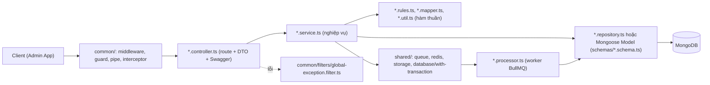
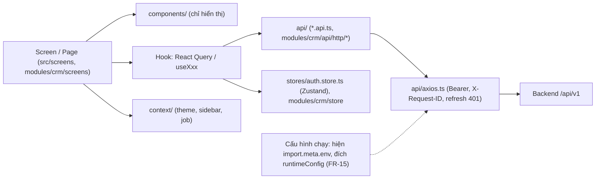

# Sơ đồ cấu trúc thư mục Backend, Frontend và cách quy hoạch (v1.0.6)

> **Phiên bản tài liệu:** v1.0.6

> Ngày tạo: 2026-11-13
> Module: Hạ tầng & vận hành (Infrastructure)
> Trạng thái: Draft
> Author: architect-agent
> Nguồn: đọc trực tiếp cây thư mục `RealEstateBackendApp/`, `RealEstateAdminApp/` và gốc repo (2026-11-13); Plan `07_Thong_Nhat_Moi_Truong_Plan.md` (Approved) mục 2.1 đến 2.4 (FR-01..FR-26).

Tài liệu giúp người mới trả lời ba câu: **file nào nằm ở đâu**, **vì sao đặt ở đó**, **thêm tính năng thì tạo file nào**.

## Cách đọc tài liệu này

| Nhãn | Nghĩa |
|---|---|
| **HIỆN TRẠNG** | Đã kiểm bằng cách đọc repo ngày 2026-11-13. Mọi đường dẫn gắn nhãn này tồn tại thật. |
| **ĐÍCH v1.0.6** | Theo Plan 07, **chưa làm**. Đường dẫn đích có thể chưa tồn tại. Mã `FR-xx` cho biết yêu cầu nào đòi đổi. |
| **architect sẽ chốt ở Architecture** | Plan chưa đủ chi tiết, tài liệu này không tự quyết. |

Ngoài phạm vi: `RealEstateApp/` (mobile, không đụng) và `stnd-crm-unified/` (prototype giao diện, giữ nguyên, không thuộc build/deploy; FR-13).

Mục lục: 1 Gốc repo · 2 Backend · 3 Frontend · 4 Hiện trạng và đích v1.0.6 · 5 Quy tắc khi thêm file mới · 6 Điểm Plan chưa rõ và chỗ hiện trạng lệch Plan.

---

## 1. Tổng quan gốc repo

### 1.1 HIỆN TRẠNG

```text
RealEstateManager/
├── RealEstateBackendApp/      # Backend NestJS (mục 2)
├── RealEstateAdminApp/        # Frontend React + Vite (mục 3)
├── RealEstateApp/             # Mobile (ngoài phạm vi, không đụng)
├── stnd-crm-unified/          # Prototype giao diện (ngoài phạm vi, giữ nguyên)
├── docs/                      # Tài liệu, chia theo NN_Tên_Module (mục 1.3)
├── scripts/                   # Chỉ còn script migration (sau FR-02, v1.0.6)
│   ├── run-migration.sh
│   └── post-migrate/          #   10-catalog-codes.sh, 20-customer-codes.sh, 90-post-up-migrations.sh
├── ops/                       # Công cụ vận hành phụ (sau FR-02, v1.0.6)
│   ├── lib/                   #   ops-common.sh: hàm dùng chung cho các script
│   ├── staging/               #   tài liệu + script diễn tập staging local (đã lỗi thời, gỡ ở T-46)
│   ├── tests/                 #   *.test.sh: test cho các script bash
│   └── check-disk.sh, print-image-digests.sh, verify-env.sh, install-release.sh, staging.sh
├── release.sh                 # Dựng image một lần (build) và gửi gói + image lên VPS (send) (FR-14, v1.0.6)
├── deploy.sh, backup.sh, restore.sh  # Script vận hành ở gốc (sau FR-01, v1.0.6); chạy trên VPS, không build, không dùng git
├── docker-compose.yml         # Stack chạy thật: backend, frontend, mongo, redis, minio, ...; dùng image dựng sẵn (FR-17)
├── docker-compose.dev.yml, docker-compose.dev-watch.yml  # Lớp phủ cho máy dev (FR-17); luôn dùng kèm docker-compose.yml
├── docker-compose.staging.yml # Staging local (đã lỗi thời, gỡ ở T-46)
├── .env.example               # Mẫu duy nhất của file `.env` (không commit); thay `.env.docker.example` (FR-18)
├── .env.staging.example       # Mẫu biến môi trường staging local (đã lỗi thời, gỡ ở T-46)
├── README.md                  # Điểm vào repo (FR-13): giới thiệu, chạy dev, build/deploy (`release.sh`), quy ước đồng bộ prototype
├── CHANGELOG.md               # Lịch sử phiên bản
├── .gitignore, .gitattributes
├── skills-lock.json           # File công cụ AI, đang bị git theo dõi (FR-05 sẽ gỡ khỏi index)
└── .claude/ .agents/ .gemini/ .archify/ .ua/ .worktrees/ .staging/
                               # Thư mục công cụ/AI/staging cục bộ, không thuộc sản phẩm
```

Lưu ý: có **hai** thư mục tên `scripts/`: một ở gốc repo (vận hành, bash) và một trong `RealEstateBackendApp/` (migration cũ `002..006` + `import-care-data.mjs`). Đừng nhầm.

### 1.2 ĐÍCH v1.0.6 (theo Plan, FR-01, FR-02, FR-14..FR-17, FR-24..FR-26)

```text
RealEstateManager/
├── deploy.sh  backup.sh  restore.sh   # FR-01: ba script chính cùng ở gốc
├── <script build + chuyển image>      # FR-14: tên do architect chốt ở Architecture
├── ops/                               # FR-02: phần phụ trợ
│   ├── lib/ops-common.sh
│   ├── tests/*.test.sh
│   ├── check-disk.sh  print-image-digests.sh
│   └── staging.sh  staging/           #   chỉ tới khi FR-26 gỡ staging local
├── scripts/                           # FR-02: chỉ còn run-migration.sh và post-migrate/*
├── .github/workflows/                 # FR-24, FR-25: CI/CD (GitHub Actions)
├── docker-compose.yml                 # FR-17: một compose gốc dùng chung, override mỏng cho dev
├── .env.example                       # FR-18: đúng một mẫu, một .env duy nhất (không commit)
└── docs/ ...
```

Bị gỡ theo Plan: `docker-compose.staging.yml`, `.env.staging.example`, `.env.docker.example` (gộp vào `.env.example`), `.staging/`, `ops/staging*` (FR-18, FR-26).
Chưa rõ: tên file override compose cho dev, tên script build/chuyển image, cách đóng gói "gói release" gửi lên VPS (FR-14, FR-17, FR-25): **architect sẽ chốt ở Architecture**.

### 1.3 Thư mục `docs/` (HIỆN TRẠNG)

| Thư mục | Chứa |
|---|---|
| `docs/00_Project_Overview/` | Plan tổng, thiết kế kỹ thuật tổng |
| `docs/01_Infrastructure/` | Hạ tầng: backend, DB, log, deploy, thống nhất môi trường, sơ đồ (tài liệu này) |
| `docs/02_Module_Auth/` .. `docs/05_Module_Market_Analysis/` | Plan + Architecture từng module nghiệp vụ |
| `docs/06_Module_Customer_Management/` | CRM: plan, thiết kế giao diện, design system, API, kiểm thử, các đợt bổ sung |
| `docs/07_Frontend_Mobile/` | Tài liệu app mobile |
| `docs/08_Quan_Ly_Phien_Ban/` | Kế hoạch và checklist theo phiên bản |
| `docs/_templates/` | Mẫu Plan / Architecture / Tasks cho bộ `/spec-*` |
| `docs/archive/` | Tài liệu hết hiệu lực |

Quy ước: file `NN_Tên_Không_Dấu.md`, `NN` là số thứ tự trong thư mục; mỗi thư mục có `README.md` làm mục lục.

---

## 2. Backend (`RealEstateBackendApp/`)

NestJS 11 chạy trên **Fastify**, MongoDB qua Mongoose, hàng đợi BullMQ (Redis), lưu file qua S3/MinIO. Mọi route có tiền tố `/api/v1` (đặt trong `src/main.ts`).

### 2.1 Nguyên tắc quy hoạch

1. **Chia theo module nghiệp vụ, không chia theo loại file.** Mọi thứ của một tính năng (controller, service, dto, schema, test) nằm cùng một thư mục `src/modules/<tên>/`. Không có thư mục `controllers/` hay `services/` toàn cục.
2. **Ba tầng đặt code, theo mức độ dùng chung:**
   - `src/modules/<module>/`: chỉ của một tính năng.
   - `src/common/`: thứ **cắt ngang** mọi module, không có kết nối hạ tầng riêng (filter, guard, pipe, decorator, logger, DTO phân trang, util thuần).
   - `src/shared/`: **module hạ tầng dùng chung** có provider/kết nối (Redis, hàng đợi, lưu trữ file, bộ đếm, cờ tính năng, tiện ích transaction).
3. **Một file một việc.** Controller chỉ nhận request và trả response; service giữ nghiệp vụ; schema chỉ mô tả dữ liệu; DTO chỉ validate đầu vào/định hình đầu ra. Logic thuần (không I/O) tách ra `*.rules.ts`, `*.mapper.ts`, `*.util.ts` để test dễ.
4. **Module lớn thì chia module con.** `modules/crm/` là module tổng, mỗi tính năng con (`customers`, `care-logs`, `appointments`, ...) là một module Nest riêng, gom lại ở `crm.module.ts`.
5. **Test nằm cạnh code** (`x.service.ts` và `x.service.spec.ts` cùng thư mục). Test cần DB thật đặt tên `*.integration.spec.ts`, chạy riêng.
6. **Migration dữ liệu có chỗ riêng** (mục 2.6), không trộn vào service nghiệp vụ.

### 2.2 Cây thư mục (HIỆN TRẠNG)

```text
RealEstateBackendApp/
├── src/
│   ├── main.ts                  # Khởi động: Fastify, prefix api/v1, helmet, cookie, CORS, ValidationPipe, Swagger
│   ├── app.module.ts            # Module gốc: gom mọi module + cấu hình Mongoose/Config
│   ├── app.controller.ts, app.service.ts (+ .spec)   # Mẫu "Hello World" (FR-05 sẽ xóa)
│   ├── health/                  # health.controller.ts, health.module.ts (+ .spec), redis.health-indicator.ts, storage.health-indicator.ts; probe /health/liveness, /health/readiness (thực tế là `/api/v1/health/...`, mục 7 của doc 06)
│   ├── common/                  # Cắt ngang (mục 2.3)
│   │   ├── decorators/  dto/  enums/  exceptions/  filters/
│   │   ├── guards/  logger/  middleware/  pipes/
│   │   ├── security/  services/  swagger/  utils/
│   │   └── http-foundation.integration.spec.ts
│   ├── shared/                  # Module hạ tầng dùng chung (mục 2.3)
│   │   ├── shared.module.ts
│   │   ├── ai-provider/  counters/  database/  feature-flags/
│   │   ├── queue/  redis/  storage/
│   │   └── foundation.integration.spec.ts
│   ├── migrations/              # Bộ chạy migration + registry + versions/ (mục 2.6)
│   │   ├── versions/            #   007_*.ts .. 011_*.ts
│   │   └── baseline-probes/     #   probe-00x-*.ts kiểm trạng thái DB cũ
│   ├── utils/                   # article-extractor.util.ts, content-cleaner.ts, cosine-similarity.util.ts (+ .spec)
│   └── modules/                 # Module nghiệp vụ (mục 2.4)
│       ├── auth/  users/  teams/  settings/  notifications/
│       ├── external-log/  google-drive-export/  knowledge-articles/
│       ├── news-fire-crawl-manager/
│       └── crm/                 # Module tổng CRM, nhiều module con
│           ├── crm.module.ts
│           ├── appointments/  audit-logs/  bulk-operations/  care-logs/  care-teams/
│           ├── catalogs/  crm-settings/  customers/  persona/  projects/
│           ├── reminders/  seed/  tags/
│           ├── common/          #   access/ crypto/ security/ utils/ + crm-common.module.ts
│           └── crm-*.integration.spec.ts   # 26 file test tích hợp xếp ngay gốc crm/ (FR-08 sẽ gom lại)
├── scripts/                     # Của riêng BE: migration cũ + import dữ liệu (mục 2.6)
│   ├── migrations/              #   002..006_*.ts (chạy tay bằng ts-node, qua scripts/run-migration.sh ở gốc repo)
│   └── import-care-data.mjs
├── test/                        # Mẫu e2e "Hello World" của Nest (FR-05 sẽ xóa)
├── Dockerfile                   # 3 stage: deps, builder, production (chạy dist/main)
├── docker-compose.dev.yml       # Hạ tầng dev: Mongo replica set, Redis, MinIO
├── nest-cli.json                # Builder swc; copy modules/news-fire-crawl-manager/constants/*.json vào dist
├── tsconfig.json, tsconfig.build.json   # build loại *.spec.ts và *.fixture.ts
├── eslint.config.mjs, .prettierrc, .dockerignore
├── .env, .env.example           # Biến môi trường (.env thật không commit)
├── package.json, package-lock.json, README.md
└── (file sinh ra, không commit: dist/ coverage/ logs/ tmp/ node_modules/ .e2e-dist/)
```

Ngoài ra ở gốc BE còn một số file chết sẽ bị xóa (FR-05): `add_description.py`, `add_query_param.py`, `add_swagger.py`, `fix_dto.py`, `test-extractor.ts`, `test-rss.js`, `start.log`.

### 2.3 Mỗi thư mục chứa gì (HIỆN TRẠNG)

| Thư mục | Lưu file gì | Ghi chú quy hoạch |
|---|---|---|
| `src/main.ts`, `src/app.module.ts` | Điểm khởi động và module gốc | Chỉ lắp ráp, không viết nghiệp vụ |
| `src/health*` | `health.controller.ts`, `health.module.ts`, `health-indicators/*.health-indicator.ts` | Dùng `@nestjs/terminus`; FR-08 đã gom vào `src/health/` (file phẳng, không còn `health-indicators/`) |
| `common/decorators/` | `*.decorator.ts`: `@Public`, `@Roles`, `@CurrentUser`, decorator validate (`trim`, `to-boolean`, ...) | Dùng cho mọi module |
| `common/dto/` | `pagination-query.dto.ts`, `paginated-response.dto.ts`, `ref.dto.ts` | Chuẩn `{ data, meta }` cho danh sách |
| `common/enums/` | `user-role.enum.ts`, `user-status.enum.ts` | Enum dùng chéo module |
| `common/exceptions/` | `business.exception.ts`, `error-codes.ts` | Lỗi nghiệp vụ và mã lỗi chuẩn |
| `common/filters/` | `global-exception.filter.ts` | Chuẩn lỗi `{ statusCode, message, timestamp, path }` |
| `common/guards/` | `jwt-auth.guard.ts`, `roles.guard.ts`, `crm-feature.guard.ts`, `*.audit.spec.ts` | `*.audit.spec.ts` là test "kiểm toán" quét mã nguồn mọi controller để bảo đảm khai báo quyền |
| `common/logger/` | `custom-logger.service.ts`, `winston.config.ts`, `pii-redactor.util.ts` | Log JSON qua Winston, che dữ liệu cá nhân |
| `common/middleware/` | `request-context.middleware.ts` | Gắn `X-Request-ID` vào ngữ cảnh log |
| `common/pipes/` | `parse-object-id.pipe.ts` | |
| `common/security/` | `helmet.config.ts`, `trust-proxy.config.ts`, `nosql-operator.interceptor.ts` | Cấu hình bảo mật + chặn NoSQL injection |
| `common/services/` | `idempotency.service.ts`, `request-context.service.ts` | Service dùng chéo, không có kết nối riêng |
| `common/swagger/` | `swagger.config.ts` | Dựng Swagger |
| `common/utils/` | `*.util.ts`: phân trang, múi giờ, regex, `with-timeout`, `url-hash`, ... | Hàm thuần, có `*.spec.ts` kèm |
| `shared/redis/` | `redis.module.ts`, `redis.config.ts`, `redis.constants.ts`, `redis-client.fixture.ts` | Kết nối Redis |
| `shared/queue/` | `queue.module.ts`, `queue-runtime.*`, `queue.constants.ts`, `health-ping.processor.ts` | Nền tảng BullMQ; processor của từng tính năng nằm trong module đó |
| `shared/storage/` | `storage.module.ts`, `file-storage.service.ts`, `file-storage.interface.ts`, `file-validation.ts`, `s3.config.ts` | Lưu file lên S3/MinIO, kiểm loại file |
| `shared/database/` | `with-transaction.util.ts`, `after-commit.util.ts`, `memory-replset.util.ts` | Tiện ích transaction; `memory-replset.util.ts` là helper test (FR-07 sẽ đổi tên/loại khỏi build) |
| `shared/counters/` | `counter.schema.ts`, `counter.service.ts`, `counters.module.ts` | Bộ đếm sinh mã tuần tự |
| `shared/feature-flags/` | `feature-flag.module.ts`, `feature-flag.service.ts` | Đọc cờ tính năng |
| `shared/ai-provider/` | `unified-ai.service.ts` | Gọi nhà cung cấp AI |
| `utils/` | `article-extractor.util.ts`, `cosine-similarity.util.ts`, `content-cleaner.ts` | Util chỉ news dùng nhưng đang nằm ở gốc (FR-06, FR-08 sẽ dọn) |
| `modules/<module>/` | Xem mục 2.4 | Đơn vị chính của hệ thống |

### 2.4 Module nghiệp vụ

#### 2.4.1 Quy ước đặt tên file BE

Chuẩn NestJS `tên-chức-năng.loại.ts`, kebab-case.

| Hậu tố | Loại file | Ví dụ có thật |
|---|---|---|
| `.module.ts` | Module Nest | `customers.module.ts` |
| `.controller.ts` | Controller (route, Swagger) | `customers.controller.ts` |
| `.service.ts` | Service nghiệp vụ | `customer-list.service.ts` |
| `.repository.ts` | Truy cập dữ liệu (chỉ khi cần tách; hiện chỉ có ở `customers`) | `customers.repository.ts` |
| `.schema.ts` | Schema Mongoose (index khai báo tại đây) | `schemas/customer.schema.ts` |
| `.dto.ts` | DTO request/response, đặt trong `dtos/` | `dtos/customer-request.dto.ts` |
| `.mapper.ts` | Chuyển document sang DTO phản hồi | `customer.mapper.ts` |
| `.rules.ts` | Quy tắc nghiệp vụ thuần (không I/O) | `care-team.rules.ts` |
| `.constants.ts` | Hằng số của module | `customer.constants.ts` |
| `.errors.ts` | Mã/loại lỗi riêng của module | `customer.errors.ts` |
| `.util.ts` | Hàm tiện ích thuần của module, đặt trong `utils/` | `utils/customer-search.util.ts` |
| `.processor.ts` | Worker BullMQ | `attachment-thumbnail.processor.ts` |
| `.guard.ts`, `.interceptor.ts`, `.filter.ts`, `.pipe.ts`, `.middleware.ts`, `.decorator.ts` | Thành phần cắt ngang (thường ở `common/`) | `jwt-auth.guard.ts` |
| `.config.ts` | Cấu hình dựng từ env | `helmet.config.ts` |
| `.cli.ts` | Điểm vào chạy từ dòng lệnh | `migrations/crm-catalog-codes.cli.ts` |
| `.spec.ts` | Unit test | `customers.service.spec.ts` |
| `.integration.spec.ts` | Test tích hợp (DB thật) | `customers.service.counter.integration.spec.ts` |
| `.fixture.ts` | Dữ liệu/helper phục vụ test, không vào bản build | `migrations/fake-mongo.fixture.ts` |

Quy ước tên: lớp PascalCase (`CustomersService`), biến/hàm camelCase, route số nhiều chữ thường, không động từ trên URL.

#### 2.4.2 Module mẫu: `modules/crm/customers/` (HIỆN TRẠNG, rút gọn)

```text
modules/crm/customers/
├── customers.module.ts            # Khai báo: import schema/module khác, controllers, providers, exports
├── customers.controller.ts        # Route /crm/customers: validate DTO, gọi service, gắn Swagger + guard
├── customers.service.ts           # Nghiệp vụ chính của khách hàng
├── customer-list.service.ts       # Tách riêng nghiệp vụ liệt kê/lọc (mỗi service một việc)
├── customer-lifecycle.service.ts  # Vòng đời: khôi phục (restore), ẩn danh hóa (anonymize)
├── customers.repository.ts        # Truy vấn Mongoose tập trung (chỉ module này tách repository)
├── customer.mapper.ts             # Document -> DTO phản hồi (không trả nguyên document ra API)
├── customer.constants.ts          # Hằng số
├── customer.errors.ts             # Lỗi nghiệp vụ của module
├── dtos/
│   ├── customer-request.dto.ts    #   Đầu vào (class-validator + @ApiProperty)
│   ├── customer-query.dto.ts      #   Tham số truy vấn danh sách
│   └── customer-response.dto.ts   #   Đầu ra
├── schemas/
│   └── customer.schema.ts         # Schema + index + deletedAt (soft delete)
├── access/                        # Quyền theo phạm vi dữ liệu (customer-scope.ts, customer-access.service.ts)
├── utils/                         # Hàm thuần: customer-search.util.ts, customer-audit.util.ts, ...
└── *.spec.ts                      # Unit test cạnh file (vd customers.service.spec.ts, customer.mapper.spec.ts)
    *.integration.spec.ts          # Test tích hợp (vd customers.service.counter.integration.spec.ts)
```

Module nhỏ hơn để so sánh, `modules/crm/tags/`: `tags.module.ts`, `tags.controller.ts`, `tags.service.ts`, `tag.rules.ts`, `tag.constants.ts`, `dtos/tag.dto.ts`, `schemas/tag.schema.ts`. Service dùng thẳng Mongoose `Model` khi chưa cần repository.

#### 2.4.3 Các module trong `src/modules/` (HIỆN TRẠNG)

| Module | Vai trò | Có gì đáng chú ý |
|---|---|---|
| `auth/` | Đăng nhập, refresh token, đăng xuất | `schemas/refresh-token.schema.ts`, `auth-throttle.config.ts` |
| `users/` | Người dùng, vai trò | `users/migrations/` giữ logic backfill vai trò/nhóm |
| `teams/` | Nhóm, thành viên nhóm | `team-membership.util.ts` |
| `settings/` | Cấu hình hệ thống | |
| `notifications/` | Hộp thông báo + push | `push/` (provider, queue, sweep, subscription), `schemas/` |
| `external-log/` | Log gọi dịch vụ bên ngoài | `controllers/`, `services/`, `schemas/`, `dtos/` |
| `google-drive-export/` | Xuất lên Google Drive | |
| `knowledge-articles/` | Bài viết tri thức | `types/` chứa kiểu trạng thái pipeline |
| `news-fire-crawl-manager/` | Thu thập, lọc, phân tích, đăng tin | Chia `controllers/ services/ schemas/ dtos/ types/ constants/` (`constants/ai-prompts.json` được copy vào dist) |
| `crm/` | CRM: khách hàng, chăm sóc, lịch hẹn, ... | Module tổng + 13 module con + `common/` riêng |

`crm/common/` là chỗ dùng chung **trong CRM**: `access/` (guard + actor), `crypto/` (mã hóa dữ liệu cá nhân), `security/` (rate limit, giám sát lạm dụng), `utils/`, `idempotency.helper.ts`.

### 2.5 Test BE: đặt ở đâu, chạy thế nào (HIỆN TRẠNG)

| Loại | Vị trí | Hậu tố | Lệnh | Ai viết |
|---|---|---|---|---|
| Unit | Cạnh file được test | `*.spec.ts` | `npm test` | Coder |
| Tích hợp (Mongo replica set trong bộ nhớ) | Cạnh module; riêng CRM đang xếp ở gốc `modules/crm/` | `*.integration.spec.ts` | `npm run test:integration` | QA |
| Hiệu năng | `modules/crm/crm-m2-perf.integration.spec.ts` | | `npm run test:perf` | QA |
| E2E "Hello World" mẫu | `test/` | `*.e2e-spec.ts` | `npm run test:e2e` | (FR-05 sẽ xóa) |

`npm test` **bỏ qua** `*.integration.spec.ts` (cấu hình `testPathIgnorePatterns` trong `package.json`); `rootDir` của Jest là `src`. Test UI đầu-cuối của cả hệ thống nằm ở `RealEstateAdminApp/e2e/` (mục 3.6). Tại thời điểm đọc có 281 file `*.spec.ts`, trong đó 62 file `*.integration.spec.ts`.

### 2.6 Nơi đặt migration dữ liệu (HIỆN TRẠNG)

| Nơi | Chứa | Cách chạy |
|---|---|---|
| `scripts/migrations/002..006_*.ts` (trong BE) | Migration **cũ**, đã chạy tay trên production | `ts-node` qua `scripts/run-migration.sh` (gốc repo) |
| `src/migrations/` | Bộ chạy (`migration-runner.ts`, `migration-state.ts`, `reconcile-plan.ts`), registry (`migration.registry.ts`), `cli.ts` | Biên dịch vào `dist`, chạy `dist/migrations/cli.js` |
| `src/migrations/versions/007..011_*.ts` | Mỗi file là **một migration**, khai báo trong `migration.registry.ts` theo thứ tự số | Do runner gọi |
| `src/migrations/baseline-probes/` | `probe-00x-*.ts` kiểm DB đã ở trạng thái nào | Do `baseline` gọi |
| `modules/crm/catalogs/migrations/`, `modules/users/migrations/` | **Logic** migration thuộc nghiệp vụ module đó; file trong `versions/` import vào | Gián tiếp qua `versions/` |

Quy tắc: migration mới là file `NNN_ten_migration.ts` trong `src/migrations/versions/` (số tiếp theo), nối vào mảng `MIGRATIONS`; thay đổi schema phải tương thích ngược (không xóa/sửa field đột ngột).

### 2.7 Sơ đồ phụ thuộc giữa các lớp BE



Chiều phụ thuộc chỉ đi **xuống**: controller gọi service, service gọi repository/model và `shared/`; `common/` và `shared/` không import ngược module nghiệp vụ. Module cần dùng service của module khác thì qua `exports` của module đó, không import chéo file.

---

## 3. Frontend (`RealEstateAdminApp/`)

React 19 + TypeScript + Vite, Tailwind CSS 4 (qua plugin `@tailwindcss/vite`, cấu hình ngay trong `src/index.css`, không có `tailwind.config`), React Query cho dữ liệu máy chủ, Zustand cho state toàn cục, PWA (service worker tự viết). Hai phần giao diện cùng sống trong một app: **tin tức/quản trị** (cũ, gốc `src/`) và **CRM** (`src/modules/crm/`).

### 3.1 Nguyên tắc quy hoạch

1. **Phân lớp theo vai trò**, tầng trên chỉ gọi tầng dưới: `screen (trang)` → `hook` → `api` → backend. Component chỉ hiển thị, không gọi API trực tiếp.
2. **Dữ liệu máy chủ dùng React Query**, state toàn cục dùng Zustand, state cục bộ dùng `useState`. Không gọi API bằng `useEffect`.
3. **Module nghiệp vụ tự chứa**: CRM gom mọi thứ của nó dưới `src/modules/crm/` (api, components, hooks, lib, store, screens, types, test) và import bằng alias `@crm/*`. Phần gốc `src/` là phần dùng chung và phần tin tức cũ.
4. **Một màn hình một thư mục** (CRM): `screens/<Tên>/` chứa `index.tsx`, biến thể `*.desktop.tsx` / `*.mobile.tsx`, hook riêng của màn (`useXxx.ts`), `components/` chỉ dùng cho màn đó.
5. **Test nằm cạnh file** (`X.tsx` và `X.test.tsx`); đầu-cuối ở `e2e/`.
6. **Cấu hình chạy đọc ở một chỗ**: hiện còn rải rác (mục 3.5); đích là một module `runtimeConfig` (FR-15).

### 3.2 Cây thư mục (HIỆN TRẠNG)

```text
RealEstateAdminApp/
├── src/
│   ├── main.tsx                 # Điểm vào: QueryClientProvider, ThemeProvider, Toaster, PWA prompt
│   ├── App.tsx                  # Bảng route, RoleGuard, ProtectedRoute, nối route CRM
│   ├── queryClient.ts           # Cấu hình React Query dùng chung
│   ├── index.css                # Tailwind (@import "tailwindcss") + kiểu chung
│   ├── svg.d.ts, vite-env.d.ts  # Khai báo kiểu
│   ├── api/                     # Gọi backend phần chung: axios, auth, users (API tin tức ở modules/news/api)
│   ├── components/
│   │   ├── auth/                #   ProtectedRoute, RoleGuard, AuthInitializer, HomeIndex
│   │   ├── common/              #   PageMeta, Pagination, TableSkeletonRows, ThemeToggleButton, ...
│   │   ├── header/              #   NotificationDropdown, UserDropdown, ...
│   │   ├── ui/                  #   Thành phần nền: DatePicker, dropdown/, modal/, ...
│   │   └── users/               #   EditUserModal, userFormSchemas
│   ├── context/                 # React Context dùng chung: Theme, Sidebar (Provider tin tức ở modules/news/context)
│   ├── hooks/                   # Hook dùng chung: useAuth, useDebouncedValue, ...
│   ├── icons/                   # *.svg + index.ts (xuất icon dạng component qua `?react`)
│   ├── images/logo/             # Logo ảnh tĩnh
│   ├── assets/                  # Ảnh mẫu Vite (không dùng)
│   ├── layout/                  # AppLayout, AppHeader, AppSidebar, Backdrop
│   ├── pwa/                     # Service worker + đăng ký + toast cập nhật + push
│   ├── screens/                 # LoginScreen, UserManagementScreen (màn tin tức ở modules/news/screens)
│   ├── stores/                  # Zustand: auth.store.ts
│   ├── test/setup.ts            # Thiết lập Vitest (jsdom)
│   ├── types/                   # pagination.ts, user.ts
│   ├── utils/                   # fetchPaginated.ts, userRoles.ts
│   └── modules/
│       ├── crm/                 # Module CRM (mục 3.4), alias @crm
│       └── news/                # Module tin tức/crawl, alias @news: screens/ api/ context/ hooks/ components/google-drive/
├── public/                      # Tài nguyên tĩnh copy nguyên vào bản build
│   ├── offline.html             #   Trang hiện khi mất mạng (service worker dùng)
│   ├── favicon-*.png, apple-touch-icon.png
│   └── pwa-192x192.png, pwa-512x512.png, pwa-maskable-512x512.png
├── e2e/                         # Playwright (mục 3.6)
├── scripts/generate-pwa-icons.mjs   # Sinh icon PWA từ ảnh gốc
├── index.html                   # Khung HTML, nạp /src/main.tsx
├── vite.config.ts               # Plugin: react, tailwind, svgr, PWA (injectManifest); alias @crm, @news; proxy /api; cấu hình Vitest
├── tsconfig.json                # Chỉ tham chiếu 3 file dưới
│   ├── tsconfig.app.json        #   Kiểm kiểu mã trình duyệt (paths @crm/*, @news/*)
│   ├── tsconfig.node.json       #   Kiểm kiểu file cấu hình
│   └── tsconfig.sw.json         #   Kiểm kiểu service worker (WebWorker, không DOM)
├── Dockerfile                   # 2 stage: build Vite, rồi nginx phục vụ file tĩnh
├── nginx.conf                   # Cấu hình nginx: phục vụ SPA + proxy /api/ về backend
├── nginx-security-headers.conf  # Snippet header bảo mật (include ở server và từng location có add_header; image chép vào /etc/nginx/snippets/)
├── .oxlintrc.json, .nvmrc, .dockerignore
├── .env, .env.example           # Biến VITE_* (build-time; .env thật không commit)
├── package.json, package-lock.json, README.md
└── (file sinh ra, không commit: dist/ playwright-report/ test-results/ node_modules/)
```

### 3.3 Mỗi thư mục chứa gì (HIỆN TRẠNG)

| Thư mục | Lưu file gì | Quy ước |
|---|---|---|
| `src/api/` | `axios.ts` (instance dùng chung: gắn Bearer token, `X-Request-ID`, tự refresh khi 401), `auth.api.ts`, `users.api.ts`; các `*.api.ts` của tin tức (`news-manager`, `knowledge-articles`, `settings`, `google-drive`) nằm ở `src/modules/news/api/` | Một file một nhóm endpoint, đặt tên `<nhóm>.api.ts`; chỉ hàm gọi HTTP, không chứa JSX |
| `src/components/` | Component dùng chung nhiều màn, chia thư mục theo vùng (`auth`, `common`, `header`, `ui`, ...) | File `PascalCase.tsx`; component thuần hiển thị, nhận dữ liệu qua props |
| `src/components/ui/` | Thành phần nền (modal, dropdown, date picker) | Không biết nghiệp vụ |
| `src/context/` | `ThemeContext.tsx`, `SidebarContext.tsx` (Context + Provider + hook `useXxx` trong cùng file); Provider job tin tức và GoogleDriveAuth nằm ở `src/modules/news/context/` | Chỉ cho state "môi trường" (theme, sidebar, job đang chạy), không dùng cho dữ liệu máy chủ |
| `src/hooks/` | `useXxx.ts` dùng chung | Tên bắt đầu bằng `use`, boolean đặt `is/has/should` |
| `src/stores/` | `xxx.store.ts` (Zustand) | State toàn cục thật sự; hiện chỉ `auth.store.ts` (access token lưu RAM, refresh token ở cookie httpOnly) |
| `src/screens/` | `LoginScreen.tsx`, `UserManagementScreen.tsx` (+ test); 12 màn tin tức/quản trị nằm ở `src/modules/news/screens/` | Màn gọi `api/*.api.ts` qua React Query, ghép component |
| `src/modules/news/` | Module tin tức/crawl (alias `@news`): `screens/` (12 màn + test), `api/` (4 file `*.api.ts`), `context/` (7 Context/Provider), `hooks/useHeaderStatusReset.ts`, `components/google-drive/` | `news` không bao giờ import `layout`; shell (`App.tsx`, `layout/AppLayout`, `AppHeader`) được import `@news/*` |
| `src/layout/` | Khung trang: `AppLayout` (bọc các Provider), header, sidebar | |
| `src/pwa/` | `sw.ts` (service worker), `registerServiceWorker.ts`, `pushClient.ts`, `PwaUpdatePrompt.tsx`, `IosInstallHint.tsx`, `RouteErrorBoundary.tsx`, ... | `sw.ts` kiểm kiểu bằng `tsconfig.sw.json` (loại khỏi `tsconfig.app.json`) |
| `src/types/` | Kiểu dùng chéo: `user.ts`, `pagination.ts` | Chỉ `type`/`interface`, không logic |
| `src/utils/` | Hàm thuần dùng chung: `fetchPaginated.ts`, `userRoles.ts` | |
| `src/icons/` | `*.svg` + `index.ts` | Import dạng `?react` qua `vite-plugin-svgr` |
| `src/test/` | `setup.ts` cho Vitest | |
| `public/` | Ảnh icon PWA, `offline.html` | Copy nguyên ra gốc bản build; **không** import từ code |
| `e2e/` | Test Playwright + hạ tầng chạy thử | Mục 3.6 |

### 3.4 Module CRM: `src/modules/crm/` (HIỆN TRẠNG)

```text
modules/crm/
├── CrmLayout.tsx, crmRoute.tsx, routes.ts, navigation.ts   # Nối route /crm/*, ánh xạ màn <-> URL (+ .test)
├── api/                       # Lớp truy cập dữ liệu CRM, UI chỉ import từ api/index.ts
│   ├── index.ts               #   Cổng xuất duy nhất
│   ├── hooks.ts, queries.ts   #   React Query hook (đọc dữ liệu: cache, loading, lỗi)
│   ├── httpCrmApi.ts          #   Hàm ghi (mutation) gọi API thật
│   ├── http/                  #   Client theo nhóm: customerApi, careApi, schedulingApi, catalogApi, adminApi, pushApi, crmHttp (bọc axios, Idempotency-Key), crmErrors, mappers, dto.ts
│   ├── dashboard.ts, exports.ts, access.ts, types.ts
│   └── mockCrmApi.ts, mockHooks.ts   # Còn mock cho báo cáo, nhập/xuất (có cờ)
├── screens/                   # Mỗi màn một thư mục: Customers, CustomerDetail, CreateCustomer, Appointments, ...
│   ├── createResponsiveScreen.tsx, ScreenSkeleton.tsx   # Chọn biến thể desktop/mobile, lazy-load
│   └── Customers/             #   Ví dụ một màn
│       ├── index.tsx          #     Cổng: createResponsiveScreen({ desktop, mobile })
│       ├── Customers.desktop.tsx, Customers.mobile.tsx
│       ├── useCustomerListScreen.ts      # Hook riêng của màn
│       ├── customerListHelpers.ts        # Hàm thuần riêng của màn
│       ├── components/        #     Component chỉ màn này dùng (CustomerCard, CustomerToolbar, ...)
│       └── *.test.tsx         #     Test cạnh file
├── components/                # Component dùng chung trong CRM (modal, dialog, form/ ...)
│   └── form/                  #   TextInput, SelectInput, FormField, ...
├── hooks/                     # Hook dùng chung trong CRM (useIsMobile, useFocusTrap, usePushSubscription, ...)
├── lib/                       # Hàm thuần nghiệp vụ CRM (csv, customerRules, dateTime, adapters, ...)
├── store/                     # Store CRM: crmReducer, crmStore, CrmProvider, crmStorage (lưu cục bộ), selectors
├── config/featureFlags.ts     # Cờ bật/tắt CRM (đọc từ env, xem mục 3.5)
├── data/                      # Dữ liệu seed/mock
├── types/                     # app.ts, crm.ts
└── test/                      # Factory/fixture dùng cho test CRM
```

Luồng của một màn CRM: `screens/<Màn>/index.tsx` → hook (`api/hooks.ts` hoặc `useXxx.ts` của màn) → `api/http/*Api.ts` → `crmHttp.ts` → `api/axios.ts` → backend `/api/v1`. Dữ liệu nghiệp vụ lấy qua React Query; `store/` giữ phiên và bộ lọc.

### 3.5 Cấu hình chạy: hiện đọc ở đâu (HIỆN TRẠNG)

| Cấu hình | Đọc ở | Đọc lúc nào |
|---|---|---|
| Địa chỉ backend (`VITE_API_URL`) | `src/api/axios.ts` | **Lúc build** (Vite nhúng vào JS) |
| Cờ CRM (`VITE_CRM_*`, `VITE_FEATURE_CRM_*`) | `src/modules/crm/config/featureFlags.ts` | Lúc build; mặc định có nhánh theo `env.DEV` |
| Bật service worker | `src/pwa/registerServiceWorker.ts` (`import.meta.env.PROD`) | Lúc build |
| Proxy `/api` khi `vite dev` | `vite.config.ts` (`server.proxy`) | Chỉ dev |

Hệ quả: đổi cấu hình phải build lại image. Đích FR-15: đọc lúc chạy qua `/env.js` (xem mục 4.3).

### 3.6 Test FE: đặt ở đâu (HIỆN TRẠNG)

| Loại | Vị trí | Hậu tố | Lệnh | Ai viết |
|---|---|---|---|---|
| Unit/component (Vitest + jsdom) | Cạnh file | `*.test.ts`, `*.test.tsx` | `npm test` | Coder |
| E2E thật (Playwright, backend dựng riêng) | `e2e/specs/` (`f1-auth.spec.ts` .. `f12-*`, `smoke`, `vn-time`) | `*.spec.ts` | `npm run e2e` | QA |
| E2E mock (không cần backend) | `e2e/specs-mock/` | `*.mock.spec.ts` | `npm run e2e:mock` | QA |
| Hạ tầng E2E | `e2e/lib/`, `e2e/backend-build/`, `e2e/tools/`, `fixtures.ts`, `global-setup.ts`, `playwright*.config.ts` | | | QA |

Thiết lập Vitest nằm ngay trong `vite.config.ts` (khối `test`) và `src/test/setup.ts`; `e2e/**` bị loại khỏi Vitest. Tại thời điểm đọc có 202 file test trong `src/`.

### 3.7 Cấu hình build, PWA, Tailwind (HIỆN TRẠNG)

- **Vite** (`vite.config.ts`): plugin `react`, `tailwindcss`, `svgr`, `VitePWA`. Alias `@crm` → `src/modules/crm` (khai báo thêm ở `tsconfig.app.json` mục `paths`).
- **PWA**: service worker tự viết ở `src/pwa/sw.ts` (chiến lược `injectManifest`): chỉ cache vỏ app, điều hướng luôn đi mạng, mất mạng hiện `public/offline.html`, `/api/*` không qua service worker. Manifest sinh từ khối `manifest` trong `vite.config.ts`.
- **Tailwind 4**: nạp bằng `@import "tailwindcss"` đầu `src/index.css`; không có file cấu hình riêng.
- **Docker**: stage 1 build bằng Node, stage 2 `nginx` phục vụ `dist/` với `nginx.conf`.

### 3.8 Sơ đồ phụ thuộc giữa các lớp FE



Chiều phụ thuộc đi **xuống**: page → hook → api → axios. `components/` không import `api/`; dữ liệu đưa vào bằng props.

---

## 4. Hiện trạng và đích v1.0.6

Nguồn: Plan 07 mục 2.2 (Mảng C1 Backend, FR-05..FR-08), mục 2.3 (Mảng C2/C3 Frontend, FR-09..FR-13) và các FR cấu hình ảnh hưởng vị trí file (FR-15, FR-16, FR-18, FR-19). Phần "sau" là **ĐÍCH, chưa làm**. Mục nào có dấu **(chốt sau)** thì Plan chưa đủ chi tiết, architect sẽ chốt ở Architecture.

### 4.1 Backend

#### 4.1.1 Gốc `RealEstateBackendApp/` (FR-05)

```text
TRƯỚC (hiện trạng)                         SAU (đích)
RealEstateBackendApp/                      RealEstateBackendApp/
├── add_description.py                     (xóa)
├── add_query_param.py                     (xóa)
├── add_swagger.py                         (xóa)
├── fix_dto.py                             (xóa)
├── test-extractor.ts                      (xóa; bỏ dòng exclude trong tsconfig.build.json)
├── test-rss.js                            (xóa)
├── start.log                              (xóa; file sinh ra)
├── test/  (app.e2e-spec.ts, jest-e2e.json) (xóa; cùng script test:e2e)
├── scripts/                               ├── scripts/
│   ├── import-care-data.mjs               │   ├── import-care-data.mjs   (giữ)
│   └── migrations/ (002..006, backups/)   │   └── migrations/ (002..006) (xóa backups/, không nằm trong git)
└── src/app.controller.ts, app.service.ts  (xóa cùng 2 file spec; gỡ khỏi app.module.ts;
                                            sửa common/guards/role-coverage.audit.spec.ts nếu còn nhắc AppController)
```

Cũng trong FR-05: giữ gói `@mendable/firecrawl-js`; bỏ `skills-lock.json` khỏi git index (`git rm --cached`) ở **gốc repo**.
Chưa rõ **(chốt sau)**: sau khi xóa `test/`, các glob `test/**/*.ts` trong script `format`/`lint` của `package.json` và mục `exclude` có `"test"` ở `tsconfig.build.json` có dọn luôn không.

#### 4.1.2 File chết và file test-helper trong `src` (FR-06, FR-07)

```text
TRƯỚC                                                     SAU
src/modules/news-fire-crawl-manager/dtos/                 (xóa news-article.dto.ts + .spec.ts; FR-06)
    news-article.dto.ts (+ .spec.ts)
src/utils/content-cleaner.ts (+ .spec.ts)                 (xóa; FR-06)
src/modules/news-fire-crawl-manager/services/             (giữ firecrawl.service.ts + .spec.ts)

src/shared/database/memory-replset.util.ts                đổi thành *.fixture.ts HOẶC loại khỏi build (FR-07) (chốt sau)
src/modules/crm/care-logs/utils/thumbnail-test-images.ts  như trên; cập nhật import ở file test (FR-07)
```

Lý do FR-07: hai file này import `mongodb-memory-server` (devDependency) nhưng đang nằm lẫn trong mã chạy thật nên bị biên dịch vào `dist/`. Quan sát khi đọc repo: `tsconfig.build.json` **đã** loại `**/*.fixture.ts` khỏi build, nên đổi hậu tố sang `.fixture.ts` là đủ để ra khỏi `dist/` (đã có tiền lệ `src/shared/redis/redis-client.fixture.ts`). Hiện `memory-replset.util` được 55 file import (đa số là test tích hợp), `thumbnail-test-images` được 3 file import: số file phải sửa import lớn, cần `git mv` + sửa hàng loạt.

#### 4.1.3 Cấu trúc `src` (FR-08)

```text
TRƯỚC                                           SAU
src/                                            src/
├── health.controller.ts (+ .spec)              ├── health/
├── health.module.ts                            │   ├── health.controller.ts (+ .spec)
├── health-indicators/                          │   ├── health.module.ts
│   ├── redis.health-indicator.ts               │   └── health-indicators/ (hoặc phẳng) (chốt sau)
│   ├── storage.health-indicator.ts             │
│   └── health-indicators.spec.ts               │
├── utils/                                      (thư mục utils/ rỗng sau FR-06 và FR-08: suy ra sẽ bỏ)
│   ├── article-extractor.util.ts (+ .spec)     ├── modules/news-fire-crawl-manager/<thư mục con> (chốt sau)
│   ├── cosine-similarity.util.ts (+ .spec)     │   ├── article-extractor.util.ts (+ .spec)
│   └── content-cleaner.ts (FR-06: xóa)         │   └── cosine-similarity.util.ts (+ .spec)
└── modules/crm/                                └── modules/crm/
    ├── crm-m1.integration.spec.ts                  └── __integration__/
    ├── crm-m2.integration.spec.ts ...                  ├── crm-m1.integration.spec.ts
    └── (26 file crm-*.integration.spec.ts)             └── ... (gom cả nhóm)
```

Kèm FR-08: dọn mục `exclude` có `"client"` (thư mục không tồn tại) trong `tsconfig` (cả `tsconfig.json` và `tsconfig.build.json` hiện đều có).
Lưu ý cho người làm: các test tích hợp import bằng đường dẫn tương đối (ví dụ `./crm.module`, `./seed/crm-seed.service`), chuyển vào `__integration__/` thì phải đổi thành `../crm.module`, `../seed/...`. `npm run test:integration` lọc theo **hậu tố** nên vẫn chạy; riêng `test:perf` lọc theo tên file `crm-m2-perf`, tên giữ nguyên nên không ảnh hưởng.

#### 4.1.4 Cấu hình BE (FR-18, FR-19)

- File `.env` riêng trong `RealEstateBackendApp/` (`.env`, `.env.example`) bị gộp vào **một** `.env` ở gốc repo. `src/main.ts` hiện nạp bằng `import 'dotenv/config'`; cách BE chạy trên host (dev, test) tìm `.env` gốc: **(chốt sau)**.
- `common/swagger/swagger.config.ts` đọc cờ mới `CRM_SWAGGER_ENABLED` thay vì dựa `NODE_ENV` (sửa nhỏ + test). Cờ CRM đổi tên về `CRM_*` ở BE, FE, compose.
- `CRON_CONFIG_FILE` không còn bind-mount `./.env`: chuyển sang volume riêng hoặc lưu Mongo **(chốt sau)**.

### 4.2 Frontend: dọn file chết (FR-09, FR-10)

```text
TRƯỚC (hiện trạng)                                     SAU (đích)
src/assets/ {hero.png, react.svg, vite.svg}            (xóa cả 3; thư mục assets/ rỗng, suy ra bỏ)
src/images/logo/ {logo.png, logo -dark.png}            src/images/logo/ {logo.png, logo -dark.png}   (đã khôi phục: là tài nguyên dự phòng)
src/icons/ 57 file *.svg + index.ts                    src/icons/ 57 file *.svg + index.ts   (đã khôi phục: giữ cả icon chưa dùng)
src/components/
  common/ {ChartTab, ComponentCard, GridShape,         common/ {PageMeta, Pagination, TableSkeletonRows, ThemeToggleButton}
           PageBreadCrumb, PageMeta, Pagination,
           ScrollToTop, TableSkeletonRows,
           ThemeToggleButton, ThemeTogglerTwo}
  header/Header.tsx (trùng layout/AppHeader)           (xóa Header.tsx; giữ phần còn lại của header/)
  ui/ {DatePicker, alert/, avatar/, badge/, button/,   ui/ {DatePicker, dropdown/, modal/}
       dropdown/, images/, modal/, table/, videos/}
  google-drive/FolderInput.tsx (+ .test)               (xóa; thư mục này còn lại chuyển đi ở FR-11)
src/hooks/ {useAuth, useDebouncedValue, useGoBack,     hooks/ {useAuth, useDebouncedValue, useHeaderStatusReset,
            useHeaderStatusReset, useModal,                     useNotificationsEnabled}
            useNotificationsEnabled}
src/modules/crm/hooks/useDebouncedValue.ts (250ms)     gộp với src/hooks/useDebouncedValue.ts (400ms) thành một hook,
                                                       mỗi bên giữ tham số mặc định riêng (FR-10); vị trí hook gộp (chốt sau)
```

Kèm FR-10: thay README Vite mẫu bằng README thật; đổi comment/alias còn ghi "[Prototype]" ở `vite.config.ts` và `tsconfig.app.json`; thử xóa `src/svg.d.ts` chỉ khi `tsc -b` vẫn đạt; sửa `docs/06_Module_Customer_Management/03_Design_System_Quy_Tac_Phong_Cach.md` (liệt kê các file bị xóa).

### 4.3 Frontend: tách module tin tức (FR-11, FR-12)

**Đã thực hiện ở v1.0.6 (T-11, T-12); sơ đồ TRƯỚC/SAU dưới đây giữ làm lịch sử thiết kế, hiện trạng ở mục 3.2/3.3.** Hiện phần tin tức nằm lẫn ở gốc `src/` (screens, api, context, components). Đích: ngang hàng `modules/crm`, có alias `@news`.

```text
TRƯỚC                                                   SAU (ĐÍCH)
src/                                                    src/
├── screens/                                            ├── screens/            (giữ LoginScreen, UserManagementScreen + test)
│   ├── AiConfigScreen.tsx, AiPromptConfigScreen.tsx    │
│   ├── CronjobScreen.tsx, ExternalLogsScreen.tsx       │
│   ├── Knowledge{Articles,Config,Cron}Screen.tsx       │
│   ├── ManageSourcesScreen.tsx, ManageWpScreen.tsx     │
│   ├── MarketAnalysisWorkflowScreen.tsx                │
│   ├── NewsDetailScreen.tsx, RawArticlesScreen.tsx     │   (12 màn + 6 test chuyển đi)
│   ├── LoginScreen.tsx                                 │
│   └── UserManagementScreen.tsx                        │
├── api/                                                ├── api/                {axios.ts, auth.api.ts, users.api.ts (+ test)}
│   ├── google-drive.api.ts, knowledge-articles.api.ts, │
│   ├── news-manager.api.ts, settings.api.ts            │   (4 file api + test chuyển đi)
├── context/                                            ├── context/            {Theme, Sidebar}
│   ├── AnalyzeJob, BulkCrawlJob, ManualCrawlJob,       │
│   ├── MarketAnalysisJob, MarketAnalysisWorkflowJob,   │
│   ├── ManageWpStatus, GoogleDriveAuth (+ 2 test)      │   (7 context chuyển đi)
├── components/google-drive/ {ExportButton,             │
│       GoogleDriveStatusBadge} (+ test)                │   (chuyển đi)
└── modules/                                            └── modules/
    └── crm/                                                ├── crm/            (không đổi)
                                                            └── news/           # alias @news
                                                                ├── screens/
                                                                ├── api/
                                                                ├── context/
                                                                └── components/google-drive/
```

Tổng khoảng 36 file (gồm test). Tham chiếu cần sửa sau khi tách (FR-12): `App.tsx` (các `import` màn hình), `layout/AppLayout.tsx` (6 Provider job/Drive), `layout/AppHeader.tsx`, các `vi.mock` bằng đường dẫn tương đối trong test, `e2e/lib/infra.ts` (dòng ~220), khoảng 9 tài liệu còn hiệu lực. Thêm alias `@news` vào **cả** `vite.config.ts` (`resolve.alias`) và `tsconfig.app.json` (`paths`). Sau đó chạy lại `tsc -b`, `vitest`, e2e.
Chưa rõ **(chốt sau)**: thư mục con chính xác cho `components/` ngoài `google-drive/` (Plan chỉ nêu `components/google-drive`); việc `layout/AppLayout.tsx` vẫn bọc các Provider tin tức cho cả app hay thu hẹp vào phạm vi tin tức (Plan chỉ nói sửa đường dẫn import).

### 4.4 Frontend: cấu hình chạy và đóng gói (FR-15, FR-16)

```text
TRƯỚC                                                  SAU (ĐÍCH)
Dockerfile: ARG/ENV VITE_* (nhúng lúc build)           (bỏ khối ARG/ENV VITE_*)
api/axios.ts          đọc import.meta.env.VITE_API_URL ┐
modules/crm/config/featureFlags.ts  đọc VITE_CRM_*     ├─ một module runtimeConfig duy nhất (vị trí chốt sau)
                       (+ mặc định theo env.DEV)       ┘   đọc window.__APP_CONFIG__
(không có)                                             /env.js sinh bởi entrypoint của container từ env
                                                       (header no-store; loại khỏi precache service worker)
nginx.conf (giá trị cố định: IP proxy, backend:3000,   nginx dạng template: BACKEND_UPSTREAM, TRUSTED_PROXY_IP,
            giới hạn body 6m)                          CLIENT_MAX_BODY; thêm healthcheck cho container FE
.env, .env.example trong RealEstateAdminApp/           (bỏ; FE không còn .env riêng, FR-18)
```

Chưa rõ **(chốt sau)**: đường dẫn module `runtimeConfig`, tên/vị trí file entrypoint và template nginx, cách `vite dev` đọc cấu hình khi không có `/env.js`, và việc `registerServiceWorker.ts` (dùng `import.meta.env.PROD`, không phải biến `VITE_*`) có đổi hay không.

### 4.5 Gốc repo (FR-01..FR-04, FR-26): xem mục 1.2

Chuyển `backup.sh`, `restore.sh` từ `scripts/` ra gốc; gom phần phụ trợ vào `ops/`; mọi tham chiếu đường dẫn (kể cả trong `deploy.sh`, test `*.test.sh`, tài liệu) phải sửa theo. Dùng `git mv` để giữ lịch sử (quy tắc 9 của Plan).

### 4.6 Không thay đổi

`src/modules/*` của BE (ngoài các điểm ở 4.1), `src/common/`, `src/shared/`, `src/migrations/`, cấu trúc `modules/crm/` của FE, `e2e/specs/`, `public/`. Plan 07 không đổi nghiệp vụ, schema hay giao diện (FR-13: không phát sinh việc đồng bộ sang prototype trong v1.0.6).

---

## 5. Quy tắc khi thêm file mới

### 5.1 Thêm một tính năng Backend

Giả sử thêm tính năng `invoices`. Tạo trong `src/modules/invoices/` (hoặc `src/modules/crm/invoices/` nếu thuộc CRM):

- [ ] `invoices.module.ts`: khai báo schema (`MongooseModule.forFeature`), controller, provider, `exports` nếu module khác cần dùng. Thêm vào `app.module.ts` (hoặc `crm.module.ts` nếu là con của CRM).
- [ ] `schemas/invoice.schema.ts`: field, **index**, `deletedAt` (soft delete), tương thích ngược.
- [ ] `dtos/invoice.dto.ts`: DTO request/response với `class-validator` và `@ApiProperty`; DTO danh sách dùng `common/dto/pagination-query.dto.ts`.
- [ ] `invoices.controller.ts`: route số nhiều, chữ thường (`/invoices`, prefix `/api/v1` tự có), `@ApiTags`, `@ApiOperation`, guard vai trò; lỗi theo `GlobalExceptionFilter`.
- [ ] `invoices.service.ts`: nghiệp vụ; dùng `.select()` loại trường nhạy cảm; cập nhật từ 2 collection trở lên thì dùng `shared/database/with-transaction.util.ts`.
- [ ] Tách logic thuần ra `invoice.rules.ts`, `invoice.mapper.ts`, `invoice.constants.ts`, `utils/*.util.ts` khi service phình to hoặc cần test riêng.
- [ ] Tác vụ nặng: thêm `*.processor.ts` (BullMQ) trong chính module; hạ tầng hàng đợi đã có ở `shared/queue/`.
- [ ] Test unit `*.spec.ts` cạnh từng file (Coder); test tích hợp `*.integration.spec.ts` (QA).
- [ ] Đổi dữ liệu có sẵn: thêm migration `src/migrations/versions/NNN_ten.ts` + nối vào `migration.registry.ts`, không sửa/xóa field đột ngột.
- [ ] Ghi `docs/` tương ứng (module có thư mục `NN_Module_*`).

Nếu tính năng chỉ cần util dùng chung nhiều module: đặt `common/utils/`; nếu cần kết nối hạ tầng (Redis, queue, storage): đặt `shared/`.

### 5.2 Thêm một màn hình Frontend

**Màn CRM** (`src/modules/crm/`):

- [ ] `api/http/<nhóm>Api.ts`: hàm gọi HTTP (bọc `crmHttp.ts`; route ghi dữ liệu quan trọng gửi `X-Idempotency-Key`), kiểu ở `api/http/dto.ts` hoặc `api/types.ts`.
- [ ] `api/hooks.ts` (hoặc file hook mới): React Query hook cho đọc; xuất qua `api/index.ts`. **Không** gọi API bằng `useEffect`.
- [ ] `screens/<Tên>/index.tsx` dùng `createResponsiveScreen`, kèm `<Tên>.desktop.tsx` và `<Tên>.mobile.tsx`.
- [ ] `screens/<Tên>/use<Tên>Screen.ts`: hook riêng của màn; `components/` cho component chỉ màn này dùng.
- [ ] Component dùng chung nhiều màn CRM: `components/`; hook dùng chung: `hooks/`; hàm thuần: `lib/`.
- [ ] Khai báo route trong `routes.ts` (và `navigation.ts` nếu hiện ở menu); import bằng alias `@crm/...`.
- [ ] Test `*.test.tsx` cạnh file (Coder); luồng người dùng thêm vào `e2e/specs/` (QA).
- [ ] Đổi giao diện thì đồng bộ sang `stnd-crm-unified/` (FR-13).

**Màn tin tức/quản trị** (nằm ở `src/modules/news/`, alias `@news`):

- [ ] `modules/news/api/<nhóm>.api.ts` (dùng `api/axios.ts` gốc), `modules/news/screens/<Tên>Screen.tsx`, thêm route trong `App.tsx` với `RoleGuard` đúng vai trò.
- [ ] Component dùng chung: `components/<vùng>/`; thành phần nền: `components/ui/`.

**Quy tắc chung FE:** component `PascalCase.tsx`, hook `useXxx.ts`, hàm thuần `camelCase.ts`; props khai báo `interface` và destructure; state boolean đặt `is/has/should`; state toàn cục thật sự mới dùng Zustand (`stores/xxx.store.ts`); icon mới đặt `src/icons/` rồi khai báo trong `src/icons/index.ts`; file tĩnh cần URL cố định đặt `public/`; cấu hình chạy đọc qua module cấu hình tập trung (đích FR-15), không rải `import.meta.env` thêm.

---

## 6. Điểm Plan chưa rõ và chỗ hiện trạng lệch Plan

### 6.1 Plan chưa đủ chi tiết (architect sẽ chốt ở Architecture)

1. FR-08: `health-indicators/` giữ thành thư mục con của `src/health/` hay dàn phẳng; thư mục con đích trong `news-fire-crawl-manager/` cho `article-extractor.util.ts` và `cosine-similarity.util.ts`.
2. FR-07: chọn đổi tên `*.fixture.ts` hay loại khỏi build (Plan cho cả hai).
3. FR-05: có dọn tiếp glob `test/**/*.ts` ở `format`/`lint` và `exclude` `"test"` ở `tsconfig.build.json` sau khi xóa `test/` không.
4. FR-10: nơi đặt hook `useDebouncedValue` đã gộp.
5. FR-11: thư mục con `components/` của `modules/news` ngoài `google-drive/`; phạm vi Provider ở `AppLayout`.
6. FR-15: đường dẫn module `runtimeConfig`, file entrypoint, template nginx, cách `vite dev` đọc cấu hình.
7. FR-18: cách `vite dev` và test BE chạy trên host đọc `.env` gốc.
8. FR-19: thay bind-mount `./.env` của `CRON_CONFIG_FILE` bằng gì.
9. FR-14, FR-17, FR-25: tên script build/chuyển image, tên override compose cho dev, cách đóng gói "gói release" và nơi đặt trên VPS.
10. FR-13: "README gốc" cần ghi quy ước đồng bộ giao diện, nhưng gốc repo hiện **không có** `README.md` (chỉ có `CHANGELOG.md`): Plan chưa nói tạo mới hay ghi chỗ khác.

### 6.2 Chỗ hiện trạng lệch so với Plan (đã đối chiếu khi đọc repo)

| # | Plan nói | Repo thực tế |
|---|---|---|
| 1 | FR-08: "gom 25 file `crm-*.integration.spec.ts`" | Có **26** file ở gốc `modules/crm/` |
| 2 | FR-11: "13 màn legacy ở `src/screens/`" | Có **12** màn legacy (14 màn trừ `LoginScreen`, `UserManagementScreen`); tổng "~36 file" của Plan vẫn khớp khi tính 12 màn |
| 3 | FR-08: "chuyển vào module news" | BE không có thư mục `news`; module thật là `news-fire-crawl-manager` |
| 4 | FR-07: đổi thành `*.fixture.ts` "hoặc loại khỏi build" | `tsconfig.build.json` đã loại `**/*.fixture.ts` sẵn, nên chỉ cần đổi hậu tố |
| 5 | FR-12: "`App.tsx` (12 import)" | `App.tsx` import 13 màn (11 màn legacy + `LoginScreen` + `UserManagementScreen`); `RawArticlesScreen` không import trực tiếp ở `App.tsx` |
| 6 | FR-09: "38 icon không dùng, giữ 18 tên" | `src/icons/` có 57 `.svg`: 38 + 18 + `calendar.svg` (xóa riêng) = 57, khớp. **Đã hủy việc xóa (2026-11-17)**: giữ cả 57 svg và `logo -dark.png` |
| 7 | FR-05/FR-06 xóa file (đã kiểm không ai tham chiếu) | Các file này đều còn tồn tại; riêng `app.controller.ts` còn được `app.module.ts` và `common/guards/role-coverage.audit.spec.ts` nhắc đến (Plan đã lường trước) |

### 6.3 Ghi chú vận hành tài liệu

- File này không nằm trong danh sách `.gitignore` của hai tài liệu nội bộ (`*_Thong_Nhat_Moi_Truong_*.md`, `08_So_Do_CICD.md`), nên sẽ được git theo dõi. Vì vậy tài liệu cố ý **không** ghi địa chỉ máy chủ, tên miền hay thông tin truy cập. Phần "đích v1.0.6" chỉ tham chiếu mã `FR-xx` của Plan 07.
- Khi một FR ở mục 4 được làm xong, cập nhật lại mục 1 đến 3 (đổi từ ĐÍCH thành HIỆN TRẠNG) và ghi vào `CHANGELOG.md` theo quy ước của dự án.
