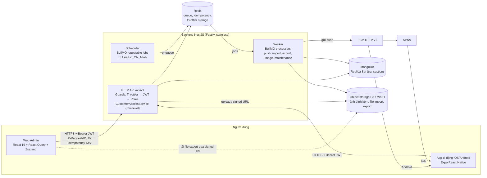
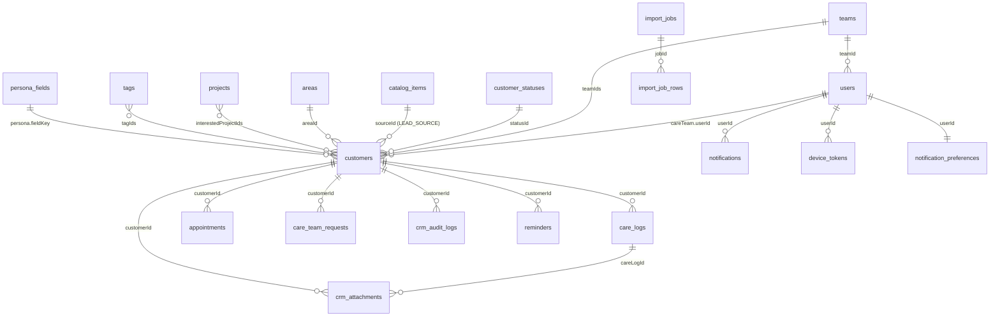
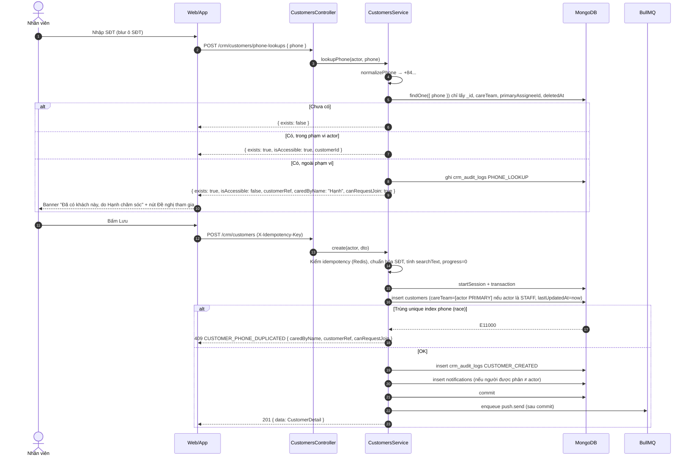
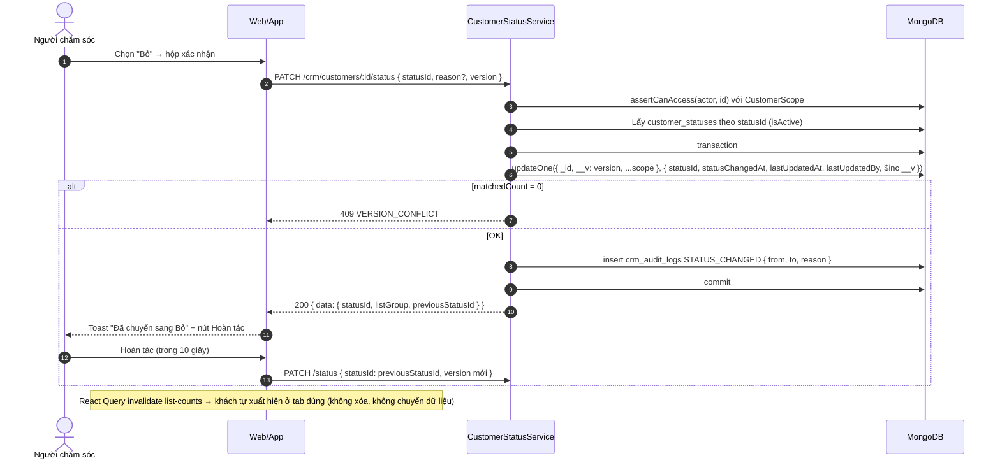
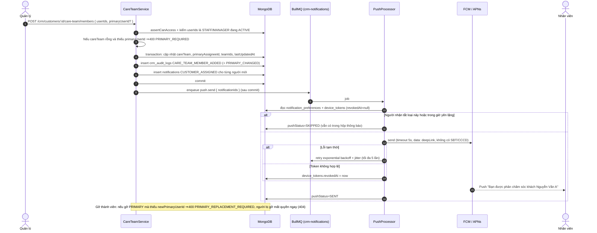
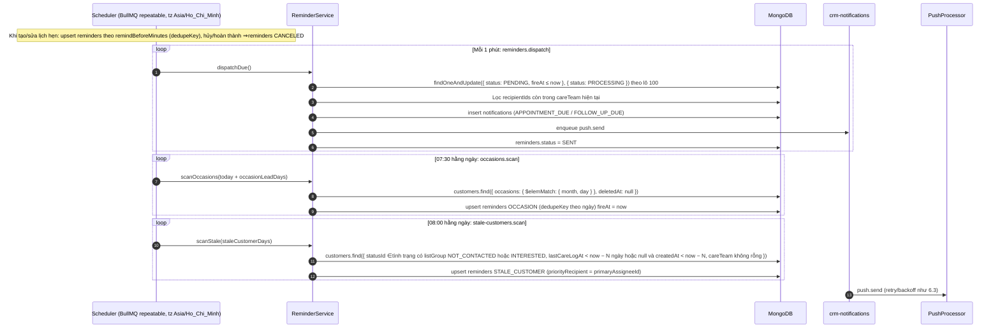
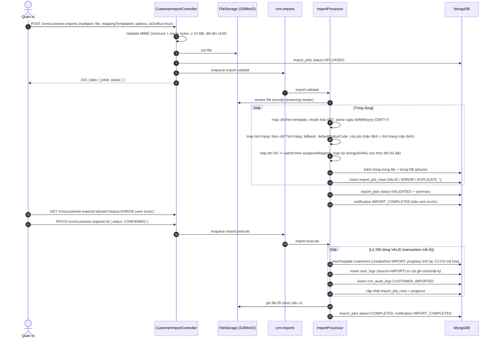
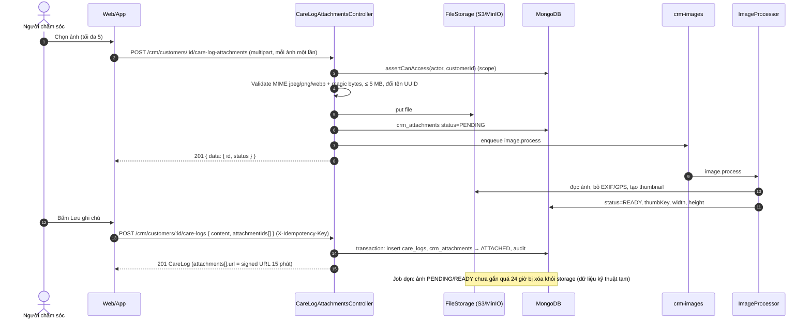

# Tài liệu kỹ thuật: Module Quản lý & chăm sóc khách hàng (CRM)

> **Phạm vi:** giai đoạn 1 của [`01_Project_Plan_WebApp_Quan_Ly_Khach_Hang.md`](01_Project_Plan_WebApp_Quan_Ly_Khach_Hang.md) (C1–C14, X1–X11, quy tắc mục 4, yêu cầu chung mục 5). **Nhập dữ liệu 3 sheet cũ (DSKH, DSKH_DROP, DSKH_NET) hoãn sang giai đoạn sau** (D7). Zalo (3.3) và ghi âm (3.4) chỉ phác thảo ở [mục 8](#8-giai-đoạn-sau-zalo-ghi-âm--phác-thảo).
> **Danh sách API đầy đủ:** [`05_Danh_Sach_API_Module_Quan_Ly_Khach_Hang.md`](05_Danh_Sach_API_Module_Quan_Ly_Khach_Hang.md).
> **Chuẩn áp dụng:** skill `nodejs-react-mongo-coding-guidelines` (naming, `/api/v1`, Swagger, phân trang `{ data, meta }`, lỗi `{ statusCode, message, timestamp, path }`, soft delete, transaction, audit trail, queue, Correlation ID).
> Các điểm **[Giả định]** gom ở [mục 9](#9-giả-định--câu-hỏi-mở): **đã xác nhận ngày 2026-10-22** (D5 chốt dùng Redis + BullMQ; D7 hoãn; FCM chưa làm ở giai đoạn 1). Nhật ký quyết định đầy đủ ở [mục 11](#11-nhật-ký-quyết-định-2026-10-22).

---

## 1. Tổng quan & phạm vi giai đoạn 1

### 1.1 Mục tiêu kỹ thuật

| Mục tiêu | Cách đáp ứng |
|---|---|
| Thay 3 sheet DSKH / DSKH_DROP / DSKH_NET | Một collection `customers` + **tình trạng** (`statusId`) thuộc một nhóm danh sách (`NOT_CONTACTED` / `INTERESTED` / `NET` / `DROPPED`; thêm tab ảo `ALL`). Đổi tình trạng là đổi danh sách hiển thị (C6, quy tắc 2) |
| Nhiều người cùng chăm sóc, đúng 1 phụ trách chính | `careTeam[]` nhúng trong khách + bất biến "đúng 1 PRIMARY" kiểm ở service (C8, quy tắc 7) |
| Phân quyền theo khách được phân | Bộ lọc phạm vi (row-level scope) bắt buộc ở tầng repository, không chỉ guard (X1, quy tắc 6) |
| Tự động hóa việc làm tay | Tiến độ (C5), `lastUpdatedAt` (C7), chống trùng SĐT (X2), nhắc lịch (C3, C13, X5) đều do server tính |
| Chân dung động | `persona_fields` do Quản trị cấu hình (X10) + giá trị lưu kiểu attribute pattern có metadata người/ngày/nguồn (quy tắc 9) |
| Di động có đẩy thông báo | App Expo (iOS/Android) + FCM HTTP v1 (APNs qua Firebase) + hộp thông báo trong app (X5, X9). **Giai đoạn 1 chỉ có hộp thông báo trong app (Web Admin chạy API thật); FCM, `device_tokens` và app di động làm ở giai đoạn 2** (thiết kế giữ nguyên, chỉ để cấu hình/placeholder) |

### 1.2 Trong / ngoài phạm vi giai đoạn 1

| Trong phạm vi | Ngoài phạm vi (giai đoạn sau hoặc không yêu cầu) |
|---|---|
| C1–C14, X1–X11 (backend lõi và Web Admin ở giai đoạn 1, phần còn lại giai đoạn 2 — xem mục 10) | Z1–Z3 (Zalo), R1–R10 (ghi âm) — xem mục 8 |
| Import/Export Excel/CSV **chung** (tự ghép cột, chạy thử, xác nhận) | **Import dữ liệu 3 sheet cũ (DSKH, DSKH_DROP, DSKH_NET): hoãn giai đoạn sau (D7), cần file mẫu thật**. Gợi ý bằng AI (prototype có `aiSuggestion`) — giai đoạn 1 dùng gợi ý theo quy tắc |
| Dashboard thống kê X6 | Real-time "ai đang mở hồ sơ" (tài liệu 02 §8) — giai đoạn 1 dùng React Query refetch |
| App di động dùng chung API | Các trường thừa còn lại của prototype (VIP tier, `unitPrice`...) — không phải yêu cầu; nếu cần thì Quản trị thêm qua trường chân dung X10. **Đã chốt GIỮ và nằm trong phạm vi:** email khách, ảnh đính kèm ở nhật ký, nhóm trường đầu tư (REAL_ESTATE), màn Dự án, Kanban. **Đã BỎ:** mã khách hàng |

### 1.3 Sơ đồ kiến trúc



| Thành phần | Quyết định | Lý do |
|---|---|---|
| Backend | Tái dùng `RealEstateBackendApp` (NestJS 11 + Fastify), thêm `src/modules/crm/*` | Đã có auth, guard, filter lỗi, logger Winston, request-id, Swagger |
| MongoDB | **Chuyển sang Replica Set** (single-node `rs0` ở dev/docker) | Bắt buộc cho `ClientSession` transaction (tạo khách + audit, đổi tình trạng + audit + thông báo). `docker-compose.yml` hiện chạy standalone |
| Queue + Scheduler | **BullMQ + Redis** (mới) | Tác vụ nặng (import/export, gửi push có retry/backoff) phải tách khỏi request; repeatable job chạy đúng 1 lần dù nhiều instance. Redis cũng thay `IdempotencyService` in-memory hiện tại (không stateless) |
| Worker | Cùng codebase, biến `APP_ROLE=api|worker|all`; giai đoạn 1 chạy `all` trong 1 container | Tối giản hạ tầng; tách container khi tải tăng |
| Lưu file | S3-compatible (MinIO ở dev) qua `FileStorageService` | Backend stateless; file export có hạn (signed URL 15 phút, xóa sau 7 ngày); ảnh đính kèm nhật ký lưu bucket riêng, đọc qua signed URL 15 phút |
| Push (**giai đoạn 2**; GĐ1 chỉ có `PushProvider` interface + `NoopPushProvider`, biến môi trường `FCM_*` để trống, `FEATURE_CRM_PUSH=false`) | FCM HTTP v1 cho cả Android và iOS (upload APNs key lên Firebase); app lấy **device token gốc** qua `expo-notifications` | Một nhà cung cấp, một API; Expo Push Service là phương án dự phòng |
| Cache | **Không dùng** ở giai đoạn 1 | Vài nghìn khách, index đủ nhanh; theo skill, cache phải hỏi trước |

---

## 2. Cấu trúc module NestJS

### 2.1 Tái sử dụng vs. mới

| Thành phần | Trạng thái | Ghi chú |
|---|---|---|
| `AuthModule` (login, refresh cookie, logout, me, JwtAuthGuard, RolesGuard, ThrottlerGuard) | **Dùng lại**, mở rộng nhỏ | `GET /auth/me` trả thêm `teamId`, `managedTeamIds`. Hỗ trợ client di động nhận refresh token trong body **[Giả định]** (mục 9) |
| `UsersModule` + `User` schema | **Dùng lại**, mở rộng tương thích ngược | Thêm giá trị enum `UserRole.MANAGER`, `UserRole.STAFF`; thêm field `teamId` (default `null`). `EDITOR` giữ nguyên nghĩa cũ (module tin tức), **không** có quyền CRM |
| `GlobalExceptionFilter` | **Dùng lại**, mở rộng | Giữ 4 trường bắt buộc; thêm trường tùy chọn `errorCode`, `details` (xem 05 §1.3) |
| `PaginationQueryDto`, `buildPaginationMeta`, `normalizePagination` | **Dùng lại** | DTO lọc CRM `extends PaginationQueryDto` |
| `RequestContextMiddleware` (X-Request-ID, AsyncLocalStorage) | **Dùng lại** | requestId ghi vào audit log và log Winston |
| `IdempotencyService` | **Thay storage** | Giữ interface, chuyển Map in-memory sang Redis (`SET NX PX`) để stateless |
| `timezone.util.ts` (`startOfDayUtc`, `endOfDayUtc`) | **Dùng lại** | Lọc theo ngày giờ VN |
| `HealthController` | **Dùng lại**, mở rộng | Readiness thêm kiểm Redis |
| `@nestjs/schedule` | Không dùng cho CRM | Dùng BullMQ repeatable để tránh chạy trùng khi scale ngang |
| `AuditLog` của news-fire-crawl-manager | **Không dùng lại** | Khác cấu trúc (không có diff trường); CRM có collection riêng `crm_audit_logs` |
| Project / Team / Customer | **Mới** | Chưa tồn tại trong backend |

### 2.2 Cây thư mục đề xuất

Theo convention hiện có (`dtos/`, `schemas/`, `services/`, `controllers/`, file `tên.loại.ts`).

```
src/
├── shared/
│   ├── queue/                 # BullMQ connection, QueueNames, base processor (retry/backoff/jitter)
│   └── storage/               # FileStorageService (S3/MinIO, signed URL, UUID filename)
├── modules/
│   ├── teams/                 # [MỚI] nhóm làm việc (org-level): teams.controller/service/repository
│   ├── notifications/         # [MỚI] app-wide: inbox, device-tokens, preferences, FcmPushProvider
│   └── crm/
│       ├── crm.module.ts      # module tổng, import các sub-module, bật bằng FEATURE_CRM_ENABLED
│       ├── common/
│       │   ├── access/        # CustomerAccessService, CrmActor, CustomerScope (row-level)
│       │   ├── crypto/        # PiiCryptoService (AES-256-GCM, keyVersion)
│       │   ├── utils/         # phone-normalizer.util, vietnamese-text.util, sort-parser.util
│       │   └── ref-resolver.service.ts  # batch $in resolve catalog/user refs (chống N+1)
│       ├── customers/         # hồ sơ (có email), tình trạng, tiêu chí, CCCD, xem/gọi SĐT (phone-views), consent, bulk, soft delete/restore/anonymize
│       ├── care-teams/        # thành viên, phụ trách chính, care-team-requests (X2)
│       ├── care-logs/         # nhật ký chăm sóc (C2) + ảnh đính kèm (upload, job xử lý ảnh, signed URL)
│       ├── persona/           # persona-fields (X10) + persona khách + completeness (C10, C12)
│       ├── tags/              # thẻ sở thích/nghề nghiệp (C11)
│       ├── catalogs/          # customer-statuses, lead-sources, areas, contact-results (X7)
│       ├── projects/          # danh sách dự án: CRUD đầy đủ, ngừng hoạt động, khôi phục (X7)
│       ├── appointments/      # lịch hẹn + daily-tasks (C3)
│       ├── reminders/         # scheduler + processors: appointment, occasion (C13), stale customer (X5)
│       ├── audit-logs/        # crm_audit_logs, lịch sử khách (X4)
│       ├── import-export/     # import chung (tự ghép cột), mapping templates tự tạo, export jobs (X8); mẫu 3 sheet cũ: giai đoạn sau
│       ├── dashboard/         # thống kê (X6)
│       └── crm-settings/      # cấu hình CRM (ngưỡng ngày, giờ nhắc)
```

### 2.3 Trách nhiệm từng module

| Module | Controller (route gốc) | Service chính | Collection | Phụ thuộc |
|---|---|---|---|---|
| `teams` | `/teams` | `TeamsService` | `teams` | users |
| `notifications` | `/notifications`, `/device-tokens`, `/notification-preferences` | `NotificationsService`, `PushDispatchService`, `FcmPushProvider` | `notifications`, `device_tokens`, `notification_preferences` | queue |
| `crm/customers` | `/crm/customers`, `/crm/deleted-customers`, `/crm/customer-*` | `CustomersService`, `CustomerStatusService`, `CriteriaService`, `NationalIdService`, `CustomerPhoneAccessService` (xem/gọi SĐT + PHONE_VIEWED), `CustomerBulkService` | `customers` | access, audit-logs, catalogs, persona, notifications |
| `crm/care-teams` | `/crm/customers/:id/care-team`, `/crm/care-team-requests` | `CareTeamService`, `CareTeamRequestsService` | `customers` (careTeam), `care_team_requests` | access, notifications, audit-logs |
| `crm/care-logs` | `/crm/customers/:id/care-logs`, `/crm/customers/:id/care-log-attachments` | `CareLogsService`, `CareLogAttachmentsService`, `ImageProcessor` | `care_logs`, `crm_attachments` | access, appointments, notifications, storage, queue |
| `crm/persona` | `/crm/persona-fields`, `/crm/customers/:id/persona` | `PersonaFieldsService`, `CustomerPersonaService`, `PersonaCompletenessCalculator` | `persona_fields`, `customers.persona` | access, queue (recompute) |
| `crm/tags` | `/crm/tags` | `TagsService` | `tags` | — |
| `crm/catalogs` | `/crm/customer-statuses`, `/crm/lead-sources`, `/crm/areas`, `/crm/contact-results` | `CustomerStatusesService`, `CatalogItemsService`, `AreasService` | `customer_statuses`, `catalog_items`, `areas` | — |
| `crm/projects` | `/crm/projects`, `/crm/project-restorations` | `ProjectsService` | `projects` (đọc `customers` để đếm tham chiếu) | areas |
| `crm/appointments` | `/crm/appointments`, `/crm/daily-tasks` | `AppointmentsService`, `DailyTasksService` | `appointments` | access, reminders |
| `crm/reminders` | (không có controller) | `ReminderSchedulerService`, `*Processor` | `reminders` | queue, notifications, crm-settings |
| `crm/audit-logs` | `/crm/customers/:id/histories`, `/crm/audit-logs` | `CrmAuditLogService` | `crm_audit_logs` | — |
| `crm/import-export` | `/crm/customer-imports`, `/crm/customer-exports`, `/crm/import-mapping-templates` | `CustomerImportService`, `ImportRowMapper`, `CustomerExportService` | `import_jobs`, `import_job_rows`, `export_jobs`, `import_mapping_templates` | storage, queue, customers |
| `crm/dashboard` | `/crm/dashboard/*` | `DashboardService` (aggregation) | đọc `customers`, `care_logs`, `appointments` | access |
| `crm/crm-settings` | `/crm/settings` | `CrmSettingsService` | `crm_settings` | — |

Mỗi module tách đúng 4 lớp: **Controller** (HTTP + Swagger, không logic) → **Service** (nghiệp vụ, transaction) → **Repository** (truy vấn Mongoose, luôn nhận `CustomerScope`) → **DTO/Schema**.

---

## 3. Data model MongoDB

Quy ước chung cho mọi collection nghiệp vụ: `timestamps: true` (`createdAt`, `updatedAt`), `deletedAt: Date | null` (soft delete, mọi query mặc định `deletedAt: null`), `createdBy`/`updatedBy: ObjectId<User>`, Date lưu UTC; **ngày không có giờ** (sinh nhật, kỷ niệm) lưu chuỗi `YYYY-MM-DD` để không lệch múi giờ. Thay đổi schema chỉ **thêm** field/enum mới (zero-downtime), không đổi kiểu hay xóa field đột ngột.

### 3.1 Sơ đồ quan hệ



### 3.2 `customers` (trung tâm)

| Field | Kiểu | Bắt buộc | Mô tả / quy tắc | ID |
|---|---|---|---|---|
| `fullName` | string (trim, 1–150) | Có | Họ tên | C1, QT3 |
| `phone` | string E.164 (`+84912345678`) | Có | **Đã chuẩn hóa trước khi lưu** (xem 3.2.1). Unique toàn hệ thống. API list/detail chỉ trả `phoneMasked`; số đầy đủ lấy qua `POST /crm/customers/:id/phone-views` (mọi thành viên nhóm, ghi `PHONE_VIEWED`) | C1, C14, X2, QT3, QT4 |
| `email` | string \| null (trim, lowercase, ≤ 254, định dạng email) | Không | Email khách (**không unique**, không bắt buộc). Là dữ liệu cá nhân: không ghi vào log ứng dụng, không đưa vào payload push | C1 |
| `statusId` | ObjectId → `customer_statuses` | Có | Mặc định trạng thái `isDefault` ("Chưa tiếp cận") | C1, C6 |
| `statusChangedAt` | Date | Có | Lần đổi tình trạng gần nhất | C6 |
| `sourceId` | ObjectId → `catalog_items` (LEAD_SOURCE) \| null | Không | Nguồn khách | C1 |
| `interestedProjectIds` | ObjectId[] → `projects` | Không | Nhiều dự án | C1 |
| `areaId` | ObjectId → `areas` \| null | Không | Nơi khách đang ở | C1 |
| `tagIds` | ObjectId[] → `tags` | Không | Thẻ sở thích/nghề nghiệp | C11 |
| `nationalId` | `{ cipherText, iv, authTag, keyVersion }` | Không | **`select: false`**. AES-256-GCM, khóa từ secret `CRM_PII_ENCRYPTION_KEY`, xoay khóa theo `keyVersion` | C9 |
| `nationalIdLast4` | string \| null | Không | 4 số cuối để hiển thị `••••1234` | C9 |
| `hasNationalId` | boolean | Có | Cho UI biết có CCCD | C9 |
| `criteria` | `{ demand, motivation, finance, timing }` mỗi cái `{ isDone: boolean, description: string ≤1000, updatedBy, updatedAt }` | Có (mặc định `isDone=false`) | 4 tiêu chí Nhu cầu / Động cơ / Tài chính / Thời gian | C4 |
| `progress` | number ∈ {0,25,50,75,100} | Có | **Server tính** = số `isDone` × 25, ghi cùng lệnh update tiêu chí; không nhận từ client | C5, QT1 |
| `careTeam` | `[{ userId, role: 'PRIMARY'\|'MEMBER', addedBy, addedAt }]` | Không | Nhóm chăm sóc. **Bất biến:** nếu không rỗng thì đúng 1 `PRIMARY`, `userId` không trùng | C8, QT7 |
| `primaryAssigneeId` | ObjectId \| null | Không | Phi chuẩn hóa từ `careTeam` để lọc/sort/thống kê nhanh | C8, X3, X6 |
| `teamIds` | ObjectId[] | Không | Hợp các `teamId` của thành viên `careTeam`; nếu `careTeam` rỗng thì = nhóm của người tạo. Dùng cho phạm vi Quản lý | QT6 |
| `persona` | `PersonaValue[]` (3.2.2) | Không | Chân dung động, attribute pattern | C10, X10, QT9 |
| `personaFilterKeys` | string[] | Không | Token lọc phi chuẩn hóa, ví dụ `occupation=ke_toan`, `purpose=dau_tu` (chỉ trường `isFilterable`) | X3 |
| `occasions` | `[{ fieldKey, month, day, year? }]` | Không | Sinh ra từ trường chân dung `isOccasion` (sinh nhật, kỷ niệm) để scheduler quét theo ngày | C13 |
| `personaCompleteness` | number 0–100 | Có (0) | Độ đầy đủ chân dung, tính lại khi sửa chân dung hoặc đổi cấu hình trường | C12 |
| `dataConsent` | `{ status: 'UNKNOWN'\|'GRANTED'\|'WITHDRAWN', method?, recordedBy?, recordedAt?, note? }` | Có (`UNKNOWN`) | Ghi nhận khách đồng ý xử lý dữ liệu cá nhân **[Giả định]** (câu hỏi 8) | §5 |
| `lastUpdatedAt` | Date | Có | **Server tự ghi** mỗi lần bất kỳ thông tin khách thay đổi; không có trong DTO | C7, QT5 |
| `lastUpdatedBy` | ObjectId | Có | Người sửa cuối | C7 |
| `lastCareLogAt` | Date \| null | Không | Lần chăm sóc gần nhất (nhật ký) — dùng cho "khách lâu chưa chăm sóc" | X5 |
| `nextAppointmentAt` | Date \| null | Không | Lịch hẹn sắp tới gần nhất (cột "HẸN" trên danh sách) | C3 |
| `searchText` | string | Có | `fullName` bỏ dấu + chữ thường + các biến thể số (`0912345678`, `84912345678`) + `email` chữ thường. Không trả ra API | X3, §5 |
| `createdVia` | `'WEB'\|'MOBILE'\|'IMPORT'` | Có | Kênh tạo (`IMPORT` = nhập file chung) | X8 |
| `legacy` | `{ sheet, rowNumber, importJobId }` | Không | **Hoãn giai đoạn sau (D7)** — chưa tạo ở giai đoạn 1; thêm sau là tương thích ngược (field mới, tùy chọn). Truy vết dữ liệu cũ từ 3 sheet | X8 |
| `deletedAt`, `deletedBy`, `anonymizedAt` | Date/ObjectId | Không | Soft delete; ẩn danh hóa khi khách yêu cầu xóa dữ liệu | §5 |
| `__v` | number | — | Bật `optimisticConcurrency` — client gửi `version` khi PATCH, lệch thì 409 `VERSION_CONFLICT` (nhiều người cùng sửa) | QT7 |

> **Không có mã khách hàng** (quyết định #2): không field `customerCode`, không unique/index, không cột trong import/export, không filter. Khách nhận diện bằng `_id` (nội bộ), họ tên và SĐT (duy nhất).

#### 3.2.1 Chuẩn hóa SĐT (X2, QT4)

| Bước | Quy tắc |
|---|---|
| 1 | Bỏ khoảng trắng, `.`, `-`, `()` |
| 2 | Parse bằng `libphonenumber-js` với vùng mặc định `VN`: `0912…` → `+84912…`; `84912…` → `+84912…`; số nước ngoài phải có `+` (khách Việt kiều) |
| 3 | Đổi đầu số 11 số cũ sang 10 số (0162→032, 0163→033, … 0199→059) — bảng map trong `phone-normalizer.util.ts`, áp dụng cả khi nhập tay và import |
| 4 | Không hợp lệ → 400 `INVALID_PHONE` |
| Lưu | `phone` dạng E.164; FE tự định dạng `0912 345 678` khi hiển thị |

#### 3.2.2 `PersonaValue` (nhúng trong `customers.persona`)

| Field | Kiểu | Mô tả |
|---|---|---|
| `fieldKey` | string | Khóa trường trong `persona_fields.key` (bất biến) |
| `valueText` | string ≤ 2000 | Kiểu `TEXT`, `TEXTAREA` |
| `valueNumber`, `valueNumberTo` | number | Kiểu `NUMBER`, `NUMBER_RANGE` (ví dụ ngân sách, đơn vị VNĐ) |
| `valueDate` | string `YYYY-MM-DD` | Kiểu `DATE` |
| `valueOptions` | string[] | Kiểu `SELECT` (1 phần tử), `MULTI_SELECT` |
| `valueBoolean` | boolean | Kiểu `BOOLEAN` |
| `source` | `'CUSTOMER_SHARED'\|'STAFF_OBSERVED'\|'IMPORTED'` | **Nguồn thông tin** (QT9) |
| `updatedBy`, `updatedAt` | ObjectId, Date | **Người và ngày cập nhật** (QT9) |

Khi lưu chân dung, service tính lại trong cùng một lệnh `updateOne`: `personaFilterKeys`, `occasions`, `personaCompleteness`, `lastUpdatedAt`.

**Độ đầy đủ (C12):** `personaCompleteness = round(Σ weight các trường active đã có giá trị / Σ weight các trường active × 100)`. Gợi ý "còn thiếu" = các trường active chưa có giá trị, sắp theo `suggestPriority`, trả trong `GET /crm/customers/:id/persona` (tối đa 5 mục). Khi Quản trị thêm/bớt trường → job `persona.recompute-completeness` chạy nền cho toàn bộ khách.

#### 3.2.3 Index `customers`

| Index | Mục đích |
|---|---|
| `{ phone: 1 }` **unique** (không partial) | SĐT duy nhất **toàn hệ thống**, kể cả khách đã xóa mềm (QT4). Chống race khi 2 người tạo cùng lúc |
| `{ deletedAt: 1, statusId: 1, lastUpdatedAt: -1 }` | Danh sách theo tình trạng, sort ngày cập nhật (mặc định) — phạm vi Quản trị |
| `{ 'careTeam.userId': 1, deletedAt: 1, lastUpdatedAt: -1 }` | Phạm vi Nhân viên |
| `{ teamIds: 1, deletedAt: 1, lastUpdatedAt: -1 }` | Phạm vi Quản lý |
| `{ primaryAssigneeId: 1, statusId: 1 }` | Lọc/thống kê phụ trách chính |
| `{ sourceId: 1 }`, `{ interestedProjectIds: 1 }`, `{ areaId: 1 }`, `{ tagIds: 1 }`, `{ personaFilterKeys: 1 }`, `{ progress: 1 }` | Tiêu chí lọc X3 |
| `{ 'occasions.month': 1, 'occasions.day': 1 }` partial `deletedAt: null` | Quét sinh nhật/kỷ niệm hằng ngày (C13) |
| `{ statusId: 1, lastCareLogAt: 1 }` partial `deletedAt: null` | Quét khách lâu chưa chăm sóc (X5): các tình trạng thuộc `listGroup` `NOT_CONTACTED` và `INTERESTED` (D4) |
| `{ nextAppointmentAt: 1 }` | Sort theo lịch hẹn |
| `{ fullName: 1 }` với `collation: { locale: 'vi' }` | Sort tên đúng thứ tự tiếng Việt (query sort tên phải truyền cùng collation) |

> **Rủi ro dò số qua tìm kiếm (QA vòng 2):** vì `searchText` chứa các biến thể số điện thoại, tìm theo ≥ 3 chữ số cho phép người xem dò ra số đầy đủ của khách trong phạm vi mình xem được (thử dần, đọc kết quả) mà **không để lại `PHONE_VIEWED`**. Giới hạn: chỉ khách trong phạm vi (`CustomerScope`). Backend phải: (1) **độ dài tối thiểu 6 chữ số** khi từ khóa toàn chữ số, hoặc chỉ khớp **đuôi số** (4–6 số cuối); (2) rate-limit riêng cho tìm kiếm (đề xuất 30 lần/phút/người); (3) cảnh báo bất thường (nhiều truy vấn số khác nhau trong thời gian ngắn, ghi audit `PHONE_SEARCH_ANOMALY` và báo Quản trị); (4) không trả khớp số một phần trong kết quả gợi ý (autocomplete). Ghi vào Quality Gates (10.2).

**Tìm kiếm tiếng Việt không dấu:** giai đoạn 1 dùng regex đã escape trên `searchText` (chuỗi bỏ dấu, `đ→d`), kết hợp với bộ lọc phạm vi + các bộ lọc khác. Với quy mô vài nghìn – vài chục nghìn khách, quét `searchText` trong tập đã thu hẹp đáp ứng < 100 ms. Nếu quá 50k khách: thêm text index `{ searchText: 'text' }` (`default_language: 'none'`) hoặc Atlas Search. Từ khóa toàn chữ số → so khớp chuỗi số trong `searchText` (tìm theo SĐT, kể cả 4 số cuối); từ khóa có `@` → so khớp email.

### 3.3 Danh mục (X7)

| Collection | Field chính | Index | Ghi chú |
|---|---|---|---|
| `customer_statuses` | `code` (bất biến), `label`, `listGroup: 'NOT_CONTACTED'\|'INTERESTED'\|'NET'\|'DROPPED'`, `color`, `order`, `isDefault`, `isSystem`, `isActive`, `deletedAt` | `{ code: 1 }` unique; `{ listGroup: 1, order: 1 }` | Seed 4 trạng thái hệ thống, mỗi trạng thái một nhóm danh sách riêng (không còn nhóm gộp "Đang chăm sóc"): `NOT_CONTACTED` "Chưa tiếp cận" (listGroup `NOT_CONTACTED`, default), `INTERESTED` "Có quan tâm" (listGroup `INTERESTED`), `NET` "Khách net" (listGroup `NET`), `DROPPED` "Bỏ" (listGroup `DROPPED`). Tab "Tất cả" (`ALL`) là tab ảo, không phải `listGroup` lưu trong DB. Trạng thái `isDefault` phải thuộc nhóm `NOT_CONTACTED`. Quản trị thêm trạng thái mới phải chọn `listGroup` → khách tự vào đúng danh sách (C6, QT2). Không xóa được trạng thái `isSystem` hoặc đang có khách |
| `catalog_items` | `type: 'LEAD_SOURCE'\|'CONTACT_RESULT'\|'PERSONA_GROUP'`, `code`, `label`, `order`, `isActive`, `isSystem`, `meta` (ví dụ CONTACT_RESULT: `{ suggestedFollowUpDays, suggestionText }`), `deletedAt` | `{ type: 1, code: 1 }` unique; `{ type: 1, order: 1 }` | Một collection cho danh mục phẳng (DRY). `CONTACT_RESULT` cho ô "Kết quả liên hệ" và gợi ý mốc hẹn (C3) |
| `areas` | `name`, `nameNormalized`, `type: 'COUNTRY'\|'PROVINCE'\|'DISTRICT'\|'WARD'\|'OTHER'`, `parentId`, `ancestorIds[]`, `adminCode?`, `isLegacy`, `order`, `isActive`, `deletedAt` | `{ parentId: 1, order: 1 }`; `{ ancestorIds: 1 }`; `{ nameNormalized: 1 }` | Cây khu vực linh hoạt. Lọc theo tỉnh tự bao gồm khu vực con (`ancestorIds`). `isLegacy` cho quận/huyện cũ (sau sắp xếp hành chính 2025) **[Giả định]** |
| `projects` | `name`, `code` (**bắt buộc**, unique, regex `^[A-Za-z0-9_-]{1,20}$`: chữ, số, `-`, `_`, tối đa 20 ký tự), `developer?`, `location?`, `areaId?`, `propertyTypes[]`, `priceFrom?`, `priceTo?` (VNĐ ≥ 0, `priceFrom ≤ priceTo`), `status` (enum `'UPCOMING'\|'SELLING'\|'SOLD_OUT'`, mặc định `UPCOMING`), `description?`, `isActive`, `deletedAt` | `{ code: 1 }` unique (kể cả dự án đã xóa mềm); `{ isActive: 1, name: 1 }` (collation vi); `{ deletedAt: 1 }` | Do **Quản trị** thêm/sửa/xóa. Field tối thiểu, thêm field sau là tương thích ngược. **Xóa:** nếu còn khách tham chiếu (`customers.interestedProjectIds`, chưa xóa mềm) ⇒ 409 `PROJECT_IN_USE` kèm `customerCount`, Quản trị chuyển `isActive=false` (ngừng hoạt động: ẩn khỏi ô chọn mới, khách cũ giữ liên kết, hiển thị "đã ngừng"); không còn tham chiếu ⇒ xóa mềm (`deletedAt`). Khôi phục qua `POST /crm/project-restorations` |
| `tags` | `name`, `nameNormalized`, `category: 'INTEREST'\|'OCCUPATION'\|'OTHER'`, `color?`, `usageCount`, `createdBy`, `deletedAt` | `{ category: 1, nameNormalized: 1 }` unique partial `deletedAt: null` | Nhân viên tạo thẻ mới khi gắn; Quản trị sửa/xóa/gộp (C11) |
| `teams` | `name`, `code` (unique), `managerIds: ObjectId[]`, `isActive`, `deletedAt` | `{ code: 1 }` unique; `{ managerIds: 1 }` | Nhóm làm việc cho phạm vi Quản lý |

> **Mã danh mục không dùng lại:** `code` của tình trạng khách, nguồn khách, kết quả liên hệ (cũng như mã nhóm và mã dự án) là unique **kể cả bản đã xóa mềm** — mã đã xóa mềm không tạo lại được (409 `CATALOG_DUPLICATED` / `TEAM_CODE_DUPLICATED` / `PROJECT_CODE_DUPLICATED`). Bản ghi seed có `seedKey` bất biến nên Quản trị đổi tên/mã không làm seed tạo lại bản trùng.

#### Quy ước migration và ràng buộc dự án (QA vòng 2)

| Hạng mục | Quy ước |
|---|---|
| Mã dự án | Bắt buộc, regex `^[A-Za-z0-9_-]{1,20}$`. **Unique không phân biệt hoa thường**, kể cả dự án đã xóa mềm: lưu thêm `codeNormalized` (chữ hoa) với index unique `{ codeNormalized: 1 }` thay cho unique trên `code`; `code` giữ nguyên chữ người nhập để hiển thị. Dữ liệu cũ không hợp lệ/trùng khi chuyển: sinh mã tạm theo quy tắc, báo cáo cho Quản trị sửa |
| Trạng thái dự án cũ → enum | Giá trị tự do cũ quy về 3 giá trị `UPCOMING`/`SELLING`/`SOLD_OUT`: "Sắp mở bán"/"Sắp ra mắt" → `UPCOMING`; "Đang mở bán"/"Đang bán" → `SELLING`; "Hết hàng"/"Đã bán hết" → `SOLD_OUT`; **"Sắp bàn giao", "Đang vận hành" → `SOLD_OUT`** (nghĩa là "không còn bán mới"); giá trị không nhận ra → `UPCOMING` kèm báo cáo. Chỉ **thêm** field/enum, không xóa giá trị cũ ngay: lưu giá trị gốc ở `legacyStatusText` (tùy chọn) để đối chiếu |
| `propertyTypes` | Luôn là **mảng** chuỗi; dữ liệu cũ dạng chuỗi đơn → bọc thành mảng 1 phần tử khi chuyển |
| Xóa dự án còn khách | Giữ nguyên: 409 `PROJECT_IN_USE { customerCount }`; ngừng hoạt động qua `PATCH /crm/projects/:id` với `isActive=false` |

### 3.4 `persona_fields` (X10)

| Field | Kiểu | Mô tả |
|---|---|---|
| `key` | string slug (unique, **bất biến**) | Ví dụ `birthday`, `occupation`, `budget` |
| `label`, `helpText?`, `placeholder?` | string | Nhãn hiển thị |
| `groupCode` | string → `catalog_items` (PERSONA_GROUP) | Cá nhân / Nghề nghiệp / Sở thích / Dịp đặc biệt / Gia đình / Liên hệ / Nhu cầu BĐS |
| `type` | `'TEXT'\|'TEXTAREA'\|'NUMBER'\|'NUMBER_RANGE'\|'DATE'\|'SELECT'\|'MULTI_SELECT'\|'BOOLEAN'` | **Không đổi được khi đã có dữ liệu** (409 `PERSONA_FIELD_TYPE_LOCKED`) |
| `options` | `[{ value, label, isActive }]` | Cho SELECT/MULTI_SELECT; bỏ lựa chọn = `isActive:false`, không xóa (dữ liệu cũ vẫn đọc được) |
| `order`, `weight` (mặc định 1), `suggestPriority` | number | Sắp xếp, trọng số độ đầy đủ, ưu tiên gợi ý |
| `isFilterable` | boolean | Sinh token vào `customers.personaFilterKeys` |
| `isOccasion`, `occasionLabel?` | boolean, string | Chỉ với DATE; sinh `occasions` để nhắc (C13) |
| `linkedCriterion` | `'DEMAND'\|'MOTIVATION'\|'FINANCE'\|'TIMING'\|null` | Hiển thị cạnh tiêu chí C4 tương ứng (ví dụ ngân sách ↔ Tài chính). **Không tự đánh dấu hoàn thành** tiêu chí |
| `isSensitive` | boolean | Trường dễ chạm nội dung nhạy cảm: khi lưu bắt buộc `source=CUSTOMER_SHARED` + `sensitiveAcknowledged=true` (QT9) |
| `isSystem`, `isActive`, `deletedAt` | boolean/Date | Trường seed không xóa được, chỉ tắt. "Bớt trường" = `isActive:false`, giá trị cũ giữ nguyên (zero-downtime) |

Index: `{ key: 1 }` unique; `{ isActive: 1, groupCode: 1, order: 1 }`.
**Seed** theo bảng gợi ý C10 (tất cả không bắt buộc); nhóm "Nhu cầu BĐS" (`groupCode = REAL_ESTATE`, quyết định #7: giữ nhóm đầu tư của prototype) seed dạng có cấu trúc, toàn bộ `isSystem`, đều tùy chọn, Quản trị tắt/sửa qua X10: `property_type` (loại hình), `bedroom_type` (cơ cấu phòng), `purchase_purposes` (MULTI_SELECT: ở / đầu tư / cho con), `budget` (NUMBER_RANGE VNĐ), `equity_ratio` (vốn tự có), `loan_support` (BOOLEAN, cần hỗ trợ vay), `expected_purchase_time` (thời điểm dự kiến mua), `criteria_priorities` (MULTI_SELECT, tiêu chí ưu tiên), `search_area` (khu vực muốn mua), `specific_location` (vị trí cụ thể). Gồm 4 trường gốc của bảng gợi ý C10 và 6 trường bổ sung từ prototype.

### 3.5 Hoạt động chăm sóc

| Collection | Field chính | Index | ID |
|---|---|---|---|
| `care_logs` | `customerId`, `authorId`, `authorName` (snapshot), `occurredAt` (mặc định now), `content` (1–5000), `contactChannel: 'CALL'\|'ZALO'\|'SMS'\|'MEETING'\|'SITE_VISIT'\|'OTHER'`, `contactResultId?`, `nextAction?: { suggestion, dueAt, appointmentId }`, `attachments?: [{ attachmentId, fileKey, thumbKey, mimeType, size, width, height }]` (tối đa 5 ảnh), `source: 'MANUAL'\|'IMPORT'\|'SYSTEM'`, `editedAt?`, `deletedAt`, `deletedBy` | `{ customerId: 1, occurredAt: -1 }` partial `deletedAt:null`; `{ authorId: 1, occurredAt: -1 }` | C2, C3 |
| `appointments` | `customerId`, `type: 'SITE_VISIT'\|'MEETING'\|'DEPOSIT_CONTRACT'\|'CALLBACK'\|'OTHER'` (`DEPOSIT_CONTRACT` = nhãn "Ký cọc / HĐMB", quyết định #6), `title`, `startAt`, `endAt?`, `location?`, `note?`, `assigneeId` (người thực hiện), `remindBeforeMinutes: number[]` (mặc định theo cài đặt), `status: 'SCHEDULED'\|'DONE'\|'CANCELED'`, `completedAt?`, `outcome?`, `sourceCareLogId?`, `deletedAt` | `{ assigneeId: 1, startAt: 1 }`; `{ customerId: 1, startAt: 1 }`; `{ status: 1, startAt: 1 }` | C3, X5 |
| `crm_attachments` (ảnh đính kèm nhật ký) | `customerId`, `careLogId?`, `uploaderId`, `kind: 'CARE_LOG_IMAGE'`, `fileKey` (UUID, không dùng tên gốc), `thumbKey?`, `originalName` (chỉ hiển thị), `mimeType` ∈ {`image/jpeg`,`image/png`,`image/webp`}, `size` (≤ 5 MB), `width?`, `height?`, `status: 'PENDING'\|'PROCESSING'\|'READY'\|'ATTACHED'\|'REJECTED'\|'REMOVED'`, `removedAt?`, `removedBy?`, `createdAt` | `{ customerId: 1, createdAt: -1 }`; `{ careLogId: 1 }` sparse; `{ status: 1, createdAt: 1 }` (dọn ảnh mồ côi PENDING > 24 giờ) | C2 |
| `care_team_requests` | `customerId`, `requesterId`, `message?`, `status: 'PENDING'\|'APPROVED'\|'REJECTED'\|'CANCELED'`, `resolvedBy?`, `resolvedAt?`, `resolutionNote?` | `{ customerId: 1, requesterId: 1 }` unique partial `status:'PENDING'`; `{ status: 1, customerId: 1 }` | X2 |
| `reminders` (kỹ thuật) | `type: 'APPOINTMENT'\|'FOLLOW_UP'\|'OCCASION'\|'STALE_CUSTOMER'`, `customerId`, `refId?`, `recipientIds[]`, `priorityRecipientId?`, `fireAt`, `status: 'PENDING'\|'PROCESSING'\|'SENT'\|'CANCELED'\|'FAILED'`, `dedupeKey` (unique), `attempts`, `sentAt?` | `{ status: 1, fireAt: 1 }`; `{ dedupeKey: 1 }` unique; TTL 90 ngày theo `sentAt` | C3, C13, X5 |

`dedupeKey` ví dụ: `APPOINTMENT:{appointmentId}:{offsetMinutes}`, `OCCASION:{customerId}:{fieldKey}:{YYYY-MM-DD}`, `STALE:{customerId}:{YYYY-MM-DD}` → scheduler chạy lại không gửi trùng. `reminders`, `notifications`, `import_job_rows` là dữ liệu kỹ thuật/tạm nên dùng TTL (như `RefreshToken` hiện có), không phải dữ liệu nghiệp vụ.

### 3.6 Thông báo (app-wide)

| Collection | Field chính | Index |
|---|---|---|
| `notifications` | `userId`, `type` (3.6.1), `title`, `body` (**không chứa SĐT, CCCD**), `data: { customerId?, appointmentId?, requestId?, deepLink }`, `priority: 'HIGH'\|'NORMAL'`, `readAt?`, `pushStatus: 'PENDING'\|'SENT'\|'SKIPPED'\|'FAILED'`, `createdAt` | `{ userId: 1, readAt: 1, createdAt: -1 }`; TTL 180 ngày |
| `device_tokens` | `userId`, `token` (unique), `platform: 'IOS'\|'ANDROID'\|'WEB'`, `deviceId?`, `appVersion?`, `lastSeenAt`, `revokedAt?` | `{ token: 1 }` unique; `{ userId: 1, revokedAt: 1 }` |
| `notification_preferences` | `userId` (unique), `types: { [NotificationType]: { push: boolean, inApp: boolean } }`, `quietHours?: { start: 'HH:mm', end: 'HH:mm' }` | `{ userId: 1 }` unique |

#### 3.6.1 Loại thông báo

| `type` | Khi nào | Người nhận | ID |
|---|---|---|---|
| `CUSTOMER_ASSIGNED` | Được thêm vào nhóm chăm sóc / thành phụ trách chính | Người được thêm | X5, QT8 |
| `APPOINTMENT_DUE` | Đến mốc nhắc trước lịch hẹn | `assigneeId` + phụ trách chính (`priority=HIGH`) | C3, X5 |
| `FOLLOW_UP_DUE` | Đến hạn "bước tiếp theo" của nhật ký | Tác giả + phụ trách chính | C3 |
| `CARE_LOG_ADDED` | Người cùng chăm sóc ghi chú mới (gộp theo khách trong 10 phút) | Thành viên khác trong nhóm | X5 |
| `STALE_CUSTOMER` | Khách có tình trạng thuộc nhóm Chưa tiếp cận hoặc Có quan tâm (cả hai) quá N ngày chưa có nhật ký | Phụ trách chính (`HIGH`); thành viên chỉ nhận nếu tự bật | X5, QT7 |
| `CUSTOMER_OCCASION` | Sinh nhật / kỷ niệm (hôm nay hoặc trước N ngày) | Cả nhóm chăm sóc, phụ trách chính `HIGH` | C13 |
| `CARE_TEAM_JOIN_REQUESTED` / `CARE_TEAM_JOIN_RESOLVED` | Có đề nghị tham gia / đề nghị được duyệt hoặc từ chối | Phụ trách chính + Quản lý nhóm / người đề nghị | X2 |
| `IMPORT_COMPLETED`, `EXPORT_READY` | Job nền xong | Người tạo job | X8 |

Mặc định bật tất cả, trừ `STALE_CUSTOMER` cho thành viên không phải phụ trách chính. Người dùng bật/tắt từng loại (§5 "Thông báo").

### 3.7 Audit & job

| Collection | Field chính | Index |
|---|---|---|
| `crm_audit_logs` (bất biến, không có API sửa/xóa) | `entityType: 'CUSTOMER'\|'CARE_LOG'\|'ATTACHMENT'\|'APPOINTMENT'\|'CATALOG'\|'PROJECT'\|'PERSONA_FIELD'\|'TEAM'\|'USER'\|'IMPORT'\|'EXPORT'\|'SETTINGS'`, `entitySubtype?` (vd `CUSTOMER_STATUS`/`LEAD_SOURCE`/`CONTACT_RESULT`/`AREA` khi `entityType = CATALOG`), `entityId`, `customerId?`, `action` (3.7.1), `actorId`, `actorName`, `actorRole`, `changes: [{ field, from, to }]` (**lưu giá trị trường**, kể cả SĐT cũ → mới đầy đủ, xem 7.3; CCCD luôn che), `reason?`, `source: 'WEB'\|'MOBILE'\|'IMPORT'\|'SYSTEM'`, `requestId`, `ip?`, `userAgent?`, `createdAt` | `{ customerId: 1, createdAt: -1 }`; `{ actorId: 1, createdAt: -1 }`; `{ action: 1, createdAt: -1 }`; `{ entityType: 1, entityId: 1, createdAt: -1 }` |
| `import_mapping_templates` | `code` (người dùng tự đặt; **mẫu hệ thống `DSKH`/`DSKH_DROP`/`DSKH_NET` hoãn giai đoạn sau, D7**), `name`, `defaultStatusCode`, `columns: [{ header, aliases[], target, transform? }]`, `isSystem` | `{ code: 1 }` unique |
| `import_jobs` | `fileKey`, `originalFileName`, `mimeType`, `size`, `sheetName?`, `mappingTemplateId`, `mappingSnapshot`, `options: { duplicatePolicy: 'SKIP'\|'FILL_EMPTY'\|'OVERWRITE', assigneeMapping[], defaultPrimaryUserId?, defaultTeamId? }`, `isDryRun`, `status: 'UPLOADED'\|'VALIDATING'\|'VALIDATED'\|'IMPORTING'\|'COMPLETED'\|'FAILED'\|'CANCELED'`, `progress: { total, processed }`, `summary: { valid, created, updated, skipped, duplicateInFile, duplicateInDb, errors }`, `errorFileKey?`, `createdBy`, `startedAt?`, `finishedAt?` | `{ createdBy: 1, createdAt: -1 }`; `{ status: 1 }` |
| `import_job_rows` (tạm) | `jobId`, `rowNumber`, `sheet`, `data` (đã map, **CCCD đã mã hóa/che**), `status: 'VALID'\|'ERROR'\|'DUPLICATE_IN_FILE'\|'DUPLICATE_IN_DB'\|'CREATED'\|'UPDATED'\|'SKIPPED'`, `messages[]`, `customerId?` | `{ jobId: 1, rowNumber: 1 }`; `{ jobId: 1, status: 1 }`; TTL 30 ngày |
| `export_jobs` | `filtersSnapshot`, `columns[]`, `format: 'XLSX'\|'CSV'`, `status: 'QUEUED'\|'PROCESSING'\|'READY'\|'FAILED'\|'EXPIRED'`, `rowCount`, `fileKey?`, `expiresAt`, `createdBy` | `{ createdBy: 1, createdAt: -1 }` |
| `crm_settings` (singleton) | `staleCustomerDays` (14), `staleCheckTime` ('08:00'), `occasionNotifyTime` ('07:30'), `occasionLeadDays` ([0, 1]), `defaultAppointmentReminderMinutes` ([60, 1440]), `careLogEditWindowHours` (24), `careLogNotifyDebounceMinutes` (10), `phoneViewAlertPerHour` (200) | — |

#### 3.7.1 Action audit (X4)

`CUSTOMER_CREATED`, `CUSTOMER_UPDATED`, `STATUS_CHANGED`, `CRITERIA_UPDATED`, `PERSONA_UPDATED`, `CARE_TEAM_MEMBER_ADDED`, `CARE_TEAM_MEMBER_REMOVED`, `PRIMARY_CHANGED`, `NATIONAL_ID_UPDATED`, `NATIONAL_ID_REMOVED`, `NATIONAL_ID_VIEWED`, `PHONE_VIEWED`, `DATA_CONSENT_UPDATED`, `CARE_LOG_CREATED`/`UPDATED`/`DELETED`, `ATTACHMENT_UPLOADED`/`ATTACHMENT_REMOVED`, `APPOINTMENT_*`, `CUSTOMER_DELETED`, `CUSTOMER_RESTORED`, `CUSTOMER_ANONYMIZED`, `CUSTOMER_IMPORTED`, `CUSTOMER_EXPORTED`, `JOIN_REQUEST_*`, `CATALOG_*`, `PROJECT_CREATED`/`UPDATED`/`DEACTIVATED`/`DELETED`/`RESTORED`, `TEAM_CREATED`/`UPDATED`/`DELETED`, `USER_TEAM_CHANGED`, `USER_ROLE_CHANGED`, `USER_STATUS_CHANGED` (entity `USER`), `PERSONA_FIELD_*`, `SETTINGS_UPDATED`, `PHONE_LOOKUP` (chỉ ghi khi kết quả là khách ngoài phạm vi — phát hiện dò số).

**`PHONE_VIEWED`** (quyết định #10): ghi mỗi lần người dùng xem số đầy đủ hoặc bấm gọi qua `POST /crm/customers/:id/phone-views`; `changes` rỗng (**riêng bản ghi `PHONE_VIEWED` không lưu số điện thoại**; khác với lịch sử sửa hồ sơ `CUSTOMER_UPDATED` có lưu giá trị SĐT cũ → mới), `reason` = mục đích `VIEW`/`CALL`/`COPY`, kèm `actorId`, `actorRole`, `requestId`, `source`, `ip`. Cho phép mọi thành viên `careTeam` (PRIMARY và MEMBER), Quản lý trong phạm vi và Quản trị; người ngoài phạm vi nhận 404. Quản lý/Quản trị xem lại qua `GET /crm/customers/:id/histories?actions=PHONE_VIEWED`; ngưỡng cảnh báo `phoneViewAlertPerHour`.

Mọi thay đổi trên `customers` ghi audit **trong cùng transaction** với lệnh sửa (skill: ≥ 2 collection ⇒ `ClientSession`).

### 3.8 Thay đổi trên collection có sẵn (tương thích ngược)

| Collection | Thay đổi | Ảnh hưởng dữ liệu cũ |
|---|---|---|
| `users` | Thêm enum `MANAGER`, `STAFF` vào `role`; thêm `teamId: ObjectId \| null` (default `null`), index `{ teamId: 1, status: 1 }` | Không — user cũ giữ `ADMIN`/`EDITOR`, `teamId=null`. M1 chỉ gán/gỡ nhóm + audit; **đồng bộ `customers.teamIds` khi đổi nhóm thuộc M2** |
| — | Không đổi kiểu, không xóa field nào | — |

---

## 4. Phân quyền

### 4.1 Vai trò

| Vai trò CRM | `UserRole` | Phạm vi khách |
|---|---|---|
| Quản trị | `ADMIN` | Tất cả |
| Quản lý | `MANAGER` | Khách có `teamIds` giao với các nhóm mình quản lý (`teams.managerIds` chứa mình) **hoặc** mình nằm trong `careTeam` |
| Nhân viên chăm sóc | `STAFF` | Chỉ khách có mình trong `careTeam` (PRIMARY hoặc MEMBER) |
| (Biên tập tin tức) | `EDITOR` | **Không có quyền CRM** — `@Roles(ADMIN, MANAGER, STAFF)` trên mọi controller CRM |

### 4.2 Ma trận vai trò × hành động

Ký hiệu: ✓ = được; **P** = chỉ trong phạm vi khách của mình (4.1); **PR** = chỉ khi là phụ trách chính; **TG** = chỉ khi là tác giả; — = không.

| Hành động | Quản trị | Quản lý | NV – phụ trách chính | NV – thành viên | ID |
|---|---|---|---|---|---|
| Xem danh sách, chi tiết, nhật ký, chân dung, lịch sử khách | ✓ | P | P | P | C8, QT6, QT9 |
| Kiểm tra trùng SĐT (chỉ biết "do [tên] chăm sóc") | ✓ | ✓ | ✓ | ✓ | X2 |
| Tạo khách (NV tạo ⇒ tự là phụ trách chính) | ✓ | ✓ | ✓ | ✓ | C1, QT7 |
| Sửa hồ sơ, tiêu chí, chân dung, thẻ; ghi nhật ký; đổi tình trạng | ✓ | P | ✓ | ✓ | QT7 |
| Sửa / xóa nhật ký | ✓ | P | TG (trong 24 giờ) | TG (trong 24 giờ) | C2 |
| Đính kèm ảnh vào nhật ký (tối đa 5/ghi chú); gỡ ảnh | ✓ | P | ✓; gỡ: TG (24 giờ) | ✓; gỡ: TG (24 giờ) | C2 |
| Thêm thành viên chăm sóc | ✓ | P | ✓ **[Giả định]** | — | C8 |
| Gỡ thành viên (không phải phụ trách chính) | ✓ | P | ✓ **[Giả định]** | — | C8 |
| Đổi phụ trách chính; gỡ phụ trách chính (bắt buộc chọn người thay) | ✓ | P | — | — | QT7 |
| Đề nghị tham gia nhóm chăm sóc | — | ✓ | ✓ | ✓ | X2 |
| Duyệt / từ chối đề nghị tham gia | ✓ | P | ✓ | — | X2 |
| Nhập / sửa / xóa CCCD | ✓ | P | ✓ | ✓ | C9 |
| Xem CCCD đầy đủ (có ghi log) | ✓ | P | ✓ **[Giả định]** | — | C9 |
| Xem nhật ký xem CCCD | ✓ | P | — | — | C9 |
| **Xem / gọi SĐT đầy đủ** (ghi log `PHONE_VIEWED`; thành viên thường cũng được) | ✓ | P | ✓ | ✓ | C14 |
| Xem nhật ký xem SĐT (`histories?actions=PHONE_VIEWED`) | ✓ | P | — | — | C14 |
| Cập nhật đồng ý xử lý dữ liệu | ✓ | P | ✓ | ✓ | §5 |
| Xóa mềm khách | ✓ | P | — | — | — |
| Khôi phục khách đã xóa; ẩn danh hóa theo yêu cầu khách | ✓ | — | — | — | §5 |
| Thao tác hàng loạt: đổi tình trạng, gắn thẻ | ✓ | P | P | P | tài liệu 02 §4.2 |
| Thao tác hàng loạt: phân người chăm sóc | ✓ | P | — | — | C8 |
| Lịch hẹn: tạo/sửa/hoàn thành | ✓ | P | ✓ | ✓ | C3 |
| Lịch hẹn: xóa mềm | ✓ | P | TG | TG | C3 |
| Đọc danh mục, dự án, trường chân dung, thẻ | ✓ | ✓ | ✓ | ✓ | X7 |
| Tạo thẻ mới khi gắn | ✓ | ✓ | ✓ | ✓ | C11 |
| Sửa/xóa thẻ, danh mục, trường chân dung, cài đặt CRM | ✓ | — | — | — | X7, X10 |
| **Thêm / sửa / xóa mềm / ngừng hoạt động / khôi phục dự án** | ✓ | — | — | — | X7 |
| Quản lý người dùng, nhóm | ✓ | — | — | — | X7 |
| Dashboard | ✓ (tất cả) | P (nhóm mình) | — | — | X6 |
| Import file Excel/CSV chung (3 sheet cũ: giai đoạn sau) | ✓ | — | — | — | X8 |
| Export | ✓ | P | — | — | X8 |
| Nhật ký audit toàn hệ thống | ✓ | — | — | — | X4 |
| Thông báo, thiết bị, cài đặt thông báo của chính mình | ✓ | ✓ | ✓ | ✓ | X5 |

### 4.3 Cách enforce row-level (không chỉ guard)

| Lớp | Cơ chế |
|---|---|
| Guard (thô) | `JwtAuthGuard` + `RolesGuard` có sẵn: chặn `EDITOR` và route chỉ dành cho Quản trị |
| `CrmActor` | Mỗi request tạo `CrmActor { userId, role, teamId, managedTeamIds }` — đọc `users` + `teams` từ DB (1 truy vấn có index, nhớ trong phạm vi request). **Không** nhét team vào JWT để khi đổi nhóm có hiệu lực ngay |
| `CustomerAccessService.buildScope(actor)` | Trả `CustomerScope` (kiểu "branded", chỉ service này tạo được): ADMIN → `{}`; MANAGER → `{ $or: [{ teamIds: { $in: managedTeamIds } }, { 'careTeam.userId': me }] }`; STAFF → `{ 'careTeam.userId': me }` |
| Repository | **Mọi** hàm đọc/ghi `customers` bắt buộc nhận tham số `scope: CustomerScope` và merge vào filter (`{ ...filter, ...scope, deletedAt: null }`). Thiếu scope ⇒ lỗi biên dịch TypeScript. Hàm không-scope chỉ dành cho worker, đặt tên rõ `findForSystemJob*` |
| Tài nguyên con (nhật ký, lịch hẹn, chân dung, CCCD, care team) | `assertCanAccess(actor, customerId, action)` = `findOne({ _id, ...scope })` lấy kèm `careTeam` để kiểm quyền theo vai (PR/TG) |
| Không lộ tồn tại | Khách ngoài phạm vi trả **404 `CUSTOMER_NOT_FOUND`**, không 403 |
| Danh sách chéo khách (lịch hẹn, việc hôm nay) | Nhân viên: `customerId ∈ accessibleCustomerIds(actor)` (truy vấn covered index `careTeam.userId`); Quản lý: tương tự theo `teamIds`; Quản trị: không lọc |
| Export, dashboard, scheduler | Export và dashboard dùng cùng `CustomerScope`; scheduler chỉ gửi cho thành viên `careTeam` hiện tại (người bị gỡ không còn nhận — QT8) |
| Dữ liệu trả về | `.select()` tường minh (`nationalId` `select:false`; `searchText` không bao giờ trả); DTO response map tay (không ném nguyên document). SĐT trong list/detail luôn là `phoneMasked`; số đầy đủ chỉ qua `phone-views` (đã kiểm scope + ghi `PHONE_VIEWED`) |
| Kiểm thử | E2E bảng ma trận 4.2 × 4 vai trò; test riêng "NV bị gỡ khỏi nhóm ⇒ 404 ở mọi endpoint con" |

---

## 5. Danh sách API

Xem file riêng: **[`05_Danh_Sach_API_Module_Quan_Ly_Khach_Hang.md`](05_Danh_Sach_API_Module_Quan_Ly_Khach_Hang.md)** — quy ước chung (format response/lỗi, phân trang, sort, filter, header), 15 nhóm, **116 endpoint** (10 dùng lại, 106 mới), DTO dùng chung và mã lỗi.

| Nhóm | Số endpoint |
|---|---|
| 1. Auth (dùng lại) | 4 |
| 2. Người dùng & nhóm | 10 |
| 3. Khách hàng | 14 |
| 4. CCCD và SĐT (xem có nhật ký) | 5 |
| 5. Nhóm chăm sóc & đề nghị tham gia | 7 |
| 6. Nhật ký chăm sóc (kèm ảnh đính kèm) | 6 |
| 7. Chân dung & thẻ | 11 |
| 8. Danh mục & dự án | 22 |
| 9. Lịch hẹn & việc hôm nay | 8 |
| 10. Thông báo & thiết bị | 8 |
| 11. Lịch sử & audit | 2 |
| 12. Import / Export | 12 |
| 13. Dashboard | 3 |
| 14. Cài đặt CRM | 2 |
| 15. Health (dùng lại) | 2 |
| **Tổng** | **116** |

---

## 6. Luồng xử lý chính

### 6.1 Tạo khách có kiểm tra trùng SĐT (C1, X2, QT3, QT4, C7)



### 6.2 Đổi tình trạng (C6, QT2, X4)



### 6.3 Phân khách & gửi push (C8, QT7, QT8, X5)



### 6.4 Nhắc lịch hẹn / sinh nhật / khách lâu chưa chăm sóc (C3, C13, X5)



### 6.5 Import file Excel/CSV chung (X8)

> Luồng chung, người dùng tự ghép cột (mẫu `import_mapping_templates` do người dùng tạo). **Mẫu và quy tắc riêng cho 3 sheet cũ DSKH / DSKH_DROP / DSKH_NET hoãn sang giai đoạn sau (D7)**, cần file mẫu thật.



Quy tắc import: cột tiến độ dạng ký tự (█░) **bỏ qua**, tiến độ tính lại từ 4 cột tiêu chí; "ngày cập nhật cuối" lấy từ file nếu hợp lệ, ngược lại = thời điểm import (D8, đã xác nhận); dòng thiếu tên hoặc SĐT ⇒ ERROR (QT3); trùng SĐT xử lý theo `duplicatePolicy` (mặc định `SKIP`, báo cáo cho Quản trị); danh mục chưa có (nguồn, khu vực, dự án) ⇒ tạo mới ở trạng thái `isActive=false` để Quản trị duyệt (D9, đã xác nhận). Email trong file được chuẩn hóa chữ thường, sai định dạng ⇒ ERROR dòng; không có cột mã khách hàng.

### 6.6 Đính kèm ảnh vào nhật ký (C2)



### 6.7 Xem / gọi SĐT và nhật ký PHONE_VIEWED (C14)

```mermaid
sequenceDiagram
  autonumber
  actor U as Thành viên nhóm chăm sóc
  participant FE as Web/App
  participant S as CustomerPhoneAccessService
  participant DB as MongoDB

  U->>FE: Bấm Hiện số / Gọi / Sao chép (danh sách chỉ hiện phoneMasked)
  FE->>S: POST /crm/customers/:id/phone-views { purpose: VIEW|CALL|COPY }
  S->>DB: assertCanAccess(actor, id) với CustomerScope (ngoài phạm vi ⇒ 404)
  S->>DB: insert crm_audit_logs PHONE_VIEWED (bản ghi này không lưu số)
  S-->>FE: 201 { data: { phone, viewedAt } } + Cache-Control: no-store
  FE-->>U: Hiện số hoặc mở tel:
  Note over S: Throttle 60 lần/phút/người; vượt phoneViewAlertPerHour ⇒ cảnh báo Quản trị
```

---

## 7. Yêu cầu phi chức năng

### 7.1 Hiệu năng (§5 "Tốc độ")

| Chỉ tiêu | Mục tiêu | Cách đạt |
|---|---|---|
| `GET /crm/customers` (5.000 khách, lọc + sort + tìm kiếm) | p95 < 300 ms | Index 3.2.3; `.lean()`; projection chỉ trường của danh sách; `countDocuments` cùng filter chạy song song; giới hạn `limit ≤ 100` |
| `GET /crm/customers/:id` | p95 < 200 ms | 1 truy vấn khách + batch `$in` cho ref (RefResolver), không populate lồng |
| `list-counts` (5 tab: Tất cả + 4 nhóm) | p95 < 150 ms | 1 aggregation `$group` theo `statusId`, `ALL` = tổng |
| Dashboard | p95 < 800 ms | Aggregation có `$match` theo scope + khoảng thời gian; chưa cache |
| Import 5.000 dòng | < 2 phút | Streaming reader, lô 200, chạy nền |
| Chống N+1 | — | Không populate từng dòng; `RefResolver` gom id rồi `$in` 1 lần/loại |
| Kiểm chứng | — | Seed 10.000 khách + k6 load test trước khi release (M10, kiểm sơ bộ danh sách ở M2) |

### 7.2 Múi giờ GMT+7 (§5)

| Chủ đề | Quy tắc |
|---|---|
| Lưu trữ | Date UTC; ngày-không-giờ (`YYYY-MM-DD`) lưu chuỗi |
| API vào | ISO 8601 có offset (`2026-10-21T15:00:00+07:00`); bộ lọc ngày `YYYY-MM-DD` hiểu là ngày giờ VN, quy đổi bằng `startOfDayUtc`/`endOfDayUtc` có sẵn |
| API ra | ISO 8601 UTC (`Z`); FE/App định dạng `dd/MM/yyyy HH:mm` theo `Asia/Ho_Chi_Minh` |
| Scheduler | Repeatable job khai `tz: 'Asia/Ho_Chi_Minh'`; "hôm nay" của sinh nhật tính theo giờ VN |
| Tiếng Việt | UTF-8, lưu đúng chữ có dấu; `searchText` bỏ dấu để tìm; sort tên dùng collation `vi` |

### 7.3 Bảo vệ dữ liệu cá nhân (Nghị định 13/2023/NĐ-CP — yêu cầu kỹ thuật)

> Luật Bảo vệ dữ liệu cá nhân 2025 có hiệu lực từ 01/01/2026; cần bộ phận pháp chế xác nhận văn bản đang áp dụng. Bảng dưới chỉ nêu yêu cầu kỹ thuật.

| Yêu cầu | Thiết kế |
|---|---|
| Sự đồng ý của chủ thể dữ liệu | `customers.dataConsent` (trạng thái, hình thức, người ghi nhận, thời điểm); có thể rút lại; audit `DATA_CONSENT_UPDATED` |
| Tối thiểu hóa dữ liệu | CCCD không bắt buộc; trường chân dung đều tùy chọn; trường `isSensitive` cần khách tự chia sẻ + xác nhận (QT9); không thu thập tôn giáo/chính trị/sức khỏe mặc định |
| Mã hóa | CCCD mã hóa cấp trường AES-256-GCM, khóa trong secret (không trong repo), có `keyVersion` để xoay khóa; TLS cho mọi kết nối; backup mã hóa |
| Kiểm soát truy cập | Row-level scope (4.3); xem CCCD qua endpoint riêng, giới hạn 10 lần/phút/người, header `Cache-Control: no-store` |
| Nhật ký xử lý | `crm_audit_logs`: mọi lần xem CCCD, export, import, đổi người chăm sóc, sửa chân dung; lưu ≥ 2 năm **[Giả định]** |
| Quyền sửa, xóa của khách | Sửa: API thường. Xóa: `POST /crm/customer-anonymizations` (Quản trị) ghi đè PII bằng giá trị ẩn danh, xóa nhật ký/chân dung, giữ khung thống kê — không xóa cứng document (tương thích quy tắc soft delete) |
| Chuyển dữ liệu ra ngoài | Payload push qua FCM (máy chủ nước ngoài) **không chứa SĐT, CCCD, nội dung nhật ký** — chỉ tên khách và loại việc; không gửi CCCD/nhạy cảm sang dịch vụ phân tích bên ngoài (QT10) |
| Chống dò số | `phone-lookups` giới hạn 30 lần/phút/người, chỉ trả tên hiển thị người phụ trách, audit khi tra khách ngoài phạm vi |
| Xem/gọi SĐT của thành viên nhóm (quyết định #10) | Không che SĐT theo vai trò trong nhóm: A, M (phạm vi), PR và MEMBER đều xem/gọi được. Danh sách/chi tiết chỉ trả `phoneMasked`; số đầy đủ qua `phone-views` (giới hạn 60 lần/phút/người, `no-store`, audit `PHONE_VIEWED` không lưu số); người bị gỡ khỏi nhóm mất quyền ngay (404) |
| Export (D10 cập nhật 2026-10-22) | Export **không chứa CCCD đầy đủ** (chỉ `••••1234`) nhưng **chứa SĐT đầy đủ**. Chỉ Quản trị và Quản lý (trong phạm vi) tạo được; áp `CustomerScope`; throttle 5/giờ; file có hạn 7 ngày, signed URL 15 phút; chặn CSV formula injection; **mỗi lần export ghi audit `CUSTOMER_EXPORTED`** (người export, bộ lọc, cột, số dòng, `requestId`, `ip`) **không lưu danh sách số điện thoại vào audit** |
| Lịch sử thay đổi chứa SĐT | `crm_audit_logs.changes` của `CUSTOMER_UPDATED` lưu **giá trị trường** gồm SĐT, email, họ tên cũ → mới đầy đủ (Oniichan đã chấp nhận, #34). Ai xem được: mọi người xem được khách qua `GET /crm/customers/:id/histories` (A, Quản lý trong phạm vi, PR, MEMBER) và A qua `/crm/audit-logs`; mục `NATIONAL_ID_VIEWED`/`PHONE_VIEWED` chỉ A/M. Ảnh hưởng quyền riêng tư: số cũ vẫn đọc được trong lịch sử, giữ ≥ 2 năm (D11); khi ẩn danh hóa khách phải xóa/ghi đè `changes` của khách đó; CCCD không bao giờ nằm trong `changes`. Không phân biệt với việc xem SĐT hiện tại: người xem lịch sử vốn đã được xem/gọi SĐT (#10) |
| Log ứng dụng | Winston không ghi body chứa `phone`, `email`, `nationalId` (bổ sung danh sách che vào sanitizer); `X-Request-ID` trên mọi dòng log |
| Sự cố | Cảnh báo bất thường (ví dụ > 50 lần xem CCCD/giờ/người, > 200 lần xem SĐT/giờ/người) gửi Quản trị; quy trình thông báo sự cố do tổ chức ban hành |

### 7.4 Bảo mật chung

Helmet (`@fastify/helmet`, hiện chưa đăng ký — bổ sung), CORS chỉ domain FE (đã có), `ValidationPipe` whitelist (đã có), chống NoSQL injection (Fastify không dùng được `express-mongo-sanitize` ⇒ sanitize `$`/`.` trong key bằng hook `preValidation` + `sanitizeFilter` của Mongoose), Throttler chuyển sang storage Redis khi chạy nhiều instance, upload validate MIME + magic bytes + đổi tên UUID (ảnh đính kèm: jpeg/png/webp, ≤ 5 MB, bỏ EXIF/GPS, signed URL 15 phút), khóa tài khoản sau 5 lần sai mật khẩu (đã có theo chuẩn auth).

### 7.5 Sao lưu & vận hành

| Hạng mục | Thiết kế **[Giả định]** |
|---|---|
| Sao lưu | `mongodump --oplog` hằng ngày 02:00 GMT+7, mã hóa, lưu ngoài máy chủ 30 ngày; snapshot volume hằng tuần |
| Khôi phục | Diễn tập khôi phục mỗi tháng; RPO 24 giờ, RTO 4 giờ |
| Health | `/api/v1/health/liveness`, `/api/v1/health/readiness` (thêm Redis) — đã có |
| Graceful shutdown | `enableShutdownHooks()` đã có; worker BullMQ `close()` chờ job đang chạy |
| Feature flag | `FEATURE_CRM_ENABLED`, `FEATURE_CRM_PUSH`, `FEATURE_CRM_IMPORT`, `FEATURE_CRM_ATTACHMENTS` |
| Giám sát | Log Winston có requestId; số job lỗi/retry của queue; tỉ lệ push thất bại; cảnh báo truy cập CCCD và SĐT bất thường; job xử lý ảnh lỗi |

### 7.6 Frontend (web + app) — cấu trúc dữ liệu

| Lớp | Quy tắc |
|---|---|
| API | `src/modules/crm/api/*.api.ts` dùng `apiAxios` có sẵn; bổ sung interceptor sinh `X-Request-ID` (hiện FE chưa gửi) và `X-Idempotency-Key` cho POST quan trọng |
| Server state | React Query: `useCustomersQuery(filters)`, `useCustomerQuery(id)`, `useCareLogsInfiniteQuery`, `useDailyTasksQuery`...; mutation invalidate đúng key; Optimistic UI cho đổi tình trạng, tick tiêu chí |
| Global UI state | Zustand: bộ lọc danh sách, chế độ xem bảng/thẻ, chế độ xem Việc hôm nay Kanban/danh sách (persist). Kanban dùng 1 lần gọi `GET /crm/daily-tasks` không truyền `group` |
| Local state | `useState`/react-hook-form + zod cho form |
| Danh mục | Tải 1 lần, `staleTime` 5 phút (statuses, sources, areas, projects, persona-fields, tags) |
| Prototype | Thay `store/` mock (reducer + localStorage) bằng các hook trên; giữ email, ảnh đính kèm, nhóm trường đầu tư, màn Dự án, Kanban; bỏ mã khách hàng và các trường thừa còn lại; **gỡ cấu hình `IMPORT_PRESETS` DSKH/DSKH_DROP/DSKH_NET** (giai đoạn sau), giữ chế độ tự ghép cột |

---

## 8. Giai đoạn sau: Zalo, ghi âm — phác thảo

### 8.1 Zalo (3.3, chưa quyết định)

| ID | Thành phần dự kiến | API dự kiến |
|---|---|---|
| Z1 | Chỉ FE: nút mở `https://zalo.me/{phone}` từ hồ sơ | Không cần API |
| Z2 | Module `zalo-integrations`: Zalo OA token (mã hóa), mẫu tin ZNS đã duyệt, `zalo_messages` (trạng thái gửi, chi phí), queue gửi có retry | `GET/POST /crm/zalo-templates`, `POST /crm/customers/:id/zalo-messages`, `GET /crm/customers/:id/zalo-messages` |
| Z3 | Webhook OA nhận tin, map SĐT ⇒ khách, ghi `care_logs` `source='ZALO_OA'` | `POST /webhooks/zalo-oa` (`@Public`, xác thực chữ ký) |

### 8.2 Ghi âm có đồng ý, chuyển văn bản, phân tích (3.4)

| ID | Thành phần dự kiến |
|---|---|
| R1 | `recording_consents` { customerId, status GRANTED/WITHDRAWN, method, recordedBy, recordedAt }; mọi luồng ghi âm kiểm consent trước |
| R2, R3, R4 | Tích hợp nhà cung cấp tổng đài/VoIP (cuộc gọi trong app + số tổng đài chuyển cho phụ trách chính); câu thông báo đầu cuộc gọi cấu hình ở tổng đài |
| R5 | Upload file ghi âm (MIME audio, UUID, S3 mã hóa) gắn vào khách, `source='UPLOADED'` |
| R6 | Queue `crm-transcriptions`: STT tiếng Việt (bên thứ ba, timeout + retry), kết quả vào `call_transcripts` + `care_logs` `source='CALL_TRANSCRIPT'` |
| R7 | Tóm tắt + gợi ý giá trị chân dung ở trạng thái "chờ duyệt" (`persona_suggestions`), nhân viên duyệt mới ghi vào `persona` với `source` mới `CALL_ANALYSIS` (thêm enum, tương thích ngược) |
| R8 | `call_recordings` mã hóa, quyền như chân dung, audit mỗi lần nghe, thời hạn lưu cấu hình, xóa theo yêu cầu |
| R9 | Text index trên `call_transcripts` theo khách/thời gian |
| R10 | Ghi âm micro trên app khi cả hai bên đồng ý — tùy chọn |

API dự kiến: `PUT /crm/customers/:id/recording-consent`, `POST /crm/customers/:id/call-recordings` (upload), `GET /crm/customers/:id/call-recordings`, `POST /crm/call-recordings/:id/playbacks` (cấp URL nghe, có log), `GET /crm/call-transcripts?q=`, `PATCH /crm/persona-suggestions/:id`, `POST /webhooks/telephony`.

Chuẩn bị ngay ở giai đoạn 1 (không tốn thêm): enum `care_logs.source` và `PersonaValue.source` là tập mở để thêm giá trị; `FileStorageService` dùng chung.

---

## 9. Giả định & câu hỏi mở

### 9.1 Các điểm **[Giả định]** trong tài liệu 01 và phương án mặc định đã chọn

| # | Vị trí trong 01 | Nội dung giả định | Phương án thiết kế đang chọn | Trạng thái |
|---|---|---|---|---|
| G1 | §2 Người dùng | 3 vai trò Quản trị / Quản lý / Nhân viên | Map `ADMIN` / `MANAGER` (mới) / `STAFF` (mới); `EDITOR` hiện có không vào CRM. Dùng chung hệ thống tài khoản hiện có | **ĐÃ XÁC NHẬN** |
| G2 | X2 | Báo "do [tên] chăm sóc" + đề nghị tham gia | `phone-lookups` trả `caredByName` (tên hiển thị phụ trách chính) + `customerRef`; đề nghị gửi tới phụ trách chính và Quản lý nhóm; ai trong họ duyệt trước thì có hiệu lực; người đề nghị nhận thông báo kết quả | **ĐÃ XÁC NHẬN** |
| G3 | QT6 | Quản trị xem tất cả, Quản lý xem nhóm, Nhân viên xem khách được phân | "Khách của nhóm" = khách có ít nhất 1 người chăm sóc thuộc nhóm (`teamIds`); khách chưa phân thuộc nhóm của người tạo | **ĐÃ XÁC NHẬN** |
| G4 | QT7 | Phụ trách chính nhận thông báo ưu tiên và có thống kê riêng | Ưu tiên = `priority=HIGH` + luôn nhận `STALE_CUSTOMER`, `APPOINTMENT_DUE`, `CUSTOMER_OCCASION`; dashboard có cột "phụ trách chính" tách với "cùng chăm sóc" | **ĐÃ XÁC NHẬN** |
| G5 | QT7 | Quản lý/Quản trị đổi phụ trách chính; gỡ phụ trách chính phải chọn người thay | Đúng như vậy; thiếu người thay ⇒ 400 `PRIMARY_REPLACEMENT_REQUIRED`. Thêm: phụ trách chính được thêm/gỡ **thành viên** (không đổi được phụ trách chính) | **ĐÃ XÁC NHẬN** |
| G6 | C10 [Đề xuất] | Danh sách trường chân dung gợi ý | Seed toàn bộ bảng gợi ý thành trường hệ thống, đều tùy chọn; Quản trị tắt/sửa/thêm qua X10. **Giữ đủ nhóm trường REAL_ESTATE của prototype** (loại hình, cơ cấu phòng, mục đích, ngân sách, vốn tự có, cần vay, thời điểm, tiêu chí ưu tiên, khu vực muốn mua, vị trí cụ thể) | **ĐÃ XÁC NHẬN** |

### 9.2 Câu hỏi mục 7 của tài liệu 01 — phương án mặc định để không chặn thiết kế

| Câu hỏi / quyết định | Mặc định / phương án đã chốt | Trạng thái |
|---|---|---|
| D1. Số người dùng, vai trò khác | ≤ 100 người dùng, 3 vai trò (ADMIN / MANAGER / STAFF) | **ĐÃ XÁC NHẬN** |
| D2. Tình trạng khác | Danh mục động có `listGroup`; seed 4 giá trị. **Không còn nhóm gộp CARING** — mỗi tình trạng một `listGroup` riêng (`NOT_CONTACTED`, `INTERESTED`, `NET`, `DROPPED`); tab `ALL` là tab ảo | **ĐÃ XÁC NHẬN** |
| D3. Phụ trách chính khác gì thành viên | Xem G5 + xem CCCD đầy đủ + duyệt đề nghị tham gia. **Mọi thành viên** (PRIMARY và MEMBER) đều được xem/gọi SĐT | **ĐÃ XÁC NHẬN** |
| D4. "Khách lâu chưa chăm sóc" | 14 ngày (cấu hình được), áp cho cả hai tình trạng **Chưa tiếp cận (`NOT_CONTACTED`) và Có quan tâm (`INTERESTED`)** | **ĐÃ XÁC NHẬN** |
| D5. Hạ tầng mới | **Đã chốt:** MongoDB Replica Set + **Redis + BullMQ** + S3/MinIO. Firebase/FCM có trong thiết kế nhưng **chưa làm ở giai đoạn 1** (chỉ cấu hình/placeholder). Phương án không Redis bị loại | **ĐÃ XÁC NHẬN (2026-10-22, cập nhật)** |
| D6. Refresh token cho app di động | App gửi `X-Client-Type: mobile` ⇒ refresh token trong body, lưu `expo-secure-store` | **ĐÃ XÁC NHẬN** |
| D7. Import 3 sheet cũ (DSKH, DSKH_DROP, DSKH_NET) | **HOÃN sang giai đoạn sau** — cần file mẫu thật để chốt cột, định dạng. Import/Export chung (tự ghép cột) vẫn giữ trong milestone hiện tại; không xung đột vì prototype IMPORT_PRESETS DSKH* sẽ tách ra | **HOÃN (giai đoạn sau)** |
| D8. Ngày cập nhật cuối khi import | Lấy từ file nếu hợp lệ, ngược lại = thời điểm import | **ĐÃ XÁC NHẬN** |
| D9. Danh mục chưa có khi import | Tạo mới `isActive=false` chờ Quản trị duyệt | **ĐÃ XÁC NHẬN** |
| D10. Export | Không chứa CCCD đầy đủ, **chứa SĐT đầy đủ** (cập nhật 2026-10-22); Quản lý chỉ export trong phạm vi; kiểm quyền và ghi audit mỗi lần export | **ĐÃ XÁC NHẬN** |
| D11. Lưu audit | ≥ 2 năm | **ĐÃ XÁC NHẬN** |
| D12. Format lỗi | Giữ 4 trường chuẩn, thêm tùy chọn `errorCode`, `details` | **ĐÃ XÁC NHẬN** |

---

## 10. Kế hoạch triển khai theo milestone

> **Chia giai đoạn (cập nhật 2026-10-22, bản sau):** Giai đoạn 1 = backend lõi đầy đủ nghiệp vụ **và Web Admin chạy API thật** (M0–M6), **không có push FCM**. Giai đoạn 2 = những việc cần Firebase, dữ liệu/đối tác bên ngoài hoặc làm sau (M7–M12). **Đánh số lại:** Web Admin ghép API thật từ M8 cũ nay là **M6** (giai đoạn 1); Push FCM từ M6 cũ thành **M7**; Import/Export & Dashboard từ M7 cũ thành **M8**; M9–M12 giữ nguyên. Theo dõi trạng thái từng milestone ở [`06_Theo_Doi_Milestone_Module_Quan_Ly_Khach_Hang.md`](06_Theo_Doi_Milestone_Module_Quan_Ly_Khach_Hang.md).

| Milestone | GĐ | Nội dung | Phụ thuộc | Agent | Tiêu chí xong |
|---|---|---|---|---|---|
| **M0 – Nền tảng** | 1 | Mongo Replica Set; Redis + BullMQ (`shared/queue`); `FileStorageService` + MinIO; `PiiCryptoService` + khóa mã hóa CCCD (`CRM_PII_ENCRYPTION_KEY`); Idempotency sang Redis; mở rộng `GlobalExceptionFilter` (`errorCode`, `details`); Helmet; feature flag; health liveness + readiness (Mongo, Redis) | — | devops-agent, coder-backend-agent | Health readiness xanh; transaction chạy trong test |
| **M1 – Người dùng, nhóm, danh mục, dự án** | 1 | Enum `MANAGER`/`STAFF`, `users.teamId`, module `teams`, `assignable-users`; `customer-statuses` (4 listGroup: NOT_CONTACTED/INTERESTED/NET/DROPPED), `catalog_items` (nguồn, kết quả liên hệ), `areas`, `projects` (CRUD đầy đủ: thêm/sửa/ngừng HĐ/xóa mềm/khôi phục) + seed | M0 | coder-backend-agent | CRUD + Swagger + unit test |
| **M2 – Khách hàng lõi** | 1 | `CustomerAccessService` + `CustomerScope`; customers CRUD (có email, không mã khách hàng), phone-lookups, phone-views (xem/gọi SĐT + audit `PHONE_VIEWED`), chuẩn hóa SĐT, `searchText`, list/filter/sort/list-counts (5 tab), đổi tình trạng, tiêu chí/tiến độ, CCCD (mã hóa, xem có log), consent, soft delete/restore/anonymize; `crm_audit_logs` + histories | M1 | coder-backend-agent → qa-agent | E2E ma trận quyền 4.2; p95 danh sách đạt trên 10k seed |
| **M3 – Chăm sóc** | 1 | care-team (thêm/gỡ/đổi chính), care-team-requests, care-logs (kèm ảnh đính kèm: upload, `ImageProcessor`, signed URL, dọn ảnh mồ côi), bulk operations | M2 | coder-backend-agent → qa-agent | Bất biến "đúng 1 PRIMARY" có test; NV bị gỡ ⇒ 404; ảnh gắn đúng ghi chú |
| **M4 – Chân dung & thẻ** | 1 | persona-fields (X10) + seed (gồm nhóm REAL_ESTATE), persona khách, completeness + job recompute, tags | M2 | coder-backend-agent → qa-agent | Đổi cấu hình trường không làm mất dữ liệu cũ |
| **M5 – Lịch hẹn, nhắc việc (không push)** | 1 | appointments (có loại ký cọc / HĐMB), daily-tasks, reminders scheduler (BullMQ repeatable), notifications **hộp thông báo trong app** + `notification-preferences`; `PushProvider` interface + `NoopPushProvider` (pushStatus=SKIPPED) | M3 | coder-backend-agent → qa-agent | Nhắc đúng hạn, không gửi trùng khi restart; thông báo xuất hiện ở hộp thông báo |
| **M6 – Web Admin ghép API thật** | 1 | Nối prototype `RealEstateAdminApp/src/modules/crm` với API thật (React Query/Zustand), **ghép từng API khi milestone tương ứng xong**: dự án, cài đặt (M1) → danh sách 5 tab, chi tiết (xem/gọi SĐT), tạo khách (M2) → nhóm chăm sóc, nhật ký + ảnh (M3) → chân dung, thẻ (M4) → việc hôm nay (Kanban/danh sách), lịch hẹn, hộp thông báo trong app (M5). **Chỉ bắt đầu sau khi Oniichan duyệt UI prototype.** Phần chưa có API (đẩy thông báo M7, import/export và dashboard M8) vẫn dùng mock, **bọc sau cờ cấu hình** (mặc định bật mock cho nhóm đó, gỡ khi API xong ở giai đoạn 2) | **Oniichan duyệt UI** (điều kiện bắt đầu); API từ M1–M5 (ghép theo từng API) | coder-frontend-agent → qa-agent | Mọi màn thuộc M1–M5 chạy API thật, không còn mock store ở các màn này; Báo cáo, nhập/xuất, đẩy thông báo còn mock có cờ và ghi rõ; Skeleton loading; lỗi tiếng Việt; qa-agent review |
| **M7 – Push FCM** | 2 | `FcmPushProvider`, `device_tokens` + `/device-tokens`, Firebase project + APNs key, bật `FEATURE_CRM_PUSH` | M5, **Oniichan chuẩn bị Firebase** | devops-agent (Firebase), coder-backend-agent → qa-agent | Push thật đến iOS + Android; không gửi trùng; token hỏng bị thu hồi |
| **M8 – Import/Export & Dashboard** | 2 | import-mapping-templates (tự tạo), customer-imports (dry-run → confirm), customer-exports, dashboard; **gỡ mock có cờ của Báo cáo và nhập/xuất ở Web Admin** | M2, M3 | coder-backend-agent, coder-frontend-agent → qa-agent | Import thử với file CSV tự tạo; số liệu dashboard khớp truy vấn kiểm |
| **M9 – App di động** | 2 | Expo app dùng chung API: đăng nhập (D6), danh sách, chi tiết, ghi chú nhanh, lịch hẹn, thông báo đẩy + deep link | M6, M7 (Web Admin chạy ổn, push có sẵn) | coder-frontend-agent → qa-agent | TestFlight + Android internal testing |
| **M10 – Hardening** | 2 | Load test k6, security review (CCCD, SĐT, scope, dò số), sao lưu/khôi phục, bật flag production | Tất cả GĐ2 trước đó | qa-agent, devops-agent | Checklist Quality Gates đạt |
| **M11 – Import 3 sheet cũ (D7)** | 2 | Mẫu ghép cột hệ thống DSKH, DSKH_DROP, DSKH_NET, trường truy vết `legacy`, quy tắc DROP ⇒ Bỏ, NET ⇒ Khách net | M8, **file mẫu thật của 3 sheet** | coder-backend-agent → qa-agent | Import thử với file thật, khớp từng cột |
| **M12 – Ghi âm (§8.2) và Zalo (§8.1)** | 2 (sau cùng) | Theo phác thảo mục 8; Zalo Z1 chỉ FE có thể làm sớm | M10 | architect-agent thiết kế chi tiết trước | Thiết kế chi tiết được duyệt trước khi code |

**Lý do ranh giới (điều chỉnh so với đề xuất):**
- **`device_tokens` và push chuyển sang M7 (GĐ2)**: chỉ phục vụ push, không có Firebase thì không kiểm thử thật được; GĐ1 vẫn có hộp thông báo trong app nên nghiệp vụ nhắc việc đầy đủ.
- **Hộp thông báo và `notification-preferences` ở lại M5 (GĐ1)**: không phụ thuộc Firebase, và Web Admin cần chuông thông báo.
- **Kiểm tải sơ bộ nằm trong M2** (10k khách, danh sách) và E2E ma trận quyền ở M2/M3, để lỗi hiệu năng/phân quyền lộ sớm; **hardening đầy đủ** (k6 toàn bộ, bảo mật, backup) vẫn ở GĐ2 (M10).
- **Web Admin (M6) thuộc giai đoạn 1 nhưng chỉ bắt đầu sau khi Oniichan duyệt UI**: tránh ghép API vào giao diện còn thay đổi. Ghép theo từng API khi M1–M5 xong; phần phụ thuộc M7 (push) và M8 (import/export, dashboard) dùng mock có cờ rồi gỡ ở giai đoạn 2, nên không phải chờ.
- **M9 phụ thuộc M6 và M7**: app di động cần push và Web Admin/API đã ổn định.
- Dashboard/Import/Export (M8) không chặn GĐ1 vì không ảnh hưởng nghiệp vụ lõi; màn tương ứng ở Web Admin tạm dùng mock có cờ.

### 10.1 Chiến lược kiểm thử (TDD)

| Mức | Trọng tâm |
|---|---|
| Unit | `normalizePhone` (đầu số cũ, +84, nước ngoài), `computeProgress`, `PersonaCompletenessCalculator`, `buildScope`, `buildSearchText` (đ→d), parser sort/filter, mapper import |
| Integration | `mongodb-memory-server` chế độ replica set: transaction tạo khách + audit, race trùng SĐT (E11000 ⇒ 409), optimistic concurrency, dedupe reminders |
| E2E | Ma trận quyền 4.2 cho 4 vai trò; luồng 6.1–6.5 |
| Hiệu năng | k6 trên 10.000 khách: danh sách, tìm kiếm không dấu, list-counts, dashboard |

### 10.2 Quality gates

- [ ] Mọi route CRM có `@ApiTags`, `@ApiOperation`, DTO có `@ApiProperty`; prefix `/api/v1`.
- [ ] Mọi danh sách trả `{ data, meta }`; mọi lỗi theo `GlobalExceptionFilter`.
- [ ] Không có truy vấn `customers` nào không đi qua `CustomerScope` (trừ `findForSystemJob*`).
- [ ] List/detail không bao giờ trả `phone` rõ; chỉ `phoneMasked`. Số đầy đủ chỉ qua `phone-views`.
- [ ] `PHONE_VIEWED` audit không lưu giá trị số điện thoại.
- [ ] Không có field `customerCode`, `mã khách` ở bất kỳ schema, DTO, export hay filter nào.
- [ ] `nationalId` không bao giờ xuất hiện trong response/log; xem CCCD luôn tạo audit.
- [ ] Không xóa cứng dữ liệu nghiệp vụ; schema chỉ thêm field/enum. Xóa dự án: kiểm tham chiếu khách trước, tự động "ngừng hoạt động" nếu đang có khách.
- [ ] Thao tác ≥ 2 collection chạy trong transaction; push/job enqueue **sau** commit.
- [ ] POST tạo khách/nhật ký/lịch hẹn/import/bulk kiểm `X-Idempotency-Key`.
- [ ] Gọi FCM/S3 có timeout 5 s, retry exponential backoff + jitter.
- [ ] Không `console.log`; log có `requestId`.
- [ ] Tìm kiếm theo SĐT: từ khóa số tối thiểu 6 chữ số (hoặc chỉ khớp đuôi số), rate-limit riêng, có cảnh báo dò số; test chứng minh tìm 3 chữ số không trả kết quả.
- [ ] Mã dự án unique không phân biệt hoa thường (kể cả đã xóa mềm); trạng thái dự án luôn thuộc enum; `propertyTypes` luôn là mảng; dữ liệu cũ đã được chuyển theo quy ước 3.3.

---

## 11. Nhật ký quyết định (2026-10-22)

> Ghi nhận các quyết định từ phiên xác nhận ngày 2026-10-22. Mỗi dòng = 1 quyết định có mã (#1–#28), nêu hệ quả kỹ thuật chính.

| # | Nhóm | Quyết định | Hệ quả kỹ thuật |
|---|---|---|---|
| 1 | A (giao diện) | **GIỮ Email khách** (tùy chọn) | Thêm field `email` vào `customers` schema; chuẩn hóa lowercase, lưu `searchText` có email; không unique; không bắt buộc; không ghi vào log ứng dụng |
| 2 | A | **BỎ mã khách hàng** | Không có field `customerCode`/`mã KH` ở schema, DTO, API filter, import/export, seed, chỉ mục. Khách nhận diện bằng `_id` + họ tên + SĐT |
| 3 | A | **GIỮ tab "Tất cả"** | Tab ảo `ALL` trong `list-counts`; `GET /crm/customers` không truyền `listGroup` = trả tất cả; không lưu trong DB |
| 4 | A | **GIỮ Kanban** cho Việc hôm nay | Frontend giữ `TaskKanbanColumn` + nút chuyển Kanban/danh sách; 1 lần gọi `GET /crm/daily-tasks`, phân nhóm ở FE |
| 5 | A | **GIỮ ảnh đính kèm** (gắn vào ghi chú chăm sóc) | Collection `crm_attachments`; upload → ImageProcessor (bỏ EXIF/GPS, thumbnail) → ATTACHED khi lưu ghi chú; signed URL 15 phút; feature flag `FEATURE_CRM_ATTACHMENTS`; tối đa 5 ảnh/ghi chú |
| 6 | A | **GIỮ loại lịch hẹn "Ký cọc / HĐMB"** | Enum `DEPOSIT_CONTRACT` trong `appointments.type` |
| 7 | A | **GIỮ nhóm trường đầu tư (Nhu cầu BĐS) đủ 10 trường** | Group `REAL_ESTATE` seed 10 trường: property_type, bedroom_type, purchase_purposes, budget, equity_ratio, loan_support, expected_purchase_time, criteria_priorities, search_area, specific_location — tất cả `isSystem`, tùy chọn |
| 8 | A | **GIỮ màn Dự án** + **BỔ SUNG** CRUD đầy đủ (Quản trị): thêm, sửa, ngừng hoạt động, xóa mềm, khôi phục | `ProjectsService` mới thêm: `deactivate` (isActive=false khi còn khách), `softDelete` (chỉ khi 0 khách tham chiếu chưa xóa), `restore`; CRUD dự án đã có sẵn ở 05 nhóm 2.8 (21 endpoint), thêm 1 endpoint `POST /crm/project-restorations` (tổng nhóm 22); mã lỗi mới `PROJECT_IN_USE` |
| 9 | A | **BỎ nhóm gộp "Đang chăm sóc"**, tách thành **"Chưa tiếp cận"** và **"Có quan tâm"** | `listGroup` không còn giá trị `CARING`; seed 4 giá trị mỗi cái một `listGroup` riêng; `list-counts` trả 4 nhóm + `ALL`; bộ lọc `listGroup` có 4 giá trị + `ALL`; ngưỡng "lâu chưa chăm sóc" (D4) áp cho cả `NOT_CONTACTED` và `INTERESTED` |
| 10 | A | **Thành viên nhóm (cả PRIMARY lẫn MEMBER) được xem và gọi SĐT**; ghi nhật ký `PHONE_VIEWED` | Endpoint mới `POST /crm/customers/:id/phone-views`; danh sách/chi tiết chỉ trả `phoneMasked`; audit không lưu số thật; throttle 60 lần/phút/người; ngưỡng cảnh báo `phoneViewAlertPerHour` (200/giờ); cập nhật ma trận quyền (hàng mới) |
| 11 | B | **G1 ĐÃ XÁC NHẬN** — 3 vai trò | Giữ nguyên thiết kế |
| 12 | B | **G2 ĐÃ XÁC NHẬN** — đề nghị tham gia | Giữ nguyên thiết kế |
| 13 | B | **G3 ĐÃ XÁC NHẬN** — phạm vi Quản lý theo `teamIds` | Giữ nguyên thiết kế |
| 14 | B | **G4 ĐÃ XÁC NHẬN** — phụ trách chính nhận thông báo ưu tiên | Giữ nguyên thiết kế |
| 15 | B | **G5 ĐÃ XÁC NHẬN** — gỡ phụ trách chính phải chọn người thay | Giữ nguyên thiết kế |
| 16 | B | **G6 ĐÃ XÁC NHẬN** — seed bảng gợi ý + giữ nhóm REAL_ESTATE đầy đủ | Xem quyết định #7 |
| 17 | C | **D1 ĐÃ XÁC NHẬN** — ≤ 100 người dùng, 3 vai trò | — |
| 18 | C | **D2 ĐÃ XÁC NHẬN** — tách 4 `listGroup` riêng | Xem quyết định #9 |
| 19 | C | **D3 ĐÃ XÁC NHẬN** — phụ trách chính + mọi thành viên xem/gọi SĐT | Xem quyết định #10 |
| 20 | C | **D4 ĐÃ XÁC NHẬN** — ngưỡng 14 ngày áp cho cả NOT_CONTACTED và INTERESTED | Xem quyết định #9; scheduler `stale-customers.scan` filter hai listGroup |
| 21 | C | **D5 ĐÃ CHỐT** — dùng Redis + BullMQ; Firebase/FCM chưa làm ở giai đoạn 1 | Redis/BullMQ/MinIO/Replica Set thuộc M0. FCM: chỉ `PushProvider` interface + `NoopPushProvider` + biến `FCM_*` trống, `FEATURE_CRM_PUSH=false`; làm thật ở giai đoạn 2 (M7) |
| 22 | C | **D6 ĐÃ XÁC NHẬN** — refresh token trong body cho mobile | Giữ nguyên thiết kế |
| 23 | C | **D7 HOÃN GIAI ĐOẠN SAU** — import 3 sheet cũ | Import/Export CSV chung giữ nguyên trong milestone; không phụ thuộc IMPORT_PRESETS; mẫu hệ thống DSKH* và trường `legacy` tách giai đoạn sau; cần file mẫu thật khi làm |
| 24 | C | **D8 ĐÃ XÁC NHẬN** — ngày import | Giữ nguyên thiết kế |
| 25 | C | **D9 ĐÃ XÁC NHẬN** — danh mục mới `isActive=false` | Giữ nguyên thiết kế |
| 26 | C | **D10 ĐÃ XÁC NHẬN** — export không có CCCD đầy đủ; Quản lý chỉ export trong phạm vi (SĐT: xem #33) | Xem quyết định #33 |
| 27 | C | **D11 ĐÃ XÁC NHẬN** — lưu audit ≥ 2 năm | Giữ nguyên thiết kế |
| 28 | C | **D12 ĐÃ XÁC NHẬN** — format lỗi 4 trường + `errorCode`/`details` tùy chọn | Giữ nguyên thiết kế |
| 29 | Chiều 22/10 | **Tab mặc định của danh sách khách là "Tất cả"** | `listGroup` mặc định `ALL` (API và FE); tab Tất cả đứng đầu, thứ tự tab: Tất cả, Chưa tiếp cận, Có quan tâm, Khách net, Bỏ |
| 30 | Chiều 22/10 | **Xóa dự án = xóa mềm (`deletedAt`) + khôi phục; dự án đang có khách tham chiếu thì chỉ ngừng hoạt động** | Khẳng định #8: DELETE chỉ khi `customerCount = 0`, ngược lại 409 `PROJECT_IN_USE` và dùng PATCH `isActive=false`; khôi phục qua `POST /crm/project-restorations`. Không đổi số endpoint |
| 31 | Chiều 22/10 | **Mã dự án bắt buộc**, gồm chữ, số, `-`, `_`, tối đa 20 ký tự | Regex `^[A-Za-z0-9_-]{1,20}$`; unique kể cả dự án đã xóa mềm; sai định dạng ⇒ 400 `VALIDATION_FAILED`, trùng ⇒ 409 `PROJECT_CODE_DUPLICATED`; DTO tạo dự án `code*` |
| 32 | Chiều 22/10 | **Trạng thái dự án là enum** `UPCOMING`/`SELLING`/`SOLD_OUT`; có khoảng giá `priceFrom`/`priceTo` | Enum cố định trong schema (như 3.3); `priceFrom ≤ priceTo`, VNĐ ≥ 0, cả hai tùy chọn; không bảng danh mục riêng |
| 33 | Chiều 22/10 | **SĐT trong CSV/XLSX xuất ra là ĐẦY ĐỦ** (cập nhật D10): không chứa CCCD đầy đủ, chứa SĐT đầy đủ; kiểm quyền và ghi audit mỗi lần export | Chỉ A và M-P tạo export; audit `CUSTOMER_EXPORTED` ghi bộ lọc, cột, số dòng, người làm (không lưu danh sách số); throttle 5/giờ; chặn CSV formula injection; cập nhật 7.3 và 05 nhóm 2.12 |
| 34 | Chiều 22/10 | **Lịch sử thay đổi (`histories.changes`) hiển thị SĐT cũ → mới đầy đủ** cho người xem được khách (Oniichan chấp nhận) | `changes` lưu giá trị trường (SĐT, email, họ tên...); riêng `PHONE_VIEWED` không lưu số; CCCD vẫn che; ai xem được và ảnh hưởng quyền riêng tư nêu ở 7.3 (giữ ≥ 2 năm, ẩn danh hóa phải ghi đè `changes`) |
| 35 | Chiều 22/10 | **List/detail chỉ trả `phoneMasked`**, số đầy đủ qua `POST /crm/customers/:id/phone-views` có ghi log | Giữ nguyên thiết kế #10 |
| 36 | Chiều 22/10 | **Giữ cả 10 trường đầu tư** của prototype; **Kanban chỉ ở Việc hôm nay** | Seed REAL_ESTATE đủ 10 trường (#7); Kanban theo tình trạng ở danh sách khách chưa làm, ghi vào ý tưởng giai đoạn sau (11.2) |
| 37 | QA vòng 2 | **Dò số qua tìm kiếm phải bị chặn**: từ khóa số tối thiểu 6 chữ số hoặc khớp đuôi số; rate-limit; cảnh báo bất thường | Xem 3.2.3, mục 12 điểm 3, Quality Gates 10.2 |
| 38 | QA vòng 2 | **Quy ước migration dự án**: trạng thái cũ → enum ("Sắp bàn giao", "Đang vận hành" → `SOLD_OUT`); mã unique không phân biệt hoa thường; `propertyTypes` là mảng; xóa còn khách → 409 `PROJECT_IN_USE`, ngừng hoạt động qua PATCH | Xem 3.3 mục "Quy ước migration và ràng buộc dự án" |

### 11.1 Câu hỏi mở còn lại

| Câu hỏi | Lý do chưa chốt | Ảnh hưởng khi biết |
|---|---|---|
| Các trường bổ sung của Dự án (câu hỏi 4 của 01) | Hiện dùng bộ trường tối thiểu (tên, mã, chủ đầu tư, vị trí, loại hình, khoảng giá, trạng thái) | Thêm field vào schema `projects` là tương thích ngược |
| Mẫu cột 3 sheet cũ (D7) | Hoãn; cần file mẫu thật | Làm ở giai đoạn 2 (M11) |

### 11.2 Ý tưởng giai đoạn sau (chưa nằm trong phạm vi)

- **Kanban theo tình trạng ở danh sách khách** (kéo thả chuyển cột, dùng lại `PATCH /crm/customers/:id/status`). Hiện Kanban chỉ có ở Việc hôm nay (#36).

## 12. Điểm còn mâu thuẫn / cần lưu ý

| # | Điểm | Chi tiết | Đề xuất |
|---|---|---|---|
| 1 | Prototype FE đã sửa theo #1–#36 | Đã qua QA vòng 1 và vòng 2 (vòng 2 đang sửa lỗi); xem 06 mục 3 | Ghép API thật ở M6 sau khi duyệt UI |
| 3 | Dò số qua tìm kiếm | Tìm theo ≥ 3 chữ số cho phép dò ra số đầy đủ trong phạm vi xem được mà không có `PHONE_VIEWED` | Độ dài tối thiểu 6 chữ số hoặc khớp đuôi số, rate-limit tìm kiếm, cảnh báo bất thường (xem 3.2.3, Quality Gates) |
| 4 | Dữ liệu dự án cũ | Trạng thái tự do, mã chưa chuẩn/không phân biệt hoa thường, `propertyTypes` có thể là chuỗi | Migration theo quy ước ở 3.3 |
| 2 | Quyền riêng tư của lịch sử SĐT | `changes` giữ SĐT cũ ≥ 2 năm và hiển thị cho mọi thành viên nhóm | Đã chấp nhận (#34); nhớ ghi đè `changes` khi ẩn danh hóa |

> Các điểm đã giải quyết ngày 22/10: tài liệu 02 đã cập nhật; "5 trường đầu tư" giữ cả 10 (#36); SĐT trong export là đầy đủ (#33); Kanban chỉ ở Việc hôm nay (#36).
