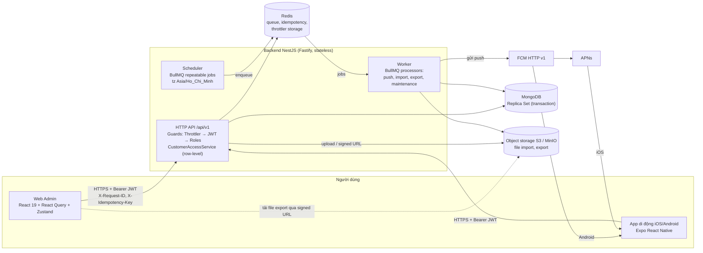
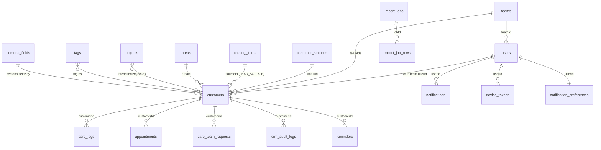
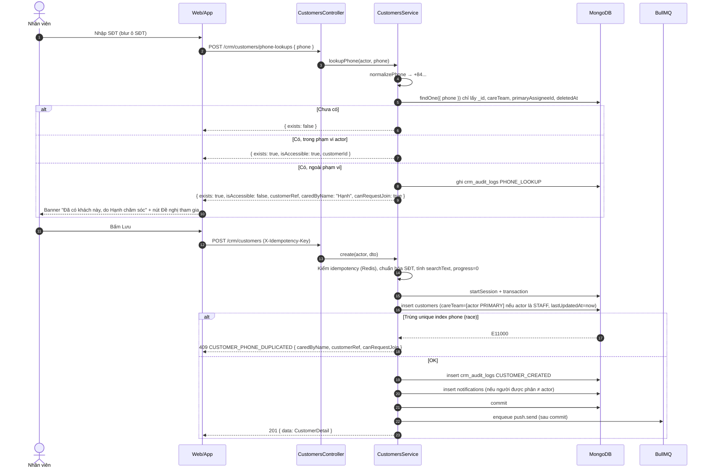
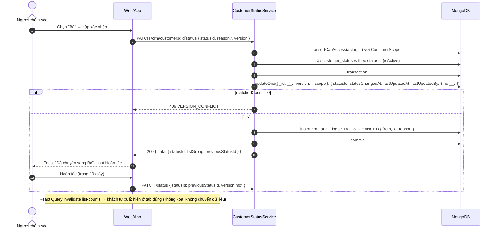
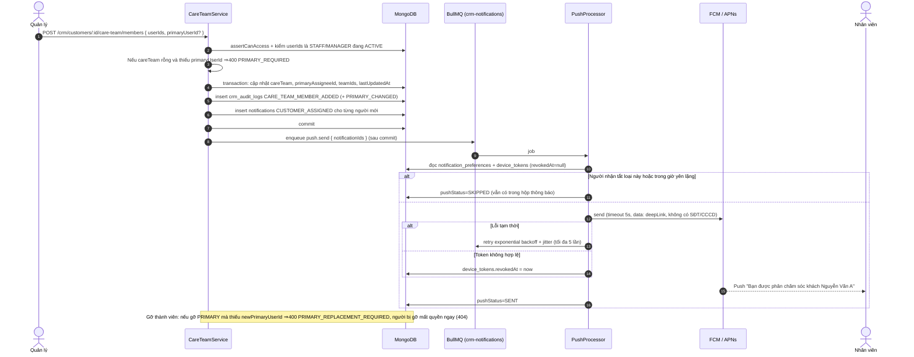
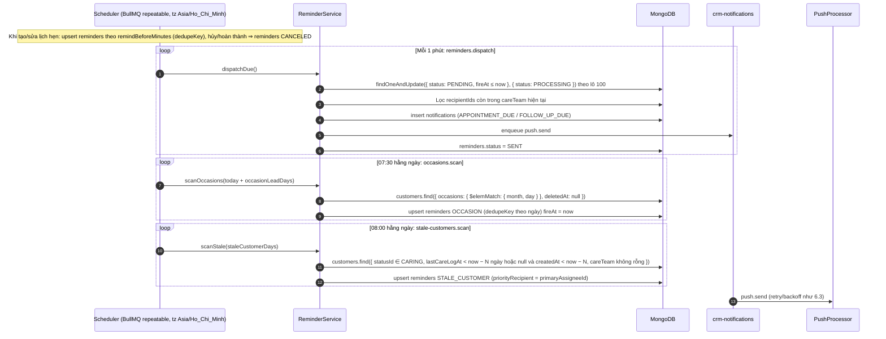
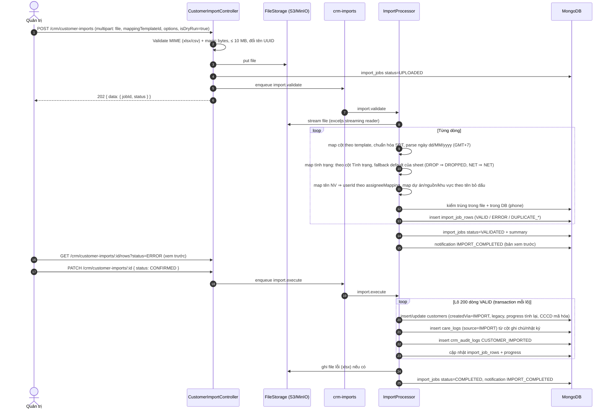

# Tài liệu kỹ thuật: Module Quản lý & chăm sóc khách hàng (CRM)

> **Phạm vi:** giai đoạn 1 của [`01_Project_Plan_WebApp_Quan_Ly_Khach_Hang.md`](01_Project_Plan_WebApp_Quan_Ly_Khach_Hang.md) (C1–C13, X1–X10, quy tắc mục 4, yêu cầu chung mục 5). Zalo (3.3) và ghi âm (3.4) chỉ phác thảo ở [mục 8](#8-giai-đoạn-sau-zalo-ghi-âm--phác-thảo).
> **Danh sách API đầy đủ:** [`05_Danh_Sach_API_Module_Quan_Ly_Khach_Hang.md`](05_Danh_Sach_API_Module_Quan_Ly_Khach_Hang.md).
> **Chuẩn áp dụng:** skill `nodejs-react-mongo-coding-guidelines` (naming, `/api/v1`, Swagger, phân trang `{ data, meta }`, lỗi `{ statusCode, message, timestamp, path }`, soft delete, transaction, audit trail, queue, Correlation ID).
> Các điểm **[Giả định]** gom ở [mục 9](#9-giả-định--câu-hỏi-mở), cần Oniichan xác nhận.

---

## 1. Tổng quan & phạm vi giai đoạn 1

### 1.1 Mục tiêu kỹ thuật

| Mục tiêu | Cách đáp ứng |
|---|---|
| Thay 3 sheet DSKH / DSKH_DROP / DSKH_NET | Một collection `customers` + **tình trạng** (`statusId`) thuộc một nhóm danh sách (`CARING` / `NET` / `DROPPED`). Đổi tình trạng là đổi danh sách hiển thị (C6, quy tắc 2) |
| Nhiều người cùng chăm sóc, đúng 1 phụ trách chính | `careTeam[]` nhúng trong khách + bất biến "đúng 1 PRIMARY" kiểm ở service (C8, quy tắc 7) |
| Phân quyền theo khách được phân | Bộ lọc phạm vi (row-level scope) bắt buộc ở tầng repository, không chỉ guard (X1, quy tắc 6) |
| Tự động hóa việc làm tay | Tiến độ (C5), `lastUpdatedAt` (C7), chống trùng SĐT (X2), nhắc lịch (C3, C13, X5) đều do server tính |
| Chân dung động | `persona_fields` do Quản trị cấu hình (X10) + giá trị lưu kiểu attribute pattern có metadata người/ngày/nguồn (quy tắc 9) |
| Di động có đẩy thông báo | App Expo (iOS/Android) + FCM HTTP v1 (APNs qua Firebase) + hộp thông báo trong app (X5, X9) |

### 1.2 Trong / ngoài phạm vi giai đoạn 1

| Trong phạm vi | Ngoài phạm vi (giai đoạn sau hoặc không yêu cầu) |
|---|---|
| C1–C13, X1–X10 | Z1–Z3 (Zalo), R1–R10 (ghi âm) — xem mục 8 |
| Import/Export Excel/CSV, import dữ liệu cũ | Gợi ý bằng AI (prototype có `aiSuggestion`) — giai đoạn 1 dùng gợi ý theo quy tắc |
| Dashboard thống kê X6 | Real-time "ai đang mở hồ sơ" (tài liệu 02 §8) — giai đoạn 1 dùng React Query refetch |
| App di động dùng chung API | Các trường thừa của prototype (VIP tier, email, ảnh nhật ký, `unitPrice`...) — không phải yêu cầu; nếu cần thì Quản trị thêm qua trường chân dung X10 |

### 1.3 Sơ đồ kiến trúc



| Thành phần | Quyết định | Lý do |
|---|---|---|
| Backend | Tái dùng `RealEstateBackendApp` (NestJS 11 + Fastify), thêm `src/modules/crm/*` | Đã có auth, guard, filter lỗi, logger Winston, request-id, Swagger |
| MongoDB | **Chuyển sang Replica Set** (single-node `rs0` ở dev/docker) | Bắt buộc cho `ClientSession` transaction (tạo khách + audit, đổi tình trạng + audit + thông báo). `docker-compose.yml` hiện chạy standalone |
| Queue + Scheduler | **BullMQ + Redis** (mới) | Tác vụ nặng (import/export, gửi push có retry/backoff) phải tách khỏi request; repeatable job chạy đúng 1 lần dù nhiều instance. Redis cũng thay `IdempotencyService` in-memory hiện tại (không stateless) |
| Worker | Cùng codebase, biến `APP_ROLE=api|worker|all`; giai đoạn 1 chạy `all` trong 1 container | Tối giản hạ tầng; tách container khi tải tăng |
| Lưu file | S3-compatible (MinIO ở dev) qua `FileStorageService` | Backend stateless; file export có hạn (signed URL 15 phút, xóa sau 7 ngày) |
| Push | FCM HTTP v1 cho cả Android và iOS (upload APNs key lên Firebase); app lấy **device token gốc** qua `expo-notifications` | Một nhà cung cấp, một API; Expo Push Service là phương án dự phòng |
| Cache | **Không dùng** ở giai đoạn 1 | Vài nghìn khách, index đủ nhanh; theo skill, cache phải hỏi trước |

---

## 2. Cấu trúc module NestJS

### 2.1 Tái sử dụng vs. mới

| Thành phần | Trạng thái | Ghi chú |
|---|---|---|
| `AuthModule` (login, refresh cookie, logout, me, JwtAuthGuard, RolesGuard, ThrottlerGuard) | **Dùng lại**, mở rộng nhỏ | `GET /auth/me` trả thêm `teamId`, `managedTeamIds`. Hỗ trợ client di động nhận refresh token trong body **[Giả định]** (mục 9) |
| `UsersModule` + `User` schema | **Dùng lại**, mở rộng tương thích ngược | Thêm giá trị enum `UserRole.MANAGER`, `UserRole.STAFF`; thêm field `teamId` (default `null`). `EDITOR` giữ nguyên nghĩa cũ (module tin tức), **không** có quyền CRM |
| `GlobalExceptionFilter` | **Dùng lại**, mở rộng | Giữ 4 trường bắt buộc; thêm trường tùy chọn `errorCode`, `details` (xem 05 §1.3) |
| `PaginationQueryDto`, `buildPaginationMeta`, `normalizePagination` | **Dùng lại** | DTO lọc CRM `extends PaginationQueryDto` |
| `RequestContextMiddleware` (X-Request-ID, AsyncLocalStorage) | **Dùng lại** | requestId ghi vào audit log và log Winston |
| `IdempotencyService` | **Thay storage** | Giữ interface, chuyển Map in-memory sang Redis (`SET NX PX`) để stateless |
| `timezone.util.ts` (`startOfDayUtc`, `endOfDayUtc`) | **Dùng lại** | Lọc theo ngày giờ VN |
| `HealthController` | **Dùng lại**, mở rộng | Readiness thêm kiểm Redis |
| `@nestjs/schedule` | Không dùng cho CRM | Dùng BullMQ repeatable để tránh chạy trùng khi scale ngang |
| `AuditLog` của news-fire-crawl-manager | **Không dùng lại** | Khác cấu trúc (không có diff trường); CRM có collection riêng `crm_audit_logs` |
| Project / Team / Customer | **Mới** | Chưa tồn tại trong backend |

### 2.2 Cây thư mục đề xuất

Theo convention hiện có (`dtos/`, `schemas/`, `services/`, `controllers/`, file `tên.loại.ts`).

```
src/
├── shared/
│   ├── queue/                 # BullMQ connection, QueueNames, base processor (retry/backoff/jitter)
│   └── storage/               # FileStorageService (S3/MinIO, signed URL, UUID filename)
├── modules/
│   ├── teams/                 # [MỚI] nhóm làm việc (org-level): teams.controller/service/repository
│   ├── notifications/         # [MỚI] app-wide: inbox, device-tokens, preferences, FcmPushProvider
│   └── crm/
│       ├── crm.module.ts      # module tổng, import các sub-module, bật bằng FEATURE_CRM_ENABLED
│       ├── common/
│       │   ├── access/        # CustomerAccessService, CrmActor, CustomerScope (row-level)
│       │   ├── crypto/        # PiiCryptoService (AES-256-GCM, keyVersion)
│       │   ├── utils/         # phone-normalizer.util, vietnamese-text.util, sort-parser.util
│       │   └── ref-resolver.service.ts  # batch $in resolve catalog/user refs (chống N+1)
│       ├── customers/         # hồ sơ, tình trạng, tiêu chí, CCCD, consent, bulk, soft delete/restore/anonymize
│       ├── care-teams/        # thành viên, phụ trách chính, care-team-requests (X2)
│       ├── care-logs/         # nhật ký chăm sóc (C2)
│       ├── persona/           # persona-fields (X10) + persona khách + completeness (C10, C12)
│       ├── tags/              # thẻ sở thích/nghề nghiệp (C11)
│       ├── catalogs/          # customer-statuses, lead-sources, areas, contact-results (X7)
│       ├── projects/          # danh sách dự án (X7)
│       ├── appointments/      # lịch hẹn + daily-tasks (C3)
│       ├── reminders/         # scheduler + processors: appointment, occasion (C13), stale customer (X5)
│       ├── audit-logs/        # crm_audit_logs, lịch sử khách (X4)
│       ├── import-export/     # import jobs, mapping templates, export jobs (X8)
│       ├── dashboard/         # thống kê (X6)
│       └── crm-settings/      # cấu hình CRM (ngưỡng ngày, giờ nhắc)
```

### 2.3 Trách nhiệm từng module

| Module | Controller (route gốc) | Service chính | Collection | Phụ thuộc |
|---|---|---|---|---|
| `teams` | `/teams` | `TeamsService` | `teams` | users |
| `notifications` | `/notifications`, `/device-tokens`, `/notification-preferences` | `NotificationsService`, `PushDispatchService`, `FcmPushProvider` | `notifications`, `device_tokens`, `notification_preferences` | queue |
| `crm/customers` | `/crm/customers`, `/crm/deleted-customers`, `/crm/customer-*` | `CustomersService`, `CustomerStatusService`, `CriteriaService`, `NationalIdService`, `CustomerBulkService` | `customers` | access, audit-logs, catalogs, persona, notifications |
| `crm/care-teams` | `/crm/customers/:id/care-team`, `/crm/care-team-requests` | `CareTeamService`, `CareTeamRequestsService` | `customers` (careTeam), `care_team_requests` | access, notifications, audit-logs |
| `crm/care-logs` | `/crm/customers/:id/care-logs` | `CareLogsService` | `care_logs` | access, appointments, notifications |
| `crm/persona` | `/crm/persona-fields`, `/crm/customers/:id/persona` | `PersonaFieldsService`, `CustomerPersonaService`, `PersonaCompletenessCalculator` | `persona_fields`, `customers.persona` | access, queue (recompute) |
| `crm/tags` | `/crm/tags` | `TagsService` | `tags` | — |
| `crm/catalogs` | `/crm/customer-statuses`, `/crm/lead-sources`, `/crm/areas`, `/crm/contact-results` | `CustomerStatusesService`, `CatalogItemsService`, `AreasService` | `customer_statuses`, `catalog_items`, `areas` | — |
| `crm/projects` | `/crm/projects` | `ProjectsService` | `projects` | areas |
| `crm/appointments` | `/crm/appointments`, `/crm/daily-tasks` | `AppointmentsService`, `DailyTasksService` | `appointments` | access, reminders |
| `crm/reminders` | (không có controller) | `ReminderSchedulerService`, `*Processor` | `reminders` | queue, notifications, crm-settings |
| `crm/audit-logs` | `/crm/customers/:id/histories`, `/crm/audit-logs` | `CrmAuditLogService` | `crm_audit_logs` | — |
| `crm/import-export` | `/crm/customer-imports`, `/crm/customer-exports`, `/crm/import-mapping-templates` | `CustomerImportService`, `ImportRowMapper`, `CustomerExportService` | `import_jobs`, `import_job_rows`, `export_jobs`, `import_mapping_templates` | storage, queue, customers |
| `crm/dashboard` | `/crm/dashboard/*` | `DashboardService` (aggregation) | đọc `customers`, `care_logs`, `appointments` | access |
| `crm/crm-settings` | `/crm/settings` | `CrmSettingsService` | `crm_settings` | — |

Mỗi module tách đúng 4 lớp: **Controller** (HTTP + Swagger, không logic) → **Service** (nghiệp vụ, transaction) → **Repository** (truy vấn Mongoose, luôn nhận `CustomerScope`) → **DTO/Schema**.

---

## 3. Data model MongoDB

Quy ước chung cho mọi collection nghiệp vụ: `timestamps: true` (`createdAt`, `updatedAt`), `deletedAt: Date | null` (soft delete, mọi query mặc định `deletedAt: null`), `createdBy`/`updatedBy: ObjectId<User>`, Date lưu UTC; **ngày không có giờ** (sinh nhật, kỷ niệm) lưu chuỗi `YYYY-MM-DD` để không lệch múi giờ. Thay đổi schema chỉ **thêm** field/enum mới (zero-downtime), không đổi kiểu hay xóa field đột ngột.

### 3.1 Sơ đồ quan hệ



### 3.2 `customers` (trung tâm)

| Field | Kiểu | Bắt buộc | Mô tả / quy tắc | ID |
|---|---|---|---|---|
| `fullName` | string (trim, 1–150) | Có | Họ tên | C1, QT3 |
| `phone` | string E.164 (`+84912345678`) | Có | **Đã chuẩn hóa trước khi lưu** (xem 3.2.1). Unique toàn hệ thống | C1, X2, QT3, QT4 |
| `statusId` | ObjectId → `customer_statuses` | Có | Mặc định trạng thái `isDefault` ("Chưa tiếp cận") | C1, C6 |
| `statusChangedAt` | Date | Có | Lần đổi tình trạng gần nhất | C6 |
| `sourceId` | ObjectId → `catalog_items` (LEAD_SOURCE) \| null | Không | Nguồn khách | C1 |
| `interestedProjectIds` | ObjectId[] → `projects` | Không | Nhiều dự án | C1 |
| `areaId` | ObjectId → `areas` \| null | Không | Nơi khách đang ở | C1 |
| `tagIds` | ObjectId[] → `tags` | Không | Thẻ sở thích/nghề nghiệp | C11 |
| `nationalId` | `{ cipherText, iv, authTag, keyVersion }` | Không | **`select: false`**. AES-256-GCM, khóa từ secret `CRM_PII_ENCRYPTION_KEY`, xoay khóa theo `keyVersion` | C9 |
| `nationalIdLast4` | string \| null | Không | 4 số cuối để hiển thị `••••1234` | C9 |
| `hasNationalId` | boolean | Có | Cho UI biết có CCCD | C9 |
| `criteria` | `{ demand, motivation, finance, timing }` mỗi cái `{ isDone: boolean, description: string ≤1000, updatedBy, updatedAt }` | Có (mặc định `isDone=false`) | 4 tiêu chí Nhu cầu / Động cơ / Tài chính / Thời gian | C4 |
| `progress` | number ∈ {0,25,50,75,100} | Có | **Server tính** = số `isDone` × 25, ghi cùng lệnh update tiêu chí; không nhận từ client | C5, QT1 |
| `careTeam` | `[{ userId, role: 'PRIMARY'\|'MEMBER', addedBy, addedAt }]` | Không | Nhóm chăm sóc. **Bất biến:** nếu không rỗng thì đúng 1 `PRIMARY`, `userId` không trùng | C8, QT7 |
| `primaryAssigneeId` | ObjectId \| null | Không | Phi chuẩn hóa từ `careTeam` để lọc/sort/thống kê nhanh | C8, X3, X6 |
| `teamIds` | ObjectId[] | Không | Hợp các `teamId` của thành viên `careTeam`; nếu `careTeam` rỗng thì = nhóm của người tạo. Dùng cho phạm vi Quản lý | QT6 |
| `persona` | `PersonaValue[]` (3.2.2) | Không | Chân dung động, attribute pattern | C10, X10, QT9 |
| `personaFilterKeys` | string[] | Không | Token lọc phi chuẩn hóa, ví dụ `occupation=ke_toan`, `purpose=dau_tu` (chỉ trường `isFilterable`) | X3 |
| `occasions` | `[{ fieldKey, month, day, year? }]` | Không | Sinh ra từ trường chân dung `isOccasion` (sinh nhật, kỷ niệm) để scheduler quét theo ngày | C13 |
| `personaCompleteness` | number 0–100 | Có (0) | Độ đầy đủ chân dung, tính lại khi sửa chân dung hoặc đổi cấu hình trường | C12 |
| `dataConsent` | `{ status: 'UNKNOWN'\|'GRANTED'\|'WITHDRAWN', method?, recordedBy?, recordedAt?, note? }` | Có (`UNKNOWN`) | Ghi nhận khách đồng ý xử lý dữ liệu cá nhân **[Giả định]** (câu hỏi 8) | §5 |
| `lastUpdatedAt` | Date | Có | **Server tự ghi** mỗi lần bất kỳ thông tin khách thay đổi; không có trong DTO | C7, QT5 |
| `lastUpdatedBy` | ObjectId | Có | Người sửa cuối | C7 |
| `lastCareLogAt` | Date \| null | Không | Lần chăm sóc gần nhất (nhật ký) — dùng cho "khách lâu chưa chăm sóc" | X5 |
| `nextAppointmentAt` | Date \| null | Không | Lịch hẹn sắp tới gần nhất (cột "HẸN" trên danh sách) | C3 |
| `searchText` | string | Có | `fullName` bỏ dấu + chữ thường + các biến thể số (`0912345678`, `84912345678`). Không trả ra API | X3, §5 |
| `createdVia` | `'WEB'\|'MOBILE'\|'IMPORT'` | Có | Kênh tạo | X8 |
| `legacy` | `{ sheet: 'DSKH'\|'DSKH_DROP'\|'DSKH_NET', rowNumber, importJobId }` | Không | Truy vết dữ liệu cũ | X8 |
| `deletedAt`, `deletedBy`, `anonymizedAt` | Date/ObjectId | Không | Soft delete; ẩn danh hóa khi khách yêu cầu xóa dữ liệu | §5 |
| `__v` | number | — | Bật `optimisticConcurrency` — client gửi `version` khi PATCH, lệch thì 409 `VERSION_CONFLICT` (nhiều người cùng sửa) | QT7 |

#### 3.2.1 Chuẩn hóa SĐT (X2, QT4)

| Bước | Quy tắc |
|---|---|
| 1 | Bỏ khoảng trắng, `.`, `-`, `()` |
| 2 | Parse bằng `libphonenumber-js` với vùng mặc định `VN`: `0912…` → `+84912…`; `84912…` → `+84912…`; số nước ngoài phải có `+` (khách Việt kiều) |
| 3 | Đổi đầu số 11 số cũ sang 10 số (0162→032, 0163→033, … 0199→059) — bảng map trong `phone-normalizer.util.ts`, áp dụng cả khi nhập tay và import |
| 4 | Không hợp lệ → 400 `INVALID_PHONE` |
| Lưu | `phone` dạng E.164; FE tự định dạng `0912 345 678` khi hiển thị |

#### 3.2.2 `PersonaValue` (nhúng trong `customers.persona`)

| Field | Kiểu | Mô tả |
|---|---|---|
| `fieldKey` | string | Khóa trường trong `persona_fields.key` (bất biến) |
| `valueText` | string ≤ 2000 | Kiểu `TEXT`, `TEXTAREA` |
| `valueNumber`, `valueNumberTo` | number | Kiểu `NUMBER`, `NUMBER_RANGE` (ví dụ ngân sách, đơn vị VNĐ) |
| `valueDate` | string `YYYY-MM-DD` | Kiểu `DATE` |
| `valueOptions` | string[] | Kiểu `SELECT` (1 phần tử), `MULTI_SELECT` |
| `valueBoolean` | boolean | Kiểu `BOOLEAN` |
| `source` | `'CUSTOMER_SHARED'\|'STAFF_OBSERVED'\|'IMPORTED'` | **Nguồn thông tin** (QT9) |
| `updatedBy`, `updatedAt` | ObjectId, Date | **Người và ngày cập nhật** (QT9) |

Khi lưu chân dung, service tính lại trong cùng một lệnh `updateOne`: `personaFilterKeys`, `occasions`, `personaCompleteness`, `lastUpdatedAt`.

**Độ đầy đủ (C12):** `personaCompleteness = round(Σ weight các trường active đã có giá trị / Σ weight các trường active × 100)`. Gợi ý "còn thiếu" = các trường active chưa có giá trị, sắp theo `suggestPriority`, trả trong `GET /crm/customers/:id/persona` (tối đa 5 mục). Khi Quản trị thêm/bớt trường → job `persona.recompute-completeness` chạy nền cho toàn bộ khách.

#### 3.2.3 Index `customers`

| Index | Mục đích |
|---|---|
| `{ phone: 1 }` **unique** (không partial) | SĐT duy nhất **toàn hệ thống**, kể cả khách đã xóa mềm (QT4). Chống race khi 2 người tạo cùng lúc |
| `{ deletedAt: 1, statusId: 1, lastUpdatedAt: -1 }` | Danh sách theo tình trạng, sort ngày cập nhật (mặc định) — phạm vi Quản trị |
| `{ 'careTeam.userId': 1, deletedAt: 1, lastUpdatedAt: -1 }` | Phạm vi Nhân viên |
| `{ teamIds: 1, deletedAt: 1, lastUpdatedAt: -1 }` | Phạm vi Quản lý |
| `{ primaryAssigneeId: 1, statusId: 1 }` | Lọc/thống kê phụ trách chính |
| `{ sourceId: 1 }`, `{ interestedProjectIds: 1 }`, `{ areaId: 1 }`, `{ tagIds: 1 }`, `{ personaFilterKeys: 1 }`, `{ progress: 1 }` | Tiêu chí lọc X3 |
| `{ 'occasions.month': 1, 'occasions.day': 1 }` partial `deletedAt: null` | Quét sinh nhật/kỷ niệm hằng ngày (C13) |
| `{ statusId: 1, lastCareLogAt: 1 }` partial `deletedAt: null` | Quét khách lâu chưa chăm sóc (X5) |
| `{ nextAppointmentAt: 1 }` | Sort theo lịch hẹn |
| `{ fullName: 1 }` với `collation: { locale: 'vi' }` | Sort tên đúng thứ tự tiếng Việt (query sort tên phải truyền cùng collation) |

**Tìm kiếm tiếng Việt không dấu:** giai đoạn 1 dùng regex đã escape trên `searchText` (chuỗi bỏ dấu, `đ→d`), kết hợp với bộ lọc phạm vi + các bộ lọc khác. Với quy mô vài nghìn – vài chục nghìn khách, quét `searchText` trong tập đã thu hẹp đáp ứng < 100 ms. Nếu quá 50k khách: thêm text index `{ searchText: 'text' }` (`default_language: 'none'`) hoặc Atlas Search. Từ khóa toàn chữ số → so khớp chuỗi số trong `searchText` (tìm theo SĐT, kể cả 4 số cuối).

### 3.3 Danh mục (X7)

| Collection | Field chính | Index | Ghi chú |
|---|---|---|---|
| `customer_statuses` | `code` (bất biến), `label`, `listGroup: 'CARING'\|'NET'\|'DROPPED'`, `color`, `order`, `isDefault`, `isSystem`, `isActive`, `deletedAt` | `{ code: 1 }` unique; `{ listGroup: 1, order: 1 }` | Seed 4 trạng thái hệ thống: `NOT_CONTACTED` (CARING, default), `INTERESTED` (CARING), `NET` (NET), `DROPPED` (DROPPED). Quản trị thêm trạng thái mới phải chọn `listGroup` → khách tự vào đúng danh sách (C6, QT2). Không xóa được trạng thái `isSystem` hoặc đang có khách |
| `catalog_items` | `type: 'LEAD_SOURCE'\|'CONTACT_RESULT'\|'PERSONA_GROUP'`, `code`, `label`, `order`, `isActive`, `isSystem`, `meta` (ví dụ CONTACT_RESULT: `{ suggestedFollowUpDays, suggestionText }`), `deletedAt` | `{ type: 1, code: 1 }` unique; `{ type: 1, order: 1 }` | Một collection cho danh mục phẳng (DRY). `CONTACT_RESULT` cho ô "Kết quả liên hệ" và gợi ý mốc hẹn (C3) |
| `areas` | `name`, `nameNormalized`, `type: 'COUNTRY'\|'PROVINCE'\|'DISTRICT'\|'WARD'\|'OTHER'`, `parentId`, `ancestorIds[]`, `adminCode?`, `isLegacy`, `order`, `isActive`, `deletedAt` | `{ parentId: 1, order: 1 }`; `{ ancestorIds: 1 }`; `{ nameNormalized: 1 }` | Cây khu vực linh hoạt. Lọc theo tỉnh tự bao gồm khu vực con (`ancestorIds`). `isLegacy` cho quận/huyện cũ (sau sắp xếp hành chính 2025) **[Giả định]** |
| `projects` | `name`, `code` (unique), `developer?`, `location?`, `areaId?`, `propertyTypes[]`, `priceFrom?`, `priceTo?` (VNĐ), `status: 'UPCOMING'\|'SELLING'\|'SOLD_OUT'`, `description?`, `isActive`, `deletedAt` | `{ code: 1 }` unique; `{ isActive: 1, name: 1 }` (collation vi) | Field tối thiểu, chờ câu hỏi 4 |
| `tags` | `name`, `nameNormalized`, `category: 'INTEREST'\|'OCCUPATION'\|'OTHER'`, `color?`, `usageCount`, `createdBy`, `deletedAt` | `{ category: 1, nameNormalized: 1 }` unique partial `deletedAt: null` | Nhân viên tạo thẻ mới khi gắn; Quản trị sửa/xóa/gộp (C11) |
| `teams` | `name`, `code` (unique), `managerIds: ObjectId[]`, `isActive`, `deletedAt` | `{ code: 1 }` unique; `{ managerIds: 1 }` | Nhóm làm việc cho phạm vi Quản lý |

### 3.4 `persona_fields` (X10)

| Field | Kiểu | Mô tả |
|---|---|---|
| `key` | string slug (unique, **bất biến**) | Ví dụ `birthday`, `occupation`, `budget` |
| `label`, `helpText?`, `placeholder?` | string | Nhãn hiển thị |
| `groupCode` | string → `catalog_items` (PERSONA_GROUP) | Cá nhân / Nghề nghiệp / Sở thích / Dịp đặc biệt / Gia đình / Liên hệ / Nhu cầu BĐS |
| `type` | `'TEXT'\|'TEXTAREA'\|'NUMBER'\|'NUMBER_RANGE'\|'DATE'\|'SELECT'\|'MULTI_SELECT'\|'BOOLEAN'` | **Không đổi được khi đã có dữ liệu** (409 `PERSONA_FIELD_TYPE_LOCKED`) |
| `options` | `[{ value, label, isActive }]` | Cho SELECT/MULTI_SELECT; bỏ lựa chọn = `isActive:false`, không xóa (dữ liệu cũ vẫn đọc được) |
| `order`, `weight` (mặc định 1), `suggestPriority` | number | Sắp xếp, trọng số độ đầy đủ, ưu tiên gợi ý |
| `isFilterable` | boolean | Sinh token vào `customers.personaFilterKeys` |
| `isOccasion`, `occasionLabel?` | boolean, string | Chỉ với DATE; sinh `occasions` để nhắc (C13) |
| `linkedCriterion` | `'DEMAND'\|'MOTIVATION'\|'FINANCE'\|'TIMING'\|null` | Hiển thị cạnh tiêu chí C4 tương ứng (ví dụ ngân sách ↔ Tài chính). **Không tự đánh dấu hoàn thành** tiêu chí |
| `isSensitive` | boolean | Trường dễ chạm nội dung nhạy cảm: khi lưu bắt buộc `source=CUSTOMER_SHARED` + `sensitiveAcknowledged=true` (QT9) |
| `isSystem`, `isActive`, `deletedAt` | boolean/Date | Trường seed không xóa được, chỉ tắt. "Bớt trường" = `isActive:false`, giá trị cũ giữ nguyên (zero-downtime) |

Index: `{ key: 1 }` unique; `{ isActive: 1, groupCode: 1, order: 1 }`.
**Seed** theo bảng gợi ý C10 (tất cả không bắt buộc); nhóm "Nhu cầu BĐS" seed dạng có cấu trúc: `property_types` (MULTI_SELECT), `purchase_purpose` (MULTI_SELECT: ở / đầu tư / cho con), `budget` (NUMBER_RANGE VNĐ), `expected_purchase_time` (SELECT theo quý/khoảng thời gian).

### 3.5 Hoạt động chăm sóc

| Collection | Field chính | Index | ID |
|---|---|---|---|
| `care_logs` | `customerId`, `authorId`, `authorName` (snapshot), `occurredAt` (mặc định now), `content` (1–5000), `contactChannel: 'CALL'\|'ZALO'\|'SMS'\|'MEETING'\|'SITE_VISIT'\|'OTHER'`, `contactResultId?`, `nextAction?: { suggestion, dueAt, appointmentId }`, `source: 'MANUAL'\|'IMPORT'\|'SYSTEM'`, `editedAt?`, `deletedAt`, `deletedBy` | `{ customerId: 1, occurredAt: -1 }` partial `deletedAt:null`; `{ authorId: 1, occurredAt: -1 }` | C2, C3 |
| `appointments` | `customerId`, `type: 'SITE_VISIT'\|'MEETING'\|'DEPOSIT'\|'CALLBACK'\|'OTHER'`, `title`, `startAt`, `endAt?`, `location?`, `note?`, `assigneeId` (người thực hiện), `remindBeforeMinutes: number[]` (mặc định theo cài đặt), `status: 'SCHEDULED'\|'DONE'\|'CANCELED'`, `completedAt?`, `outcome?`, `sourceCareLogId?`, `deletedAt` | `{ assigneeId: 1, startAt: 1 }`; `{ customerId: 1, startAt: 1 }`; `{ status: 1, startAt: 1 }` | C3, X5 |
| `care_team_requests` | `customerId`, `requesterId`, `message?`, `status: 'PENDING'\|'APPROVED'\|'REJECTED'\|'CANCELED'`, `resolvedBy?`, `resolvedAt?`, `resolutionNote?` | `{ customerId: 1, requesterId: 1 }` unique partial `status:'PENDING'`; `{ status: 1, customerId: 1 }` | X2 |
| `reminders` (kỹ thuật) | `type: 'APPOINTMENT'\|'FOLLOW_UP'\|'OCCASION'\|'STALE_CUSTOMER'`, `customerId`, `refId?`, `recipientIds[]`, `priorityRecipientId?`, `fireAt`, `status: 'PENDING'\|'PROCESSING'\|'SENT'\|'CANCELED'\|'FAILED'`, `dedupeKey` (unique), `attempts`, `sentAt?` | `{ status: 1, fireAt: 1 }`; `{ dedupeKey: 1 }` unique; TTL 90 ngày theo `sentAt` | C3, C13, X5 |

`dedupeKey` ví dụ: `APPOINTMENT:{appointmentId}:{offsetMinutes}`, `OCCASION:{customerId}:{fieldKey}:{YYYY-MM-DD}`, `STALE:{customerId}:{YYYY-MM-DD}` → scheduler chạy lại không gửi trùng. `reminders`, `notifications`, `import_job_rows` là dữ liệu kỹ thuật/tạm nên dùng TTL (như `RefreshToken` hiện có), không phải dữ liệu nghiệp vụ.

### 3.6 Thông báo (app-wide)

| Collection | Field chính | Index |
|---|---|---|
| `notifications` | `userId`, `type` (3.6.1), `title`, `body` (**không chứa SĐT, CCCD**), `data: { customerId?, appointmentId?, requestId?, deepLink }`, `priority: 'HIGH'\|'NORMAL'`, `readAt?`, `pushStatus: 'PENDING'\|'SENT'\|'SKIPPED'\|'FAILED'`, `createdAt` | `{ userId: 1, readAt: 1, createdAt: -1 }`; TTL 180 ngày |
| `device_tokens` | `userId`, `token` (unique), `platform: 'IOS'\|'ANDROID'\|'WEB'`, `deviceId?`, `appVersion?`, `lastSeenAt`, `revokedAt?` | `{ token: 1 }` unique; `{ userId: 1, revokedAt: 1 }` |
| `notification_preferences` | `userId` (unique), `types: { [NotificationType]: { push: boolean, inApp: boolean } }`, `quietHours?: { start: 'HH:mm', end: 'HH:mm' }` | `{ userId: 1 }` unique |

#### 3.6.1 Loại thông báo

| `type` | Khi nào | Người nhận | ID |
|---|---|---|---|
| `CUSTOMER_ASSIGNED` | Được thêm vào nhóm chăm sóc / thành phụ trách chính | Người được thêm | X5, QT8 |
| `APPOINTMENT_DUE` | Đến mốc nhắc trước lịch hẹn | `assigneeId` + phụ trách chính (`priority=HIGH`) | C3, X5 |
| `FOLLOW_UP_DUE` | Đến hạn "bước tiếp theo" của nhật ký | Tác giả + phụ trách chính | C3 |
| `CARE_LOG_ADDED` | Người cùng chăm sóc ghi chú mới (gộp theo khách trong 10 phút) | Thành viên khác trong nhóm | X5 |
| `STALE_CUSTOMER` | Khách nhóm CARING quá N ngày chưa có nhật ký | Phụ trách chính (`HIGH`); thành viên chỉ nhận nếu tự bật | X5, QT7 |
| `CUSTOMER_OCCASION` | Sinh nhật / kỷ niệm (hôm nay hoặc trước N ngày) | Cả nhóm chăm sóc, phụ trách chính `HIGH` | C13 |
| `CARE_TEAM_JOIN_REQUESTED` / `CARE_TEAM_JOIN_RESOLVED` | Có đề nghị tham gia / đề nghị được duyệt hoặc từ chối | Phụ trách chính + Quản lý nhóm / người đề nghị | X2 |
| `IMPORT_COMPLETED`, `EXPORT_READY` | Job nền xong | Người tạo job | X8 |

Mặc định bật tất cả, trừ `STALE_CUSTOMER` cho thành viên không phải phụ trách chính. Người dùng bật/tắt từng loại (§5 "Thông báo").

### 3.7 Audit & job

| Collection | Field chính | Index |
|---|---|---|
| `crm_audit_logs` (bất biến, không có API sửa/xóa) | `entityType: 'CUSTOMER'\|'CARE_LOG'\|'APPOINTMENT'\|'CATALOG'\|'PERSONA_FIELD'\|'TEAM'\|'IMPORT'\|'EXPORT'\|'SETTINGS'`, `entityId`, `customerId?`, `action` (3.7.1), `actorId`, `actorName`, `actorRole`, `changes: [{ field, from, to }]` (CCCD luôn che), `reason?`, `source: 'WEB'\|'MOBILE'\|'IMPORT'\|'SYSTEM'`, `requestId`, `ip?`, `userAgent?`, `createdAt` | `{ customerId: 1, createdAt: -1 }`; `{ actorId: 1, createdAt: -1 }`; `{ action: 1, createdAt: -1 }`; `{ entityType: 1, entityId: 1, createdAt: -1 }` |
| `import_mapping_templates` | `code` (`DSKH`\|`DSKH_DROP`\|`DSKH_NET`\|tùy chọn), `name`, `defaultStatusCode`, `columns: [{ header, aliases[], target, transform? }]`, `isSystem` | `{ code: 1 }` unique |
| `import_jobs` | `fileKey`, `originalFileName`, `mimeType`, `size`, `sheetName?`, `mappingTemplateId`, `mappingSnapshot`, `options: { duplicatePolicy: 'SKIP'\|'FILL_EMPTY'\|'OVERWRITE', assigneeMapping[], defaultPrimaryUserId?, defaultTeamId? }`, `isDryRun`, `status: 'UPLOADED'\|'VALIDATING'\|'VALIDATED'\|'IMPORTING'\|'COMPLETED'\|'FAILED'\|'CANCELED'`, `progress: { total, processed }`, `summary: { valid, created, updated, skipped, duplicateInFile, duplicateInDb, errors }`, `errorFileKey?`, `createdBy`, `startedAt?`, `finishedAt?` | `{ createdBy: 1, createdAt: -1 }`; `{ status: 1 }` |
| `import_job_rows` (tạm) | `jobId`, `rowNumber`, `sheet`, `data` (đã map, **CCCD đã mã hóa/che**), `status: 'VALID'\|'ERROR'\|'DUPLICATE_IN_FILE'\|'DUPLICATE_IN_DB'\|'CREATED'\|'UPDATED'\|'SKIPPED'`, `messages[]`, `customerId?` | `{ jobId: 1, rowNumber: 1 }`; `{ jobId: 1, status: 1 }`; TTL 30 ngày |
| `export_jobs` | `filtersSnapshot`, `columns[]`, `format: 'XLSX'\|'CSV'`, `status: 'QUEUED'\|'PROCESSING'\|'READY'\|'FAILED'\|'EXPIRED'`, `rowCount`, `fileKey?`, `expiresAt`, `createdBy` | `{ createdBy: 1, createdAt: -1 }` |
| `crm_settings` (singleton) | `staleCustomerDays` (14), `staleCheckTime` ('08:00'), `occasionNotifyTime` ('07:30'), `occasionLeadDays` ([0, 1]), `defaultAppointmentReminderMinutes` ([60, 1440]), `careLogEditWindowHours` (24), `careLogNotifyDebounceMinutes` (10) | — |

#### 3.7.1 Action audit (X4)

`CUSTOMER_CREATED`, `CUSTOMER_UPDATED`, `STATUS_CHANGED`, `CRITERIA_UPDATED`, `PERSONA_UPDATED`, `CARE_TEAM_MEMBER_ADDED`, `CARE_TEAM_MEMBER_REMOVED`, `PRIMARY_CHANGED`, `NATIONAL_ID_UPDATED`, `NATIONAL_ID_REMOVED`, `NATIONAL_ID_VIEWED`, `DATA_CONSENT_UPDATED`, `CARE_LOG_CREATED`/`UPDATED`/`DELETED`, `APPOINTMENT_*`, `CUSTOMER_DELETED`, `CUSTOMER_RESTORED`, `CUSTOMER_ANONYMIZED`, `CUSTOMER_IMPORTED`, `CUSTOMER_EXPORTED`, `JOIN_REQUEST_*`, `CATALOG_*`, `PERSONA_FIELD_*`, `SETTINGS_UPDATED`, `PHONE_LOOKUP` (chỉ ghi khi kết quả là khách ngoài phạm vi — phát hiện dò số).

Mọi thay đổi trên `customers` ghi audit **trong cùng transaction** với lệnh sửa (skill: ≥ 2 collection ⇒ `ClientSession`).

### 3.8 Thay đổi trên collection có sẵn (tương thích ngược)

| Collection | Thay đổi | Ảnh hưởng dữ liệu cũ |
|---|---|---|
| `users` | Thêm enum `MANAGER`, `STAFF` vào `role`; thêm `teamId: ObjectId \| null` (default `null`), index `{ teamId: 1, status: 1 }` | Không — user cũ giữ `ADMIN`/`EDITOR`, `teamId=null` |
| — | Không đổi kiểu, không xóa field nào | — |

---

## 4. Phân quyền

### 4.1 Vai trò

| Vai trò CRM | `UserRole` | Phạm vi khách |
|---|---|---|
| Quản trị | `ADMIN` | Tất cả |
| Quản lý | `MANAGER` | Khách có `teamIds` giao với các nhóm mình quản lý (`teams.managerIds` chứa mình) **hoặc** mình nằm trong `careTeam` |
| Nhân viên chăm sóc | `STAFF` | Chỉ khách có mình trong `careTeam` (PRIMARY hoặc MEMBER) |
| (Biên tập tin tức) | `EDITOR` | **Không có quyền CRM** — `@Roles(ADMIN, MANAGER, STAFF)` trên mọi controller CRM |

### 4.2 Ma trận vai trò × hành động

Ký hiệu: ✓ = được; **P** = chỉ trong phạm vi khách của mình (4.1); **PR** = chỉ khi là phụ trách chính; **TG** = chỉ khi là tác giả; — = không.

| Hành động | Quản trị | Quản lý | NV – phụ trách chính | NV – thành viên | ID |
|---|---|---|---|---|---|
| Xem danh sách, chi tiết, nhật ký, chân dung, lịch sử khách | ✓ | P | P | P | C8, QT6, QT9 |
| Kiểm tra trùng SĐT (chỉ biết "do [tên] chăm sóc") | ✓ | ✓ | ✓ | ✓ | X2 |
| Tạo khách (NV tạo ⇒ tự là phụ trách chính) | ✓ | ✓ | ✓ | ✓ | C1, QT7 |
| Sửa hồ sơ, tiêu chí, chân dung, thẻ; ghi nhật ký; đổi tình trạng | ✓ | P | ✓ | ✓ | QT7 |
| Sửa / xóa nhật ký | ✓ | P | TG (trong 24 giờ) | TG (trong 24 giờ) | C2 |
| Thêm thành viên chăm sóc | ✓ | P | ✓ **[Giả định]** | — | C8 |
| Gỡ thành viên (không phải phụ trách chính) | ✓ | P | ✓ **[Giả định]** | — | C8 |
| Đổi phụ trách chính; gỡ phụ trách chính (bắt buộc chọn người thay) | ✓ | P | — | — | QT7 |
| Đề nghị tham gia nhóm chăm sóc | — | ✓ | ✓ | ✓ | X2 |
| Duyệt / từ chối đề nghị tham gia | ✓ | P | ✓ | — | X2 |
| Nhập / sửa / xóa CCCD | ✓ | P | ✓ | ✓ | C9 |
| Xem CCCD đầy đủ (có ghi log) | ✓ | P | ✓ **[Giả định]** | — | C9 |
| Xem nhật ký xem CCCD | ✓ | P | — | — | C9 |
| Cập nhật đồng ý xử lý dữ liệu | ✓ | P | ✓ | ✓ | §5 |
| Xóa mềm khách | ✓ | P | — | — | — |
| Khôi phục khách đã xóa; ẩn danh hóa theo yêu cầu khách | ✓ | — | — | — | §5 |
| Thao tác hàng loạt: đổi tình trạng, gắn thẻ | ✓ | P | P | P | tài liệu 02 §4.2 |
| Thao tác hàng loạt: phân người chăm sóc | ✓ | P | — | — | C8 |
| Lịch hẹn: tạo/sửa/hoàn thành | ✓ | P | ✓ | ✓ | C3 |
| Lịch hẹn: xóa mềm | ✓ | P | TG | TG | C3 |
| Đọc danh mục, dự án, trường chân dung, thẻ | ✓ | ✓ | ✓ | ✓ | X7 |
| Tạo thẻ mới khi gắn | ✓ | ✓ | ✓ | ✓ | C11 |
| Sửa/xóa thẻ, danh mục, dự án, trường chân dung, cài đặt CRM | ✓ | — | — | — | X7, X10 |
| Quản lý người dùng, nhóm | ✓ | — | — | — | X7 |
| Dashboard | ✓ (tất cả) | P (nhóm mình) | — | — | X6 |
| Import dữ liệu | ✓ | — | — | — | X8 |
| Export | ✓ | P | — | — | X8 |
| Nhật ký audit toàn hệ thống | ✓ | — | — | — | X4 |
| Thông báo, thiết bị, cài đặt thông báo của chính mình | ✓ | ✓ | ✓ | ✓ | X5 |

### 4.3 Cách enforce row-level (không chỉ guard)

| Lớp | Cơ chế |
|---|---|
| Guard (thô) | `JwtAuthGuard` + `RolesGuard` có sẵn: chặn `EDITOR` và route chỉ dành cho Quản trị |
| `CrmActor` | Mỗi request tạo `CrmActor { userId, role, teamId, managedTeamIds }` — đọc `users` + `teams` từ DB (1 truy vấn có index, nhớ trong phạm vi request). **Không** nhét team vào JWT để khi đổi nhóm có hiệu lực ngay |
| `CustomerAccessService.buildScope(actor)` | Trả `CustomerScope` (kiểu "branded", chỉ service này tạo được): ADMIN → `{}`; MANAGER → `{ $or: [{ teamIds: { $in: managedTeamIds } }, { 'careTeam.userId': me }] }`; STAFF → `{ 'careTeam.userId': me }` |
| Repository | **Mọi** hàm đọc/ghi `customers` bắt buộc nhận tham số `scope: CustomerScope` và merge vào filter (`{ ...filter, ...scope, deletedAt: null }`). Thiếu scope ⇒ lỗi biên dịch TypeScript. Hàm không-scope chỉ dành cho worker, đặt tên rõ `findForSystemJob*` |
| Tài nguyên con (nhật ký, lịch hẹn, chân dung, CCCD, care team) | `assertCanAccess(actor, customerId, action)` = `findOne({ _id, ...scope })` lấy kèm `careTeam` để kiểm quyền theo vai (PR/TG) |
| Không lộ tồn tại | Khách ngoài phạm vi trả **404 `CUSTOMER_NOT_FOUND`**, không 403 |
| Danh sách chéo khách (lịch hẹn, việc hôm nay) | Nhân viên: `customerId ∈ accessibleCustomerIds(actor)` (truy vấn covered index `careTeam.userId`); Quản lý: tương tự theo `teamIds`; Quản trị: không lọc |
| Export, dashboard, scheduler | Export và dashboard dùng cùng `CustomerScope`; scheduler chỉ gửi cho thành viên `careTeam` hiện tại (người bị gỡ không còn nhận — QT8) |
| Dữ liệu trả về | `.select()` tường minh (`nationalId` `select:false`; `searchText` không bao giờ trả); DTO response map tay (không ném nguyên document) |
| Kiểm thử | E2E bảng ma trận 4.2 × 4 vai trò; test riêng "NV bị gỡ khỏi nhóm ⇒ 404 ở mọi endpoint con" |

---

## 5. Danh sách API

Xem file riêng: **[`05_Danh_Sach_API_Module_Quan_Ly_Khach_Hang.md`](05_Danh_Sach_API_Module_Quan_Ly_Khach_Hang.md)** — quy ước chung (format response/lỗi, phân trang, sort, filter, header), 15 nhóm, **112 endpoint** (10 dùng lại, 102 mới), DTO dùng chung và mã lỗi.

| Nhóm | Số endpoint |
|---|---|
| 1. Auth (dùng lại) | 4 |
| 2. Người dùng & nhóm | 10 |
| 3. Khách hàng | 14 |
| 4. CCCD | 4 |
| 5. Nhóm chăm sóc & đề nghị tham gia | 7 |
| 6. Nhật ký chăm sóc | 4 |
| 7. Chân dung & thẻ | 11 |
| 8. Danh mục & dự án | 21 |
| 9. Lịch hẹn & việc hôm nay | 8 |
| 10. Thông báo & thiết bị | 8 |
| 11. Lịch sử & audit | 2 |
| 12. Import / Export | 12 |
| 13. Dashboard | 3 |
| 14. Cài đặt CRM | 2 |
| 15. Health (dùng lại) | 2 |
| **Tổng** | **112** |

---

## 6. Luồng xử lý chính

### 6.1 Tạo khách có kiểm tra trùng SĐT (C1, X2, QT3, QT4, C7)



### 6.2 Đổi tình trạng (C6, QT2, X4)



### 6.3 Phân khách & gửi push (C8, QT7, QT8, X5)



### 6.4 Nhắc lịch hẹn / sinh nhật / khách lâu chưa chăm sóc (C3, C13, X5)



### 6.5 Import dữ liệu cũ DSKH / DSKH_DROP / DSKH_NET (X8)



Quy tắc import: cột tiến độ dạng ký tự (█░) **bỏ qua**, tiến độ tính lại từ 4 cột tiêu chí; "ngày cập nhật cuối" lấy từ sheet nếu hợp lệ, ngược lại = thời điểm import **[Giả định]**; dòng thiếu tên hoặc SĐT ⇒ ERROR (QT3); trùng SĐT xử lý theo `duplicatePolicy` (mặc định `SKIP`, báo cáo cho Quản trị); danh mục chưa có (nguồn, khu vực, dự án) ⇒ tạo mới ở trạng thái `isActive=false` để Quản trị duyệt **[Giả định]**.

---

## 7. Yêu cầu phi chức năng

### 7.1 Hiệu năng (§5 "Tốc độ")

| Chỉ tiêu | Mục tiêu | Cách đạt |
|---|---|---|
| `GET /crm/customers` (5.000 khách, lọc + sort + tìm kiếm) | p95 < 300 ms | Index 3.2.3; `.lean()`; projection chỉ trường của danh sách; `countDocuments` cùng filter chạy song song; giới hạn `limit ≤ 100` |
| `GET /crm/customers/:id` | p95 < 200 ms | 1 truy vấn khách + batch `$in` cho ref (RefResolver), không populate lồng |
| `list-counts` (3 tab) | p95 < 150 ms | 1 aggregation `$group` theo `statusId` |
| Dashboard | p95 < 800 ms | Aggregation có `$match` theo scope + khoảng thời gian; chưa cache |
| Import 5.000 dòng | < 2 phút | Streaming reader, lô 200, chạy nền |
| Chống N+1 | — | Không populate từng dòng; `RefResolver` gom id rồi `$in` 1 lần/loại |
| Kiểm chứng | — | Seed 10.000 khách + k6 load test trước khi release (M7) |

### 7.2 Múi giờ GMT+7 (§5)

| Chủ đề | Quy tắc |
|---|---|
| Lưu trữ | Date UTC; ngày-không-giờ (`YYYY-MM-DD`) lưu chuỗi |
| API vào | ISO 8601 có offset (`2026-10-21T15:00:00+07:00`); bộ lọc ngày `YYYY-MM-DD` hiểu là ngày giờ VN, quy đổi bằng `startOfDayUtc`/`endOfDayUtc` có sẵn |
| API ra | ISO 8601 UTC (`Z`); FE/App định dạng `dd/MM/yyyy HH:mm` theo `Asia/Ho_Chi_Minh` |
| Scheduler | Repeatable job khai `tz: 'Asia/Ho_Chi_Minh'`; "hôm nay" của sinh nhật tính theo giờ VN |
| Tiếng Việt | UTF-8, lưu đúng chữ có dấu; `searchText` bỏ dấu để tìm; sort tên dùng collation `vi` |

### 7.3 Bảo vệ dữ liệu cá nhân (Nghị định 13/2023/NĐ-CP — yêu cầu kỹ thuật)

> Luật Bảo vệ dữ liệu cá nhân 2025 có hiệu lực từ 01/01/2026; cần bộ phận pháp chế xác nhận văn bản đang áp dụng. Bảng dưới chỉ nêu yêu cầu kỹ thuật.

| Yêu cầu | Thiết kế |
|---|---|
| Sự đồng ý của chủ thể dữ liệu | `customers.dataConsent` (trạng thái, hình thức, người ghi nhận, thời điểm); có thể rút lại; audit `DATA_CONSENT_UPDATED` |
| Tối thiểu hóa dữ liệu | CCCD không bắt buộc; trường chân dung đều tùy chọn; trường `isSensitive` cần khách tự chia sẻ + xác nhận (QT9); không thu thập tôn giáo/chính trị/sức khỏe mặc định |
| Mã hóa | CCCD mã hóa cấp trường AES-256-GCM, khóa trong secret (không trong repo), có `keyVersion` để xoay khóa; TLS cho mọi kết nối; backup mã hóa |
| Kiểm soát truy cập | Row-level scope (4.3); xem CCCD qua endpoint riêng, giới hạn 10 lần/phút/người, header `Cache-Control: no-store` |
| Nhật ký xử lý | `crm_audit_logs`: mọi lần xem CCCD, export, import, đổi người chăm sóc, sửa chân dung; lưu ≥ 2 năm **[Giả định]** |
| Quyền sửa, xóa của khách | Sửa: API thường. Xóa: `POST /crm/customer-anonymizations` (Quản trị) ghi đè PII bằng giá trị ẩn danh, xóa nhật ký/chân dung, giữ khung thống kê — không xóa cứng document (tương thích quy tắc soft delete) |
| Chuyển dữ liệu ra ngoài | Payload push qua FCM (máy chủ nước ngoài) **không chứa SĐT, CCCD, nội dung nhật ký** — chỉ tên khách và loại việc; không gửi CCCD/nhạy cảm sang dịch vụ phân tích bên ngoài (QT10) |
| Chống dò số | `phone-lookups` giới hạn 30 lần/phút/người, chỉ trả tên hiển thị người phụ trách, audit khi tra khách ngoài phạm vi |
| Export | Export không bao giờ chứa CCCD đầy đủ (chỉ `••••1234`); file có hạn 7 ngày, signed URL 15 phút; audit `CUSTOMER_EXPORTED` |
| Log ứng dụng | Winston không ghi body chứa `phone`, `nationalId` (bổ sung danh sách che vào sanitizer); `X-Request-ID` trên mọi dòng log |
| Sự cố | Cảnh báo bất thường (ví dụ > 50 lần xem CCCD/giờ/người) gửi Quản trị; quy trình thông báo sự cố do tổ chức ban hành |

### 7.4 Bảo mật chung

Helmet (`@fastify/helmet`, hiện chưa đăng ký — bổ sung), CORS chỉ domain FE (đã có), `ValidationPipe` whitelist (đã có), chống NoSQL injection (Fastify không dùng được `express-mongo-sanitize` ⇒ sanitize `$`/`.` trong key bằng hook `preValidation` + `sanitizeFilter` của Mongoose), Throttler chuyển sang storage Redis khi chạy nhiều instance, upload validate MIME + magic bytes + đổi tên UUID, khóa tài khoản sau 5 lần sai mật khẩu (đã có theo chuẩn auth).

### 7.5 Sao lưu & vận hành

| Hạng mục | Thiết kế **[Giả định]** |
|---|---|
| Sao lưu | `mongodump --oplog` hằng ngày 02:00 GMT+7, mã hóa, lưu ngoài máy chủ 30 ngày; snapshot volume hằng tuần |
| Khôi phục | Diễn tập khôi phục mỗi tháng; RPO 24 giờ, RTO 4 giờ |
| Health | `/api/v1/health/liveness`, `/api/v1/health/readiness` (thêm Redis) — đã có |
| Graceful shutdown | `enableShutdownHooks()` đã có; worker BullMQ `close()` chờ job đang chạy |
| Feature flag | `FEATURE_CRM_ENABLED`, `FEATURE_CRM_PUSH`, `FEATURE_CRM_IMPORT` |
| Giám sát | Log Winston có requestId; số job lỗi/retry của queue; tỉ lệ push thất bại; cảnh báo truy cập CCCD bất thường |

### 7.6 Frontend (web + app) — cấu trúc dữ liệu

| Lớp | Quy tắc |
|---|---|
| API | `src/modules/crm/api/*.api.ts` dùng `apiAxios` có sẵn; bổ sung interceptor sinh `X-Request-ID` (hiện FE chưa gửi) và `X-Idempotency-Key` cho POST quan trọng |
| Server state | React Query: `useCustomersQuery(filters)`, `useCustomerQuery(id)`, `useCareLogsInfiniteQuery`, `useDailyTasksQuery`...; mutation invalidate đúng key; Optimistic UI cho đổi tình trạng, tick tiêu chí |
| Global UI state | Zustand: bộ lọc danh sách, chế độ xem bảng/thẻ (persist) |
| Local state | `useState`/react-hook-form + zod cho form |
| Danh mục | Tải 1 lần, `staleTime` 5 phút (statuses, sources, areas, projects, persona-fields, tags) |
| Prototype | Thay `store/` mock (reducer + localStorage) bằng các hook trên; không giữ trường thừa của prototype |

---

## 8. Giai đoạn sau: Zalo, ghi âm — phác thảo

### 8.1 Zalo (3.3, chưa quyết định)

| ID | Thành phần dự kiến | API dự kiến |
|---|---|---|
| Z1 | Chỉ FE: nút mở `https://zalo.me/{phone}` từ hồ sơ | Không cần API |
| Z2 | Module `zalo-integrations`: Zalo OA token (mã hóa), mẫu tin ZNS đã duyệt, `zalo_messages` (trạng thái gửi, chi phí), queue gửi có retry | `GET/POST /crm/zalo-templates`, `POST /crm/customers/:id/zalo-messages`, `GET /crm/customers/:id/zalo-messages` |
| Z3 | Webhook OA nhận tin, map SĐT ⇒ khách, ghi `care_logs` `source='ZALO_OA'` | `POST /webhooks/zalo-oa` (`@Public`, xác thực chữ ký) |

### 8.2 Ghi âm có đồng ý, chuyển văn bản, phân tích (3.4)

| ID | Thành phần dự kiến |
|---|---|
| R1 | `recording_consents` { customerId, status GRANTED/WITHDRAWN, method, recordedBy, recordedAt }; mọi luồng ghi âm kiểm consent trước |
| R2, R3, R4 | Tích hợp nhà cung cấp tổng đài/VoIP (cuộc gọi trong app + số tổng đài chuyển cho phụ trách chính); câu thông báo đầu cuộc gọi cấu hình ở tổng đài |
| R5 | Upload file ghi âm (MIME audio, UUID, S3 mã hóa) gắn vào khách, `source='UPLOADED'` |
| R6 | Queue `crm-transcriptions`: STT tiếng Việt (bên thứ ba, timeout + retry), kết quả vào `call_transcripts` + `care_logs` `source='CALL_TRANSCRIPT'` |
| R7 | Tóm tắt + gợi ý giá trị chân dung ở trạng thái "chờ duyệt" (`persona_suggestions`), nhân viên duyệt mới ghi vào `persona` với `source` mới `CALL_ANALYSIS` (thêm enum, tương thích ngược) |
| R8 | `call_recordings` mã hóa, quyền như chân dung, audit mỗi lần nghe, thời hạn lưu cấu hình, xóa theo yêu cầu |
| R9 | Text index trên `call_transcripts` theo khách/thời gian |
| R10 | Ghi âm micro trên app khi cả hai bên đồng ý — tùy chọn |

API dự kiến: `PUT /crm/customers/:id/recording-consent`, `POST /crm/customers/:id/call-recordings` (upload), `GET /crm/customers/:id/call-recordings`, `POST /crm/call-recordings/:id/playbacks` (cấp URL nghe, có log), `GET /crm/call-transcripts?q=`, `PATCH /crm/persona-suggestions/:id`, `POST /webhooks/telephony`.

Chuẩn bị ngay ở giai đoạn 1 (không tốn thêm): enum `care_logs.source` và `PersonaValue.source` là tập mở để thêm giá trị; `FileStorageService` dùng chung.

---

## 9. Giả định & câu hỏi mở

### 9.1 Các điểm **[Giả định]** trong tài liệu 01 và phương án mặc định đã chọn

| # | Vị trí trong 01 | Nội dung giả định | Phương án thiết kế đang chọn |
|---|---|---|---|
| G1 | §2 Người dùng | 3 vai trò Quản trị / Quản lý / Nhân viên | Map `ADMIN` / `MANAGER` (mới) / `STAFF` (mới); `EDITOR` hiện có không vào CRM. Dùng chung hệ thống tài khoản hiện có |
| G2 | X2 | Báo "do [tên] chăm sóc" + đề nghị tham gia | `phone-lookups` trả `caredByName` (tên hiển thị phụ trách chính) + `customerRef`; đề nghị gửi tới phụ trách chính và Quản lý nhóm; ai trong họ duyệt trước thì có hiệu lực; người đề nghị nhận thông báo kết quả |
| G3 | QT6 | Quản trị xem tất cả, Quản lý xem nhóm, Nhân viên xem khách được phân | "Khách của nhóm" = khách có ít nhất 1 người chăm sóc thuộc nhóm (`teamIds`); khách chưa phân thuộc nhóm của người tạo |
| G4 | QT7 | Phụ trách chính nhận thông báo ưu tiên và có thống kê riêng | Ưu tiên = `priority=HIGH` + luôn nhận `STALE_CUSTOMER`, `APPOINTMENT_DUE`, `CUSTOMER_OCCASION`; dashboard có cột "phụ trách chính" tách với "cùng chăm sóc" |
| G5 | QT7 | Quản lý/Quản trị đổi phụ trách chính; gỡ phụ trách chính phải chọn người thay | Đúng như vậy; thiếu người thay ⇒ 400 `PRIMARY_REPLACEMENT_REQUIRED`. Thêm: phụ trách chính được thêm/gỡ **thành viên** (không đổi được phụ trách chính) |
| G6 | C10 [Đề xuất] | Danh sách trường chân dung gợi ý | Seed toàn bộ bảng gợi ý thành trường hệ thống, đều tùy chọn; Quản trị tắt/sửa/thêm qua X10 |

### 9.2 Câu hỏi mục 7 của tài liệu 01 — phương án mặc định để không chặn thiết kế

| Câu hỏi | Mặc định đang dùng | Ảnh hưởng nếu đổi |
|---|---|---|
| 1. Số người dùng, vai trò khác | ≤ 100 người dùng, 3 vai trò | Thêm vai trò = thêm enum + dòng ma trận |
| 2. Tình trạng khác | Danh mục động có `listGroup`; seed 4 giá trị | Không đổi code |
| 3. Phụ trách chính khác gì thành viên | Xem G5 + xem CCCD đầy đủ + duyệt đề nghị tham gia | Đổi cấu hình quyền trong `CareTeamPolicy` |
| 4. Ai quản lý dự án, lưu gì | Quản trị; field tối thiểu (tên, mã, chủ đầu tư, vị trí, loại hình, khoảng giá, trạng thái) | Thêm field = tương thích ngược |
| 5. Danh sách khu vực | Cây khu vực tự do: Việt Nam → tỉnh/thành (34 đơn vị sau sắp xếp 2025) + quận/huyện cũ đánh dấu `isLegacy` để khớp dữ liệu sheet + "Nước ngoài" → quốc gia | Chỉ đổi seed |
| 6. Zalo | Chỉ Z1 (FE) nếu muốn làm sớm | Mục 8.1 |
| 7. Trường chân dung, X10 | Có X10 + seed như G6 | — |
| 8. Ghi nhận đồng ý lưu thông tin | Có trường `dataConsent` (không chặn lưu khách) | Nếu bắt buộc: thêm validate khi lưu chân dung |
| 9, 10. Ghi âm | Giai đoạn sau | Mục 8.2 |

### 9.3 Quyết định thiết kế bổ sung cần xác nhận

| # | Quyết định | Mặc định | Phương án khác |
|---|---|---|---|
| D1 | SĐT unique kể cả khách đã xóa mềm | Có (đúng QT4 "toàn hệ thống"); tạo lại số đã xóa ⇒ 409 kèm gợi ý Quản trị khôi phục | Unique chỉ trong tập chưa xóa |
| D2 | Ai xem CCCD đầy đủ | Quản trị, Quản lý (phạm vi), phụ trách chính | Chỉ Quản trị |
| D3 | Sửa/xóa nhật ký | Tác giả trong 24 giờ; Quản lý/Quản trị bất kỳ lúc nào (xóa mềm) | Không cho sửa |
| D4 | "Khách lâu chưa chăm sóc" | Nhóm CARING, 14 ngày không có nhật ký (cấu hình được) | Ngưỡng khác theo tình trạng |
| D5 | Hạ tầng mới | MongoDB Replica Set, Redis + BullMQ, S3/MinIO, Firebase project | Không Redis: job lưu Mongo + `@nestjs/schedule` có khóa (đơn giản hơn nhưng kém bền khi scale) |
| D6 | Refresh token cho app di động | App gửi `X-Client-Type: mobile` ⇒ refresh token trả trong body, lưu `expo-secure-store`; web giữ HttpOnly cookie | Dùng cookie cho cả app (RN hỗ trợ nhưng dễ lỗi) |
| D7 | Cột của 3 sheet cũ | Template mặc định đoán: STT, Họ tên, SĐT, Nguồn, Dự án, Khu vực, CCCD, Tình trạng, Nhu cầu, Động cơ, Tài chính, Thời gian (mô tả + dấu ✓), Tiến độ (bỏ qua), Ngày cập nhật, NV chăm sóc, Ghi chú | **Cần file mẫu thật** để chốt template; template sửa được qua API, không cần code |
| D8 | Ngày cập nhật cuối khi import | Lấy từ sheet nếu hợp lệ | Luôn = thời điểm import |
| D9 | Danh mục chưa có khi import | Tạo mới `isActive=false` chờ duyệt | Báo lỗi dòng |
| D10 | Export | Không chứa CCCD đầy đủ; Quản lý chỉ export trong phạm vi | Cho Quản trị export CCCD |
| D11 | Lưu audit | ≥ 2 năm | Theo pháp chế |
| D12 | Format lỗi | Giữ 4 trường chuẩn, thêm tùy chọn `errorCode`, `details` | Chỉ `message` (FE phải parse chuỗi) |

---

## 10. Kế hoạch triển khai theo milestone

| Milestone | Nội dung | Phụ thuộc | Agent | Tiêu chí xong |
|---|---|---|---|---|
| **M0 – Nền tảng** | Mongo Replica Set; Redis + BullMQ (`shared/queue`); `FileStorageService` + MinIO; `PiiCryptoService`; Idempotency sang Redis; mở rộng `GlobalExceptionFilter` (`errorCode`, `details`); Helmet; feature flag; readiness Redis | — | devops-agent, coder-backend-agent | Health readiness xanh; transaction chạy trong test |
| **M1 – Người dùng, nhóm, danh mục** | Enum `MANAGER`/`STAFF`, `users.teamId`, module `teams`, `assignable-users`; `customer-statuses`, `catalog_items` (nguồn, kết quả liên hệ), `areas`, `projects` + seed | M0 | coder-backend-agent | CRUD + Swagger + unit test |
| **M2 – Khách hàng lõi** | `CustomerAccessService` + `CustomerScope`; customers CRUD, phone-lookups, chuẩn hóa SĐT, `searchText`, list/filter/sort/list-counts, đổi tình trạng, tiêu chí/tiến độ, CCCD (mã hóa, xem có log), consent, soft delete/restore/anonymize; `crm_audit_logs` + histories | M1 | coder-backend-agent → qa-agent | E2E ma trận quyền 4.2; p95 danh sách đạt trên 10k seed |
| **M3 – Chăm sóc** | care-team (thêm/gỡ/đổi chính), care-team-requests, care-logs, bulk operations | M2 | coder-backend-agent → qa-agent | Bất biến "đúng 1 PRIMARY" có test; NV bị gỡ ⇒ 404 |
| **M4 – Chân dung & thẻ** | persona-fields (X10) + seed, persona khách, completeness + job recompute, tags | M2 | coder-backend-agent → qa-agent | Đổi cấu hình trường không làm mất dữ liệu cũ |
| **M5 – Lịch hẹn, nhắc việc, thông báo** | appointments, daily-tasks, reminders scheduler, notifications, device-tokens, preferences, FCM provider | M3 | coder-backend-agent, devops-agent (Firebase) → qa-agent | Push thật đến iOS + Android; không gửi trùng khi restart |
| **M6 – Web Admin** | Nối prototype `RealEstateAdminApp/src/modules/crm` với API (React Query/Zustand) theo thứ tự: danh sách → chi tiết → tạo khách → việc hôm nay → lịch hẹn → cài đặt | M2–M5 (theo từng API) | coder-frontend-agent → qa-agent | Không còn mock store; Skeleton loading; lỗi tiếng Việt |
| **M7 – Import/Export & Dashboard** | import-mapping-templates (DSKH/DROP/NET), customer-imports (dry-run → confirm), customer-exports, dashboard | M2, M3 | coder-backend-agent, coder-frontend-agent → qa-agent | Import thử với file sheet thật; số liệu dashboard khớp truy vấn kiểm |
| **M8 – App di động** | Expo app dùng chung API: đăng nhập (D6), danh sách, chi tiết, ghi chú nhanh, lịch hẹn, thông báo đẩy + deep link | M5 | coder-frontend-agent → qa-agent | TestFlight + Android internal testing |
| **M9 – Hardening** | Load test k6, security review (CCCD, scope, dò số), sao lưu/khôi phục, bật flag production | Tất cả | qa-agent, devops-agent | Checklist Quality Gates đạt |

### 10.1 Chiến lược kiểm thử (TDD)

| Mức | Trọng tâm |
|---|---|
| Unit | `normalizePhone` (đầu số cũ, +84, nước ngoài), `computeProgress`, `PersonaCompletenessCalculator`, `buildScope`, `buildSearchText` (đ→d), parser sort/filter, mapper import |
| Integration | `mongodb-memory-server` chế độ replica set: transaction tạo khách + audit, race trùng SĐT (E11000 ⇒ 409), optimistic concurrency, dedupe reminders |
| E2E | Ma trận quyền 4.2 cho 4 vai trò; luồng 6.1–6.5 |
| Hiệu năng | k6 trên 10.000 khách: danh sách, tìm kiếm không dấu, list-counts, dashboard |

### 10.2 Quality gates

- [ ] Mọi route CRM có `@ApiTags`, `@ApiOperation`, DTO có `@ApiProperty`; prefix `/api/v1`.
- [ ] Mọi danh sách trả `{ data, meta }`; mọi lỗi theo `GlobalExceptionFilter`.
- [ ] Không có truy vấn `customers` nào không đi qua `CustomerScope` (trừ `findForSystemJob*`).
- [ ] `nationalId` không bao giờ xuất hiện trong response/log; xem CCCD luôn tạo audit.
- [ ] Không xóa cứng dữ liệu nghiệp vụ; schema chỉ thêm field/enum.
- [ ] Thao tác ≥ 2 collection chạy trong transaction; push/job enqueue **sau** commit.
- [ ] POST tạo khách/nhật ký/lịch hẹn/import/bulk kiểm `X-Idempotency-Key`.
- [ ] Gọi FCM/S3 có timeout 5 s, retry exponential backoff + jitter.
- [ ] Không `console.log`; log có `requestId`.
