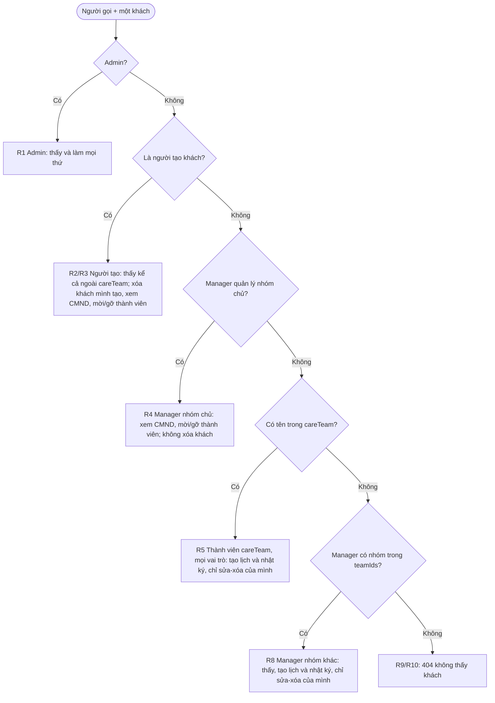
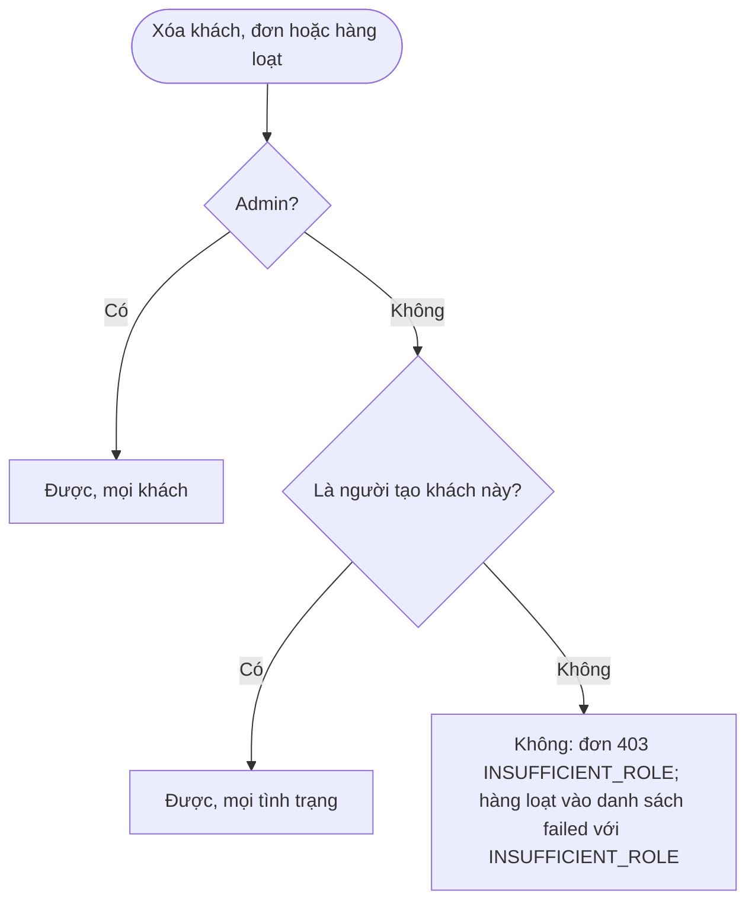
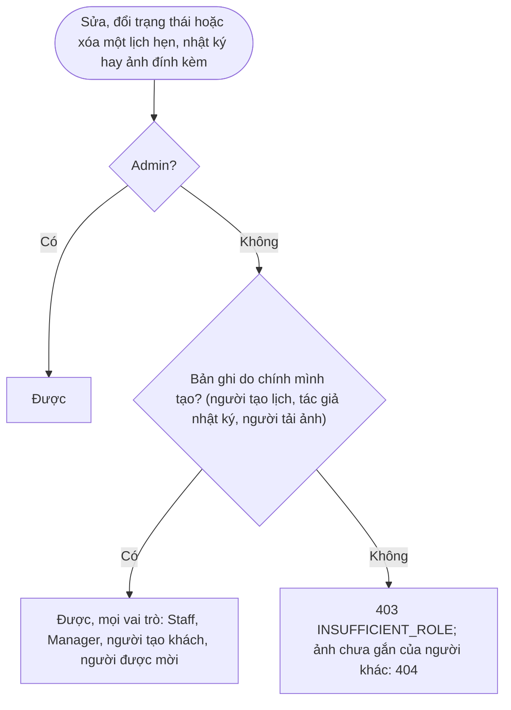
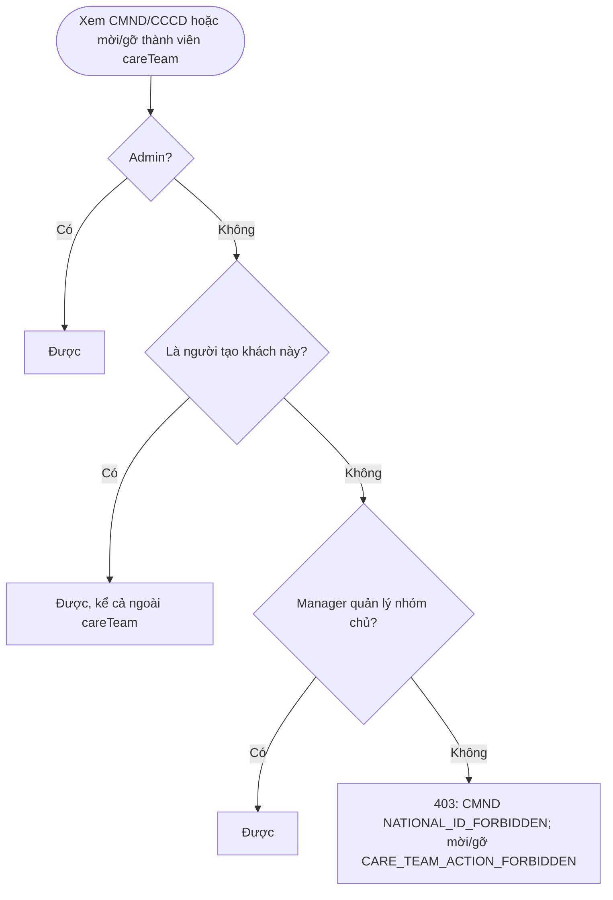

# Ma trận phân quyền CRM (nguồn duy nhất về luật phân quyền)

> **Phiên bản tài liệu:** v1.0.6

> Ngày tạo: 2026-11-16
> Module: Quản lý & chăm sóc khách hàng (CRM), Mảng F (FR-30..FR-33)
> Trạng thái: Approved (Oniichan duyệt 2026-11-17 cùng Plan/Architecture/Tasks)
> Author: architect-agent

Tài liệu này **chỉ trình bày lại** luật Oniichan đã chốt ngày 2026-11-16, đã cập nhật theo **vòng sửa 11** (người thực hiện lịch hẹn chọn nhiều người; xóa khách chỉ Admin hoặc người tạo; **sửa/xóa lịch hẹn, nhật ký và ảnh đính kèm chỉ của chính mình**; **xem CMND/CCCD và mời/gỡ thành viên chỉ Admin, người tạo khách, Manager nhóm chủ**). Nguồn chi tiết: `docs/01_Infrastructure/10_Thong_Nhat_Moi_Truong_Architecture.md` mục 5.13, 11.0, 11.6; Plan `07_...`; Tasks `11_...` T-54..T-62 (cả ba nằm trong `.gitignore`). Chỗ các tài liệu lệch nhau hoặc còn chờ Oniichan nằm ở mục 6 (D1..D8, D10 đã xử lý; **D3, D4, D5 đã đóng** ở vòng sửa 11; **D9 = Plan Câu hỏi 37 và D12 = Câu hỏi 40 đã đóng 2026-11-17** (Oniichan giữ nguyên), D10 = Câu hỏi 38 (đã đóng), D11, D13 = Câu hỏi 39, 41 là điểm Oniichan cần xem, không chặn việc; **2026-11-17 thêm luật mới: người tạo khách thuộc tập người thực hiện, xem mục 3a và D14**; **D15 đến D18 ghi nhận ở T-60 (2026-11-17): lệch giữa tài liệu thiết kế và code thật, đều đã khớp, D18 là việc phải làm ở v1.0.7**).

**Về mockup:** mockup (HTML minh họa) chỉ để minh họa ma trận. Tab "Lịch sử thay đổi" trong mockup chỉ là dữ liệu mẫu, **KHÔNG có trong sản phẩm**; coder không triển khai. Ma trận này (mục 1) mới là nguồn duy nhất về luật.

**Cách đọc.** Hàng = vai trò của một người **trên MỘT khách cụ thể** (không phải vai trò hệ thống). Cột = hành động. Mã ô = `Rn.Am` (ví dụ `R5.A8`); Plan, Tasks, test trỏ về mã ô, không chép lại bảng. **Chi tiết code và test xem Architecture 10 mục 5.13.2 (điểm sửa theo hàm) và 5.13.5 (test).**

---

## 1. Bảng chính: vai trò × hành động

**Cột (hành động):**

| Mã | Hành động | Mã | Hành động |
|---|---|---|---|
| A1 | Xem khách | A8 | Sửa/xóa bản ghi **của mình**: lịch hẹn (sửa, đổi trạng thái, xóa), nhật ký, ảnh đính kèm |
| A2 | Sửa thông tin, trạng thái, tiêu chí khách | A9 | Sửa/xóa nhật ký **người khác** |
| A3 | Xóa khách (đơn) | A10 | Gỡ ảnh khỏi nhật ký (hoặc ảnh chưa gắn) **của người khác** |
| A4 | Xóa khách (hàng loạt) | A11 | Xem CMND/CCCD |
| A5 | Tạo lịch hẹn (và ghi nhật ký kèm lịch) | A12 | Mời/gỡ thành viên `careTeam` |
| A6 | Giao lịch cho ai (xem bảng 3a) | A13 | Gỡ **người tạo** khỏi `careTeam` |
| A7 | Sửa, đổi trạng thái, xóa lịch **người khác** tạo | | |

**Ký hiệu:** ✅ được; ❌ không (nêu mã lỗi ở chú thích); ⚠️ được có điều kiện (số = chú thích bên dưới).

| Hàng | Vai trò trên khách này | A1 | A2 | A3 | A4 | A5 | A6 | A7 | A8 | A9 | A10 | A11 | A12 | A13 |
|---|---|---|---|---|---|---|---|---|---|---|---|---|---|---|
| R1 | **Admin** (người tạo là Admin cũng thuộc hàng này) | ✅ | ✅ | ✅5 | ✅1 | ✅ | ⚠️2 | ✅6 | ✅ | ✅6 | ✅6 | ✅ | ⚠️9 | ❌3 |
| R2 | **Người tạo khách (`createdBy`), là Staff** | ✅4 | ✅ | ✅5 | ✅1 | ✅ | ⚠️2 | ❌6 | ✅ | ❌6 | ❌6 | ✅7 | ✅8 | ❌3 |
| R3 | **Người tạo khách, là Manager** | ✅4 | ✅ | ✅5 | ✅1 | ✅ | ⚠️2 | ❌6 | ✅ | ❌6 | ❌6 | ✅7 | ✅8 | ❌3 |
| R4 | **Manager nhóm chủ** (quản lý nhóm của người tạo, không phải người tạo) | ✅ | ✅ | ❌5 | ❌5 | ✅ | ⚠️2 | ❌6 | ✅ | ❌6 | ❌6 | ✅7 | ✅8 | ❌3 |
| R5 | **Thành viên `careTeam` khác**: Staff hay Manager, PRIMARY hay MEMBER, được mời chéo hay không; không phải người tạo, không phải Manager nhóm chủ (**gộp R5, R6, R7 cũ**: nay cùng quyền) | ✅ | ✅ | ❌5 | ❌5 | ✅ | ⚠️2 | ❌6 | ✅ | ❌6 | ❌6 | ❌7 | ❌8 | ❌3 |
| R8 | **Manager nhóm khác trong phạm vi** (quản lý nhóm nằm trong `teamIds`, không trong `careTeam`, không phải nhóm chủ) | ✅ | ✅ | ❌5 | ❌5 | ✅ | ⚠️2 | ❌6 | ✅ | ❌6 | ❌6 | ❌7 | ❌8 | ❌3 |
| R9 | **Staff khác** (ngoài `careTeam`, không phải người tạo) | ❌10 | ❌ | ❌ | ❌ | ❌ | ❌ | ❌ | ❌ | ❌ | ❌ | ❌ | ❌ | ❌ |
| R10 | **Manager ngoài phạm vi** (không quản lý nhóm trong `teamIds`, không trong `careTeam`, không phải người tạo) | ❌10 | ❌ | ❌ | ❌ | ❌ | ❌ | ❌ | ❌ | ❌ | ❌ | ❌ | ❌ | ❌ |

Ghi chú hàng: **R6 và R7 cũ đã gộp vào R5** (vòng sửa 11): người được mời chéo, PRIMARY không phải người tạo và MEMBER nay cùng quyền, không còn phân biệt Manager/Staff hay PRIMARY/MEMBER (không còn khác ở xóa lịch, CMND/CCCD, mời/gỡ thành viên). Mã R8, R9, R10 giữ nguyên để Plan, Tasks, mockup không phải đổi mã. Người được mời không có cờ riêng trong dữ liệu (chỉ là thành viên `careTeam`). "Manager trong phạm vi nhóm" (khách nằm trong `CustomerScope` nhờ `teamIds`, quy tắc FR-15 không đổi) là **R4 nếu nhóm đó là nhóm chủ, R8 nếu không**. **R8 thấy khách và tạo được lịch hẹn, nhật ký** (phạm vi khách là điều kiện duy nhất để tạo, không cần là thành viên `careTeam`; hành vi hiện hành, xem D13), nhưng chỉ sửa/xóa bản ghi của mình. Cột A7, A9, A10 nay cùng một luật ("của người khác: chỉ Admin"), giữ ba cột để mã ô cũ không đổi.

**Chú thích:**

1. **Xóa khách hàng loạt** (`type = DELETE`, bắt buộc `reason`; thiếu `reason` thì 400 cả lô): trả `{ succeeded: [], failed: [{ customerId, errorCode }] }`. Mỗi khách xét riêng: người gọi không phải Admin và không phải người tạo khách đó vào `failed[]` với `errorCode = INSUFFICIENT_ROLE`; khách ngoài phạm vi vào `failed[]` với `CUSTOMER_NOT_FOUND`; lỗi khác `INTERNAL_ERROR`; khách khác trong lô không bị ảnh hưởng. **Không có điều kiện tình trạng** (xóa được cả khách chưa "Bỏ"; Oniichan giữ nguyên 2026-11-17: D9 đã đóng). Không còn mã `CUSTOMER_NOT_DROPPED` ở luồng xóa.
2. **Giao lịch** (chọn **nhiều người**, `assigneeIds`, 1 đến 20): chỉ chọn được người trong **tập hợp lệ** của khách (bảng 3a: thành viên `careTeam` còn `ACTIVE` hợp Manager nhóm chủ còn `ACTIVE` hợp **người tạo khách còn `ACTIVE`**, kể cả khi người tạo không trong `careTeam`; Oniichan chốt 2026-11-17). Admin cũng theo tập này: Admin ngoài `careTeam` mà **không phải người tạo khách** không được chọn (cũng không tự giao cho mình); Admin là người tạo thì chọn được. Không chỉ định thì dùng mặc định ở 3a.
3. **Không ai gỡ được người tạo** khỏi `careTeam`, **kể cả Admin**, mọi đường (gỡ thành viên, đổi/thay PRIMARY, thay cả nhóm): 409 `PRIMARY_LOCKED` kèm `details.reason = CREATOR_LOCKED` (người tạo là PRIMARY hay MEMBER đều vậy). Gỡ PRIMARY **không phải** người tạo (khách cũ): 409 `PRIMARY_LOCKED` không kèm `reason` (như hiện hành).
4. Người tạo **luôn thấy** khách mình tạo, kể cả khi không trong `careTeam` hoặc ngoài nhóm (nhánh `createdBy` của phạm vi khách); không bao giờ mất quyền do bị gỡ.
5. **Xóa khách (đơn và hàng loạt, cùng một luật):** chỉ **Admin** (mọi khách) hoặc **người tạo** (`createdBy`) của chính khách đó, **ở mọi tình trạng**. Mọi vai trò khác không xóa được: Manager nhóm chủ không phải người tạo (R4), Manager được mời, PRIMARY không phải người tạo và mọi thành viên khác (R5), Manager nhóm khác (R8). Đơn: 403 `INSUFFICIENT_ROLE`; hàng loạt: `failed[]` với `INSUFFICIENT_ROLE` (xem chú thích 1).
6. **Bản ghi chỉ của mình** (A7, A8, A9, A10; vòng sửa 11): lịch hẹn (sửa, đổi trạng thái, xóa), nhật ký chăm sóc (sửa, xóa) và ảnh đính kèm (gỡ): mỗi người chỉ làm trên bản ghi **do chính mình tạo** (người tạo lịch, tác giả nhật ký, người tải ảnh lên). Của **người khác** chỉ **Admin**. **Không ngoại lệ** cho người tạo khách, Manager nhóm chủ, Manager hay Staff được mời. Lỗi: 403 `INSUFFICIENT_ROLE`; ảnh chưa gắn của người khác: 404 (không lộ sự tồn tại, như hiện hành). Tạo lịch và tạo nhật ký thì mọi người trong phạm vi (A5) làm được. **Đổi trạng thái lịch** (Hoàn thành, Hủy, Mở lại) tính là **sửa** (cách hiểu của architect; người thực hiện không phải người tạo lịch thì không đổi trạng thái được: D12, đã chốt 2026-11-17). Đổi so với hiện hành: code cho Manager xóa mọi lịch, sửa/đổi trạng thái lịch không kiểm quyền nào ngoài phạm vi, Manager sửa/xóa mọi nhật ký (sửa ở T-56).
7. **CMND/CCCD** (vòng sửa 11): chỉ **Admin**, **người tạo khách** (Staff hay Manager, kể cả ngoài `careTeam`) và **Manager nhóm chủ**. PRIMARY không phải người tạo, thành viên `careTeam`, Manager được mời và Manager nhóm khác **không** xem: 403 `NATIONAL_ID_FORBIDDEN` (`canRevealNationalId = false`); ngoài phạm vi: 404. **Đóng Q-35** (Staff người tạo mà không phải PRIMARY: nay **được** xem; D4). Nhật ký các lần xem CMND/CCCD (`listViews`) dùng cùng điều kiện.
8. **Mời/gỡ thành viên `careTeam`** (vòng sửa 11): chỉ **Admin**, **người tạo khách** (kể cả ngoài `careTeam`) và **Manager nhóm chủ**; không còn PRIMARY không phải người tạo, không Staff/Manager được mời. Lỗi: 403 `CARE_TEAM_ACTION_FORBIDDEN`. **Đóng Q-36** (Staff được mời: không; D5). Phân hàng loạt `ASSIGN` cũng kiểm từng khách theo luật này (khách không đủ quyền vào `failed[]` với `INSUFFICIENT_ROLE`; cổng ngoài "Admin hoặc Manager" giữ nguyên). Hiện code cho mọi Manager trong phạm vi và PRIMARY, hàng loạt không kiểm từng khách (sửa ở T-56). Luật "người tạo không bị gỡ" (chú thích 3) không đổi.
9. **Admin "mời bất kỳ ai"** nghĩa là mọi tài khoản `ACTIVE` có vai trò **Manager hoặc Staff** (không mời Admin khác, EDITOR); quyền mời **độc lập** với quyền đặt lịch. Hàm liệt kê người có thể mời khi **không** kèm khách cụ thể: giữ Admin hoặc Manager (không có khách để xét người tạo hay nhóm chủ).
10. Ngoài phạm vi: khách "không tồn tại" (404), không lộ sự tồn tại. Người vừa bị gỡ khỏi `careTeam` (không phải người tạo) rơi vào R9 hoặc R10 **ngay** ở lần gọi kế tiếp; ghi trong transaction đọc lại `careTeam` nên gỡ giữa chừng cũng không lọt.

### Quy tắc gộp khi một người mang nhiều vai trò trên cùng một khách

Vai trò hệ thống lấy theo vai trò **cao nhất hiện tại** trong DB (`actor.role`: ADMIN > MANAGER > STAFF; Admin kiêm Manager thì là Admin).

1. **Hợp quyền**: ô nào có ✅ ở **bất kỳ** hàng nào người đó mang thì được (**trừ** A3, A4, A13: xem điểm 3 và 4). Ví dụ Manager vừa là thành viên `careTeam` (R5) vừa quản lý nhóm chủ (R4) thì có quyền R4 (xem CMND, mời/gỡ; vẫn không xóa khách, không sửa của người khác). Staff vừa người tạo vừa PRIMARY thì quyền người tạo (R2).
2. **Ưu tiên 1, "không bị gỡ người tạo" (A13)**: ❌ ở A13 **thắng mọi vai trò**, kể cả Admin; hợp quyền không bao giờ mở được ô này.
3. **Ưu tiên 2, "chỉ của mình" (A8 thay A7, A9, A10)**: mặc định của **mọi** người ngoài Admin; **không vai trò nào khác nới được** (người tạo khách, Manager nhóm chủ, Manager, PRIMARY đều không), nên hợp quyền không mở ô A7, A9, A10 cho ai ngoài Admin.
4. **Xóa khách (A3, A4)** chỉ Admin (R1) hoặc người tạo (R2, R3) được; **không vai trò nào khác mở được ô này**, dù mang nhiều vai trò (Manager nhóm chủ vừa là thành viên vừa quản lý nhóm vẫn không xóa khách của người khác). Xem CMND và mời/gỡ (A11, A12) thì Admin, người tạo, Manager nhóm chủ đều được (hợp quyền bình thường).

---

## 2. Sơ đồ quyết định

### 2.1. Người này là ai trên khách này? (theo thứ tự ưu tiên)

Từ R5 trở xuống **không còn khác nhau theo vai trò hệ thống hay PRIMARY/MEMBER** ở xóa lịch, CMND/CCCD, mời/gỡ thành viên; chỉ khác ở việc có thấy khách hay không (phạm vi) và người tạo/Manager nhóm chủ (R2, R3, R4) có quyền chủ khách (A11, A12).

### 2.2. Xóa khách (đơn và hàng loạt)

Không còn nhánh "Manager nhóm chủ", "PRIMARY" hay điều kiện tình trạng "Bỏ" ở luồng xóa khách; một hàm duy nhất cho xóa đơn, hàng loạt và cờ `permissions.canDelete`.

### 2.3. Sửa, đổi trạng thái, xóa lịch hẹn; sửa/xóa nhật ký; gỡ ảnh (bản ghi chỉ của mình)

Hai nhánh, không có nhánh thứ ba: không còn "Manager nhóm chủ", "người tạo khách" hay "Manager trong phạm vi" sửa/xóa của người khác. Một hàm cho lịch hẹn (`canModifyAppointment`, dùng cho sửa, đổi trạng thái, xóa và hai cờ `canEdit`, `canDelete`), một hàm cho nhật ký và ảnh đã gắn (`canModifyCareLog`), ảnh chưa gắn: Admin hoặc người tải.

### 2.4. Xem CMND/CCCD và mời/gỡ thành viên (quyền chủ khách)

**Nhóm chủ** = đúng **MỘT** nhóm: nhóm của người tạo khách (`createdBy`), cố định, không đổi khi đổi PRIMARY hay đổi thành viên. **Bất biến (Oniichan chốt):** khách không bao giờ thuộc nhiều nhóm (cần thì đó là bản ghi khách khác); code giữ cách so khớp hiện tại (`teamObjectIdsOf`), không thêm nhánh xử lý nhiều nhóm, không thêm ràng buộc mới trong FR-30..33. **Hệ quả một dòng:** người tạo không thuộc nhóm nào (ví dụ Admin tạo khách) thì **không có Manager nhóm chủ** (chỉ còn Admin, và Manager là người tạo nếu có). Khách cũ thiếu `createdBy` (hoặc không tìm thấy user) thì dự phòng `customer.teamIds` (đúng hành vi hiện hành); người tạo bị khóa hoặc xóa mềm vẫn tính nhóm hiện có của họ; người tạo đổi nhóm thì nhóm chủ đổi theo. **"Manager nhóm chủ"** = Manager quản lý nhóm đó, hoặc Manager là chính người tạo. Khái niệm này dùng cho **bốn việc** (tập người thực hiện còn có thêm **người tạo khách**, không phải Manager nhóm chủ, xem 3a): tập người thực hiện (3a), xem CMND/CCCD (A11), mời/gỡ thành viên (A12) và bộ lọc nhắc lịch (3b); **không** dùng để xóa khách và **không** để sửa/xóa bản ghi của người khác.

---

## 3. Hai bảng nhỏ

### 3a. Ai được làm người thực hiện lịch hẹn (chọn nhiều người, theo từng khách)

Người thực hiện là **mảng** `assigneeIds` (1 đến 20 người, không trùng). Họ là đúng những người nhận nhắc `APPOINTMENT_DUE` (3b) và lịch hiển thị danh sách này. Áp cho **mọi người đặt lịch** (Admin, Manager, Staff) và ở **cả hai đường** (tạo lịch trực tiếp; nhật ký kèm `nextAction.appointment`, cùng một transaction nên lịch lỗi thì nhật ký không lưu). Lỗi: **400 `USER_NOT_ASSIGNABLE`**, `details = { userIds, reason }`.

**Tập hợp lệ** = thành viên `careTeam` (PRIMARY hoặc MEMBER) còn `ACTIVE` **hợp** Manager còn `ACTIVE` của nhóm chủ (Manager là người tạo, hoặc quản lý nhóm chủ; nhóm chủ là đúng một nhóm, mục 2.4), **kể cả chưa được mời vào `careTeam`**, **hợp người tạo khách (`createdBy`) còn `ACTIVE`, bất kể vai trò (Admin, Manager, Staff) và kể cả khi không nằm trong `careTeam`** (Oniichan chốt 2026-11-17; D14). Chọn một Manager nhóm chủ hoặc người tạo ngoài `careTeam` **không** thêm họ vào `careTeam` và **không** đổi quyền của họ.

**Người tạo và `careTeam` (đã đọc mã thật 2026-11-17):** khách **mới** luôn có người tạo là PRIMARY của `careTeam` ở mọi vai trò kể cả Admin (`customers.service.ts: planCareTeam`), PRIMARY khóa vĩnh viễn và không có đường đổi PRIMARY, nên người tạo của khách mới luôn là thành viên `careTeam`. Nhánh `createdBy` riêng vẫn **bắt buộc** cho khách cũ (người tạo từng là MEMBER rồi bị gỡ, `careTeam` rỗng hoặc dữ liệu chỉnh tay) và làm lớp phòng thủ; `resolveAssignee` so id với `customer.createdBy` độc lập với `careTeam`, không thêm truy vấn.

| Ai là người được chọn | Hợp lệ? | `details.reason` khi không hợp lệ |
|---|---|---|
| Thành viên `careTeam` (PRIMARY hoặc MEMBER, không phân biệt), kể cả Admin đã nằm trong `careTeam` (ví dụ Admin tạo khách và là PRIMARY) | ✅ | |
| **Manager nhóm chủ**, kể cả chưa vào `careTeam` (nhóm chủ rỗng thì chỉ còn Manager là người tạo) | ✅ | |
| **Người tạo khách** (`createdBy`) còn `ACTIVE`, **mọi vai trò** (Admin, Manager, Staff), kể cả **ngoài `careTeam`** (Admin tạo khách; Staff tạo khách mà không còn trong `careTeam`) | ✅ | (Oniichan chốt 2026-11-17; D14) |
| **Admin khác ngoài `careTeam`**, không phải người tạo khách (kể cả Admin đang đặt lịch tự giao cho mình) | ❌ | `NOT_IN_CARE_TEAM` (Oniichan chốt Q-34 = KHÔNG; xem D11) |
| Người tạo khách nhưng tài khoản bị khóa hoặc đã xóa mềm | ❌ | `NOT_ACTIVE` (như mọi thành viên bị khóa) |
| Manager nhóm khác, Manager/Staff ngoài `careTeam`, không phải Manager nhóm chủ và không phải người tạo khách: muốn chọn thì nhờ thành viên có quyền mời đưa vào `careTeam` | ❌ | `NOT_IN_CARE_TEAM` |
| Id không tồn tại | ❌ | `NOT_IN_CARE_TEAM` (không lộ sự tồn tại tài khoản) |
| Thuộc tập hợp lệ nhưng tài khoản bị khóa hoặc đã xóa mềm | ❌ | `NOT_ACTIVE` |
| Thuộc tập hợp lệ, `ACTIVE`, nhưng không có vai trò CRM (ví dụ chỉ EDITOR) | ❌ | `NOT_CRM_ROLE` |

**Chú thích ký hiệu:** ô ⚠️ ở cột A6 của bảng chính (mục 1) nghĩa là "giao trong tập hợp lệ" của bảng này (không phải "có điều kiện" riêng của từng hàng); Manager nhóm chủ (R3 là người tạo, R4) luôn thuộc tập hợp lệ khi còn `ACTIVE`; **người tạo khách (R1 là Admin tạo khách, R2, R3) cũng luôn thuộc tập khi còn `ACTIVE`, kể cả ngoài `careTeam`** (Oniichan chốt 2026-11-17). Ô A6 của R1 vẫn là ⚠️ vì Admin khác (không phải người tạo) ngoài `careTeam` không giao được.

- **Thứ tự kiểm (cả mảng, một lần đọc `users`):** (1) ngoài tập hợp lệ (không thuộc `careTeam`, không phải Manager nhóm chủ, không phải người tạo khách; gồm id không tồn tại) thì `NOT_IN_CARE_TEAM`, `userIds` = các id vi phạm; (2) `ACTIVE` và chưa xóa, nếu không `NOT_ACTIVE`; (3) có vai trò CRM (`hasCrmRole`: ADMIN, MANAGER hoặc STAFF), nếu không `NOT_CRM_ROLE`. Tên `NOT_IN_CARE_TEAM` giữ cho ổn định (ít phá hợp đồng nhất) với nghĩa "ngoài tập hợp lệ"; thông điệp nói rõ "ngoài nhóm chăm sóc, không phải người tạo khách và không phải Manager của nhóm chủ". Người tạo khách bị khóa hoặc xóa mềm: `NOT_ACTIVE` (bước 2); người tạo chỉ có vai trò EDITOR: `NOT_CRM_ROLE` (bước 3). Không có mã `CUSTOMER_NOT_VISIBLE`.
- **Không chỉ định người thực hiện:** mặc định là **người đặt lịch** nếu thuộc tập hợp lệ (gồm người đặt lịch là người tạo khách ngoài `careTeam`), ngược lại **PRIMARY** (mảng một phần tử). Mặc định cũng đi qua cùng các bước kiểm trên. Nếu không suy ra được (người đặt lịch ngoài tập hợp lệ, ví dụ Admin khác, **và** khách chưa có PRIMARY, ví dụ `careTeam` rỗng ở khách cũ): 400 `USER_NOT_ASSIGNABLE`, `reason = NOT_IN_CARE_TEAM`, `userIds = []`, thông điệp bảo chọn người thực hiện hoặc nhờ thành viên có quyền mời đưa người vào nhóm trước.
- **Chỉ kiểm khi chọn hoặc đổi:** sửa giờ, ghi chú không kiểm lại. Sửa danh sách (PATCH) chỉ kiểm các id **mới thêm** theo đúng tập hợp lệ hiện tại ở trên (gồm người tạo khách), danh sách sau sửa còn tối thiểu 1 người; id đã có sẵn không kiểm lại; hệ thống khử trùng và giữ thứ tự. Người đã bị gỡ khỏi `careTeam` vẫn nằm trong `assigneeIds` (không tự sửa lại lịch cũ) nhưng không nhận nhắc nữa (3b).
- **Giao diện** lấy tập hợp từ chính dữ liệu của trang chi tiết khách: `careTeam` (`ACTIVE`) hợp trường `ownerManagers` (Manager nhóm chủ chưa vào `careTeam`) hợp trường **`creator`** (`{ userId, fullName, role } | null`: người tạo khách còn `ACTIVE`, có vai trò CRM, **ngoài `careTeam`** và chưa ở `ownerManagers`; `null` ở các ca còn lại) ở API chi tiết khách, khử trùng theo `userId`; **không còn endpoint `assignee-candidates`**, không còn trường `source`. BE và FE dùng cùng một hàm dựng tập hợp (có test khớp nhau); `resolveAssignee` vẫn là cổng cuối.
- **Tương thích API:** yêu cầu nhận `assigneeIds` (mới) và vẫn nhận `assigneeId` (cũ, deprecated; có cả hai thì `assigneeIds` thắng). Phản hồi có `assignees` (danh sách) và giữ `assignee` (người đầu tiên, deprecated). Thông điệp lỗi không chứa tên hoặc SĐT khách.

### 3b. Ai nhận nhắc lịch `APPOINTMENT_DUE`

| Loại nhắc | Ai nhận | Lọc |
|---|---|---|
| **Giờ hẹn** (`ReminderType.APPOINTMENT`, `APPOINTMENT_DUE`) | **Đúng những người trong `assigneeIds` của lịch đó**, giao với tập hợp lệ **hiện tại** của khách (`careTeam` hợp Manager nhóm chủ hợp người tạo khách, cùng hàm với 3a), tính lúc gửi (PRIMARY ưu tiên `HIGH`, còn lại `NORMAL`) | Phải `ACTIVE`, chưa xóa; bị khóa/xóa thì không nhận |
| Giờ hẹn: người đã bị gỡ khỏi `careTeam` (và không phải Manager nhóm chủ, không phải người tạo khách) | **Không nhận** dù còn tên trong `assigneeIds` (tránh lộ dữ liệu khách khi đã mất quyền, FR-19); không còn ai thì nhắc chưa gửi thành `CANCELED` | Thành viên `careTeam` **không được chọn** vào lịch cũng không nhận `APPOINTMENT_DUE` của lịch đó (đổi so với trước); người tạo khách ngoài `careTeam` **được chọn** thì nhận (nếu còn `ACTIVE`, chưa xóa) |
| `FOLLOW_UP`, `OCCASION`, `STALE_CUSTOMER` | Chỉ thành viên `careTeam` `ACTIVE`, chưa xóa | **Giữ nguyên lọc `careTeam`**, không thêm người thực hiện, không thêm loại nhắc mới |

Đổi danh sách người thực hiện thì nhắc theo danh sách mới (người nhận tính lúc gửi từ bản ghi lịch mới nhất); lịch hủy, hoàn thành, xóa hoặc dời giờ thì nhắc chưa gửi thành `CANCELED`. Bộ lọc "việc của tôi" ở danh sách lịch/việc hằng ngày tìm theo `assigneeIds` (giữ nhánh theo `careTeam`).

---

## 4. Cách thêm/sửa/xóa một luật

1. **Sửa ô trước:** đổi ô `Rn.Am` ở mục 1 (hoặc dòng ở 3a/3b) và chú thích số của ô. Luật mới: thêm hàng/cột. Gỡ luật: xóa ô/dòng rồi ghi lý do ở mục 5.
2. **Sửa hàm** ở đúng **một nơi** (`getDeleteDenial`, `canModifyAppointment`, `canModifyCareLog`, `hasOwnerRights` (xem CMND, `canManageMembers`), `resolveAssignee`, hàm dựng tập người thực hiện...; danh sách hàm và dòng sửa xem Architecture 10 mục 5.13.2). Không rải luật ra nhiều chỗ; xóa khách, `canDelete` và hàng loạt vẫn dùng chung `getDeleteDenial`; `resolveAssignee`, trường `ownerManagers`, trường `creator` và bộ lọc nhắc lịch dùng chung hàm dựng tập người thực hiện (nhánh người tạo là so khớp `createdBy`); CMND (xem, danh sách lượt xem, cờ `canRevealNationalId`) và mời/gỡ (bốn chỗ gọi, cờ `canManageCareTeam`) dùng chung `hasOwnerRights`.
3. **Sửa test:** test ĐỎ trước, cả chiều **bị chặn**; ô nào đổi thì có test đột biến (bỏ nhánh luật => test đỏ). Tên test và T-xx xem Architecture 10 mục 5.13.5.
4. **Cập nhật Plan, Architecture, Tasks** (07, 10, 11) bằng cách **trỏ về mã ô** (ví dụ "theo `R5.A8`"), không chép lại bảng; nếu hai tài liệu lệch thì ghi vào mục 6 thay vì chọn một bên.
5. **Đổi người thực hiện hợp lệ, quyền xem, xóa, sửa bản ghi hoặc CMND:** rà thêm FE (`AssigneeField` chọn nhiều người, `canDelete`, `canEdit` của lịch hẹn, nút xóa hàng loạt, nút Mời/Gỡ, nút xem CMND; T-59), prototype `stnd-crm-unified` (danh sách người thực hiện, `canManageCareTeam`, `canDelete`, `canOfferBulkDelete`), Swagger (mô tả `reason`, 403) và bảng 3b.

---

## 5. Quyết định đã chốt (2026-11-16, nguồn: Oniichan)

Mã Q-xx theo Architecture mục 11.0; "câu" = "Câu hỏi" trong Plan.

1. **Admin toàn quyền** (Q-F4, Q-F5; câu 22, 28): thấy và làm mọi thứ trên mọi khách, xóa khách (đơn và hàng loạt), sửa/xóa bản ghi của người khác. **Một ngoại lệ**: Admin ngoài `careTeam` và không phải người tạo khách không được chọn làm người thực hiện lịch (Q-34 = KHÔNG, vòng sửa 11; ghi ở D11; Admin là người tạo khách thì chọn được, Oniichan chốt 2026-11-17, D14).
2. **Người tạo khách** (Q-45, câu 23; **đảo** giả định cũ "bị gỡ thì mất quyền"): luôn thấy và có quyền chủ khách với khách mình tạo (xóa khách, xem CMND, mời/gỡ thành viên), không phụ thuộc `careTeam`, **không bao giờ bị gỡ khỏi `careTeam`, kể cả Admin**. Sửa/xóa lịch, nhật ký, ảnh thì **chỉ của mình** như mọi người (Oniichan xác nhận vòng sửa 11; thay Q-50 phần nhật ký).
3. **Staff là người tạo** (Q-50, câu 32): xóa khách ở mọi tình trạng (đơn và hàng loạt); **xem CMND/CCCD kể cả khi không phải PRIMARY** (đóng Q-35, câu 35); mời/gỡ thành viên.
4. **Người được mời chéo nhóm và mọi thành viên `careTeam`, không phân biệt role, PRIMARY hay MEMBER** (Q-43 = A, Q-44; câu 24, 25; vòng sửa 11 gộp R5, R6, R7): xem khách, sửa thông tin, tạo lịch và nhật ký; **chỉ sửa/xóa bản ghi của mình**; **không** xóa khách, **không** xem CMND/CCCD, **không** mời/gỡ thành viên (đóng Q-36, câu 36: Staff được mời không); gỡ khỏi `careTeam` thì mất quyền ngay. **Q-47 bị thay thế** (không còn "Manager được mời xóa lịch, xem CMND").
5. **Bản ghi chỉ của mình** (vòng sửa 11, **Oniichan đã xác nhận**; thay Q-47 phần xóa lịch, Q-48 và Q-44 phần nhật ký, Q-50 phần nhật ký): lịch hẹn (sửa, đổi trạng thái, xóa), nhật ký chăm sóc, gỡ ảnh đính kèm: chỉ do chính mình tạo hoặc tải lên; của người khác **chỉ Admin**. Manager nhóm chủ và người tạo khách **không** còn sửa/xóa của người khác.
6. **Nhóm chủ** (Q-48, câu 31, 33): nhóm của người tạo, **đúng một nhóm**, cố định (khách không bao giờ thuộc nhiều nhóm). Manager nhóm chủ: là ứng viên người thực hiện, **xem CMND/CCCD** và **mời/gỡ thành viên**; **không** xóa khách, **không** sửa/xóa bản ghi của người khác (Q-48 phần nhật ký đã bị thay).
7. **Tập người thực hiện hợp lệ, chọn nhiều người** (Q-F6, Q-34 đã đóng; câu 29, vòng sửa 11): thành viên `careTeam` còn `ACTIVE` hợp Manager nhóm chủ còn `ACTIVE` (kể cả chưa được mời) **hợp người tạo khách còn `ACTIVE` (kể cả ngoài `careTeam`; Oniichan chốt 2026-11-17)**. Ngoài tập này không chọn được, **kể cả Admin khác không phải người tạo**. Lịch có `assigneeIds` 1 đến 20 người. Ai trong phạm vi cũng **tạo** được lịch (chọn người thực hiện theo tập này).
8. **Nhắc lịch** (Q-F7, Q-46, câu 26; vòng sửa 11 đổi người nhận): `APPOINTMENT_DUE` gửi **đúng** những người trong `assigneeIds` còn thuộc tập hợp lệ, `ACTIVE`, chưa xóa; loại nhắc khác giữ lọc `careTeam`; không thêm loại nhắc mới.
9. **Manager giữ giới hạn theo nhóm, Staff giữ luật hiện hành** (FR-31): phạm vi xem khách không đổi, không làm lỏng.
10. **Xóa khách** (vòng sửa 11, đè mọi luật xóa cũ: Q-43, Q-44, Q-47, Q-48 phần xóa khách): chỉ **Admin** (mọi khách) hoặc **người tạo** (khách mình tạo), đơn và hàng loạt, **không điều kiện tình trạng** (Oniichan giữ nguyên 2026-11-17: D9 đã đóng). Manager nhóm chủ không phải người tạo, Manager được mời và PRIMARY không phải người tạo **mất quyền xóa khách**.

**Architect tự quyết** (không phải Oniichan chốt; đổi được nếu Oniichan muốn): cách lấy nhóm chủ bằng nhóm **hiện tại** của `createdBy` (không snapshot); giữ mã `USER_NOT_ASSIGNABLE` 400 và tên lý do `NOT_IN_CARE_TEAM` (nghĩa "ngoài tập hợp lệ"); FE lấy Manager nhóm chủ từ trường `ownerManagers` và người tạo khách ngoài `careTeam` từ trường `creator` của API chi tiết khách (thay endpoint ứng viên đã bỏ; `creator` là trường cộng thêm, không đổi nghĩa `ownerManagers`); lưu `assigneeIds` kèm ghi kép `assigneeId = assigneeIds[0]` trong v1.0.6 (bỏ ở v1.0.7), migration `012_crm_appointment_assignee_ids` pha `post-up` (chạy ở bước 90 của `deploy.sh` sau 011; không `pre-up` vì runner từ chối khi 011 post-up còn chờ); tái dùng `PRIMARY_LOCKED` kèm `CREATOR_LOCKED` thay vì mã lỗi mới; **Q-F8 (đã đổi ở vòng sửa 11)**: gỡ ảnh chưa gắn vào nhật ký nay là **Admin hoặc chính người tải**, người khác 404 (Manager không còn gỡ ảnh chưa gắn của người khác); **đổi trạng thái lịch tính là sửa** (D12); nhật ký xem CMND (`listViews`) dùng cùng điều kiện xem CMND; phân hàng loạt `ASSIGN` kiểm quyền mời từng khách; cờ `canSetInitialPrimary` chỉ bật khi người đó cũng có quyền mời/gỡ (vì đặt PRIMARY lần đầu đi qua cổng mời).

---

## 6. Điểm lệch giữa các tài liệu và câu hỏi còn chờ Oniichan

| # | Điểm lệch | Giữa | Tài liệu này ghi theo | Ai xử lý |
|---|---|---|---|---|
| D1 | **ĐÃ XỬ LÝ (2026-11-16).** Mã lỗi gỡ người tạo: Plan FR-32 và Tasks T-56 từng nói `CREATOR_LOCKED` chỉ khi người tạo là MEMBER. Nay pm-agent đã sửa 07 và 11: **mọi** lần gỡ người tạo (PRIMARY hay MEMBER) đều 409 `PRIMARY_LOCKED` kèm `details.reason = CREATOR_LOCKED`; chỉ gỡ PRIMARY không phải người tạo thì không kèm `reason` (khớp chú thích 3 và ô A13) | 07, 11 với 10 | Khớp cả ba tài liệu | Xong (pm-agent) |
| D2 | **ĐÃ XỬ LÝ (2026-11-16, đổi nội dung ở vòng sửa 11).** Người thực hiện mặc định từng lệch giữa 5.13.1 và 5.13.2 hàng 1; nay Architecture thống nhất MỘT luật ở mọi chỗ: **người đặt lịch nếu thuộc tập hợp lệ, ngược lại PRIMARY** (mảng một phần tử); không suy ra được thì 400 `USER_NOT_ASSIGNABLE` (`NOT_IN_CARE_TEAM`, `userIds = []`). Bỏ nhánh "Admin tự đặt mình" | 10 (5.13.1, 5.13.2, 5.13.4, 5.13.5) | Luật thống nhất ở mục 3a | Xong (architect-agent). pm-agent rà Plan/Tasks nếu có câu mặc định khác |
| D3 | **ĐÃ ĐÓNG (2026-11-16, vòng sửa 11).** "Admin khác ngoài `careTeam` không được làm người thực hiện": Oniichan chốt **KHÔNG** (Q-34 = KHÔNG). Admin ngoài `careTeam` cũng không tự giao cho mình (ngoại lệ: Admin là người tạo khách, xem D14) | 07, 11 với 10 | Không hợp lệ (`NOT_IN_CARE_TEAM`; mục 3a) | Xong; pm-agent đóng Plan Câu hỏi 34 |
| D4 | **ĐÃ ĐÓNG (2026-11-16, vòng sửa 11).** Staff **người tạo mà không phải PRIMARY** (khách cũ) xem CMND/CCCD (Plan Câu hỏi 35): Oniichan chốt luật mới "chỉ Admin, người tạo, Manager nhóm chủ xem CMND/CCCD" nên **được xem**. Bỏ luôn quyền của PRIMARY không phải người tạo, Manager/Staff được mời, Manager nhóm khác | 10 (Q-45, Q-47, Q-50) | Được xem (ô `R2.A11`; chú thích 7) | Xong; pm-agent đóng Plan Câu hỏi 35, sửa FR-32 |
| D5 | **ĐÃ ĐÓNG (2026-11-16, vòng sửa 11).** Staff được mời mời/gỡ thành viên (Plan Câu hỏi 36): Oniichan chốt luật mới "chỉ Admin, người tạo, Manager nhóm chủ mời/gỡ" nên Staff được mời **không**; PRIMARY không phải người tạo cũng không; Manager ngoài nhóm chủ cũng không | 07 (FR-32) với 10 | Không (ô `R5.A12`, `R8.A12`; chú thích 8) | Xong; pm-agent đóng Plan Câu hỏi 36, sửa FR-32 |
| D6 | **ĐÃ XỬ LÝ (2026-11-16), nội dung đổi ở vòng sửa 11.** Gỡ ảnh nhật ký có **hai nhánh** trong `care-log-attachments.service.ts`: ảnh **đã gắn** đi `assertCanModifyCareLog` (nay: Admin hoặc tác giả nhật ký; service **không** truyền thêm `createdBy`, `teamIds` hay nhóm chủ của khách (chữ ký chỉ `actor` và `log.authorId`); giữ nguyên `projection: { _id: 1 }` ở `care-log-attachments.service.ts:121` và `:245`, KHÔNG mở rộng); ảnh **chưa gắn** (tải tạm) nay là **Admin hoặc chính người tải** (bỏ `isPrivileged` của Manager; người khác 404). Q-F8 đổi theo luật "chỉ của mình" | 10 (5.13.2 hàng 9, 5.13.5, 11.6 Q-F8), 11 | Architecture 10 mục 5.13.2 hàng 9 | Xong (architect-agent); pm-agent sửa T-56 (f) |
| D7 | **ĐÃ XỬ LÝ (2026-11-16).** Plan FR-31 từng chưa nhắc nhánh `createdBy` của phạm vi Manager và Staff (Architecture Q-45); pm-agent đã bổ sung vào 07 (FR-31, FR-32) | 07 (FR-31) với 10 | Có nhánh `createdBy` (A1) | Xong (pm-agent) |
| D8 | **ĐÃ XỬ LÝ (2026-11-16).** Tasks từng không nêu `customer-owner-team.ts`, `CustomerOwnerTeamService`, `hasCrmRole`; nay T-55 ghi đủ là nơi tạo, T-56 dùng lại | 11 với 10 | Khớp | Xong (pm-agent) |
| D9 | **ĐÃ ĐÓNG (2026-11-17; Oniichan giữ nguyên; Plan Câu hỏi 37).** Luật xóa khách (vòng sửa 11): Admin xóa mọi khách; dưới Admin chỉ người tạo xóa khách mình tạo, **không có điều kiện tình trạng** cho cả xóa đơn lẫn hàng loạt, nên bỏ `requireDropped`, `NOT_DROPPED` và luật "hàng loạt chỉ khách Bỏ", "Staff PRIMARY chỉ xóa khách Bỏ". Đã bỏ ở T-56: `bulk-operations.service.ts` không còn truyền `requireDropped` (không còn ký hiệu này trong mã nguồn không phải test); mã kết quả thật là `failed[].errorCode` ∈ `INSUFFICIENT_ROLE`, `CUSTOMER_NOT_FOUND`, `INTERNAL_ERROR` | 10 (5.13.1, 5.13.2 hàng 8) với code hiện hành | Không điều kiện tình trạng (chú thích 1, 5; mục 2.2) | Xong; pm-agent đóng Plan Câu hỏi 37 |
| D10 | **ĐÃ ĐÓNG (2026-11-16, vòng sửa 11; Oniichan xác nhận).** Luật nhật ký (Q-48) từng được giữ trong khi luật xóa khách thu hẹp: Oniichan chốt tiếp **Manager nhóm chủ và người tạo khách cũng chỉ sửa/xóa lịch, nhật ký, ảnh của chính mình; chỉ Admin sửa/xóa của người khác**. Q-48 phần nhật ký và Q-47 phần xóa lịch bị thay thế | 10 (Q-48, Q-47) | Chỉ của mình (chú thích 6; mục 2.3) | Xong (Plan Câu hỏi 38 đã đóng) |
| D11 | **ĐỂ ONIICHAN BIẾT** (Plan Câu hỏi 39; không chặn việc). Admin ngoài `careTeam` không chọn được làm người thực hiện (Q-34 = KHÔNG) và cũng không mời được vào `careTeam` (bộ lọc người được mời hiện hành chỉ nhận Manager/Staff, `CRM_TEAM_ROLES` GIỮ). Hệ quả: muốn giao việc cho một Admin thì Admin đó phải đã nằm trong `careTeam` (ví dụ Admin tạo khách là PRIMARY) **hoặc là người tạo khách** (ngoại lệ Oniichan chốt 2026-11-17, D14). Nếu cần Admin được mời, phải đổi bộ lọc người được mời (ngoài phạm vi vòng sửa 11) | 10 (5.13.6 R-F15) | Không chọn, không mời (mục 3a) | Oniichan quyết nếu cần cho Admin được mời (Plan Câu hỏi 39) |
| D12 | **ĐÃ ĐÓNG (2026-11-17; Oniichan giữ nguyên; Plan Câu hỏi 40).** Hiện code **không kiểm quyền** khi sửa và đổi trạng thái lịch (chỉ phạm vi khách). Luật "chỉ lịch do mình tạo" áp cho cả sửa lẫn **đổi trạng thái** (Hoàn thành, Hủy, Mở lại). Hệ quả đã được chấp nhận: người thực hiện **không phải người tạo lịch** (ví dụ Manager giao việc cho Staff) không tự bấm "Hoàn thành" được; chỉ người tạo lịch hoặc Admin | 10 (5.13.2 hàng 5) với code hiện hành | Chỉ người tạo lịch hoặc Admin (chú thích 6) | Xong; pm-agent đóng Plan Câu hỏi 40 |
| D13 | **ĐỂ ONIICHAN BIẾT** (Plan Câu hỏi 41; không chặn việc). Câu "ai trong `careTeam` cũng tạo được lịch" không nói người ngoài `careTeam`. Code hiện hành cho **mọi người trong phạm vi khách** tạo lịch và nhật ký, gồm **R8** (Manager nhóm khác thấy khách nhờ `teamIds`) và người tạo ngoài `careTeam`; doc giữ hiện hành (R8 ✅ ở A5, không phải ⚠️; mockup đã khớp). Nếu Oniichan chỉ muốn thành viên `careTeam` và người tạo được tạo thì phải thêm một kiểm tra mới (ngoài phạm vi vòng sửa 11) | 10 (5.13.1) | R8 tạo được lịch và nhật ký (ghi chú hàng; ma trận R8×A5 là ✅; mockup R8×A5 cũng đã là ✅, khớp, ghi để biết) | Oniichan quyết (Plan Câu hỏi 41) |
| D14 | **ĐÃ ĐÓNG (2026-11-17; Oniichan chốt).** Người tạo khách (`createdBy`) thuộc tập người thực hiện, mọi vai trò, kể cả ngoài `careTeam`, nếu còn `ACTIVE` (ví dụ Admin tạo khách; Staff tạo khách nhưng không còn trong `careTeam`). Vẫn **không** cho Admin khác ngoài nguồn, Manager nhóm khác, Staff ngoài `careTeam` không phải người tạo. Kỹ thuật (architect): khách mới luôn có người tạo là PRIMARY nên đã trong `careTeam`; nhánh `createdBy` cần cho khách cũ và dữ liệu lệch; BE so id, 0 truy vấn thêm; FE nhận trường cộng thêm `creator` ở chi tiết khách; mặc định, PATCH và nhắc `APPOINTMENT_DUE` dùng cùng tập hiện tại; mã lỗi không đổi. Test mới: Admin tạo khách ngoài `careTeam` chọn được; `careTeam` không chứa người tạo (khách cũ, `careTeam` rỗng, người tạo từng là MEMBER rồi bị gỡ, hoặc dữ liệu dựng tay; fixture dựng tay, không tạo được qua API) thì người tạo vẫn chọn được; người tạo bị khóa `NOT_ACTIVE`; Admin khác vẫn `NOT_IN_CARE_TEAM` | 10 (5.13, Q-56), 07, 11 | Người tạo thuộc tập (mục 3a; ô A6) | Xong; Plan Câu hỏi 42 |
| D15 | **ĐÃ GHI NHẬN (2026-11-17, T-60).** Migration `012_crm_appointment_assignee_ids` (hàm `backfill-appointment-assignee-ids.ts`): Architecture 10 (mục 11.6, 5.13.2 hàng 12) từng mô tả `updateMany` với pipeline cập nhật (**đã sửa ở doc 10 ngày 2026-11-18**); **code thật dùng `bulkWrite` theo lô 500 bản ghi, phân trang theo `_id` (`_id > lastId`, sắp tăng), mỗi bản ghi một `updateOne` có điều kiện "vẫn thiếu `assigneeIds`"**. Bản ghi có `assigneeId` không phải ObjectId hợp lệ **bị bỏ qua và ghi cảnh báo kèm `_id`** (cần xử lý tay), KHÔNG biến thành `assigneeIds: []` làm mất dữ liệu; bản ghi bị bỏ qua vẫn "thiếu `assigneeIds`" nên phân trang theo `_id` để chúng không chặn các lô sau. Chạy lại an toàn (idempotent). Lý do chọn: chặn mất dữ liệu và không giữ một pipeline lớn trên cả collection | 10 (mục 11.6) với code `RealEstateBackendApp/src/migrations/backfill-appointment-assignee-ids.ts` | Code (bulkWrite theo lô 500, bỏ qua và ghi cảnh báo bản ghi hỏng) | Xong; **đã đồng bộ vào doc 10 (2026-11-18)** |
| D16 | **ĐÃ GHI NHẬN (2026-11-17, T-60).** Thứ tự kiểm `USER_NOT_ASSIGNABLE` ở mục 3a: **id còn trong `careTeam` nhưng tài khoản KHÔNG tồn tại (đã bị xóa cứng hoặc id mồ côi) trả `NOT_ACTIVE`**, không phải `NOT_IN_CARE_TEAM` và không phải lỗi khác. Lý do: thành viên tĩnh (`careTeam`, người tạo) đã vượt bước "ngoài tập" nên bước hai gom "không tồn tại, không ACTIVE, đã xóa mềm" vào cùng một `reason`; chỉ id **ngoài tập** (kể cả id không tồn tại và chưa từng trong `careTeam`) mới là `NOT_IN_CARE_TEAM`, kiểm TRƯỚC. Hàm `resolveAssignees` trong `appointments-write.service.ts` | 10 (5.13.2, mục 3a của tài liệu này) với code | Code (không tồn tại thì `NOT_ACTIVE`) | Xong (T-57 đã khóa bằng test); **đã đồng bộ vào doc 10 (2026-11-18; 5.13.2 hàng 1, 5.13.3, test)** |
| D17 | **ĐÃ GHI NHẬN (2026-11-17, T-60).** Số dòng trích dẫn lệch: Architecture 10 từng ghi `projectCodeCondition` ở `appointments.service.ts` **dòng 62**; **code thật ở dòng 57** (khai báo `const projectCodeCondition`), và `assigneeFilter` được gộp với bộ lọc dự án bằng `$and` (khối `...(query.assigneeIds?.length ? { $and: [...] } : projectFilter)` trong hàm `list` ở dòng 118 đến 122; dòng 116 đến 117 là comment giải thích) vì cả hai cùng dùng khóa `$or`. Chỉ là số dòng, không đổi hành vi. Quy ước: tài liệu không trích số dòng cố định, ai sửa 10 sau này nên trích theo tên hàm | 10 (mục 11.6) với code | Code (tên hàm, không theo số dòng) | Xong; **đã đồng bộ vào doc 10 (2026-11-18; 11.6 trích theo tên hàm, ghi dòng 57 và 118-122 chỉ để tham khảo)** |
| D18 | **VIỆC PHẢI LÀM Ở v1.0.7 (ghi nhận T-60, 2026-11-17).** `assigneeId` (lịch hẹn) **deprecated** nhưng còn được ghi kép (`assigneeId = assigneeIds[0]`) và còn index `{ assigneeId: 1, startAt: 1 }`. Trước khi **bỏ `assigneeId`** ở v1.0.7 phải **chạy lại backfill `assigneeIds` một lần nữa** (migration mới hoặc chạy lại hàm của `012`, chạy lại an toàn): giữa lúc chạy `012` ở bước deploy 90 và lúc bỏ cột, FE/BE cũ hoặc bản ghi dựng tay còn ghi `assigneeId` mà không có `assigneeIds` sẽ mất người thực hiện nếu bỏ cột mà không backfill lại. Kiểm bằng số liệu: số lịch thiếu `assigneeIds` phải bằng 0 (trừ bản ghi hỏng đã bị cảnh báo ở D15) rồi mới bỏ `assigneeId`, index cũ, đường đọc `getAssigneeIds` lùi về `assigneeId`, field `assignee` (deprecated) ở response, và `assigneeId` ở DTO | 10 (mục 11.6), 07 (FR-30), Tasks v1.0.7 | Backfill lại trước khi bỏ `assigneeId`; không bỏ cột ở v1.0.6 | Chờ v1.0.7 (pm-agent đưa vào backlog v1.0.7; devops-agent kiểm số liệu); **yêu cầu đã đồng bộ vào doc 10 (2026-11-18; 5.13.2 hàng 12, R-F14)** |
